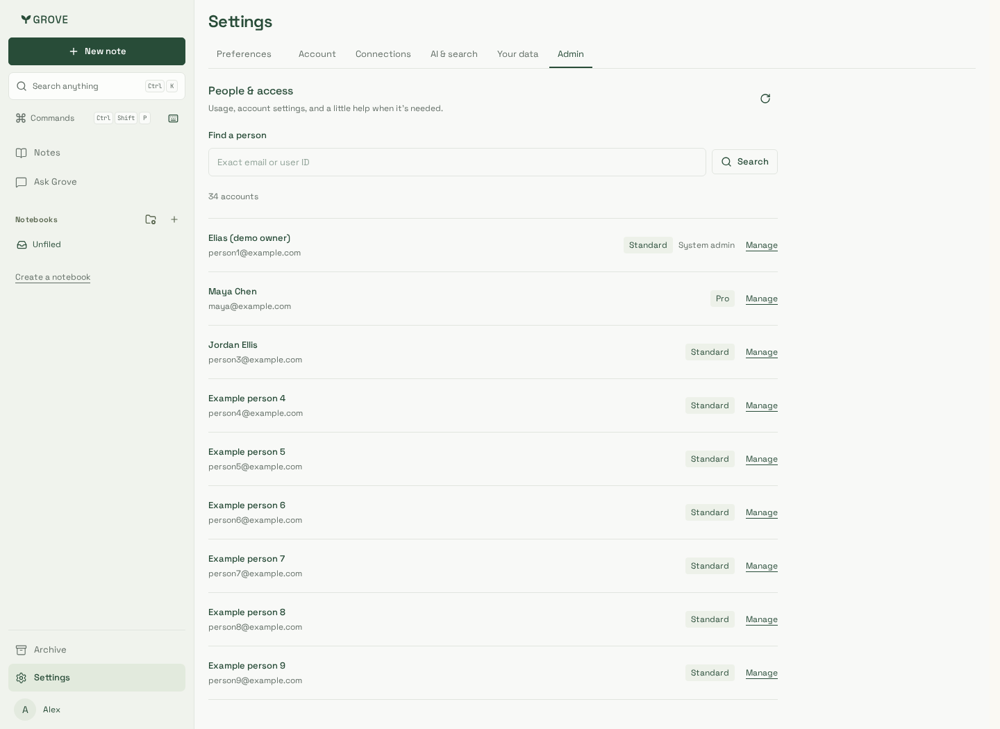
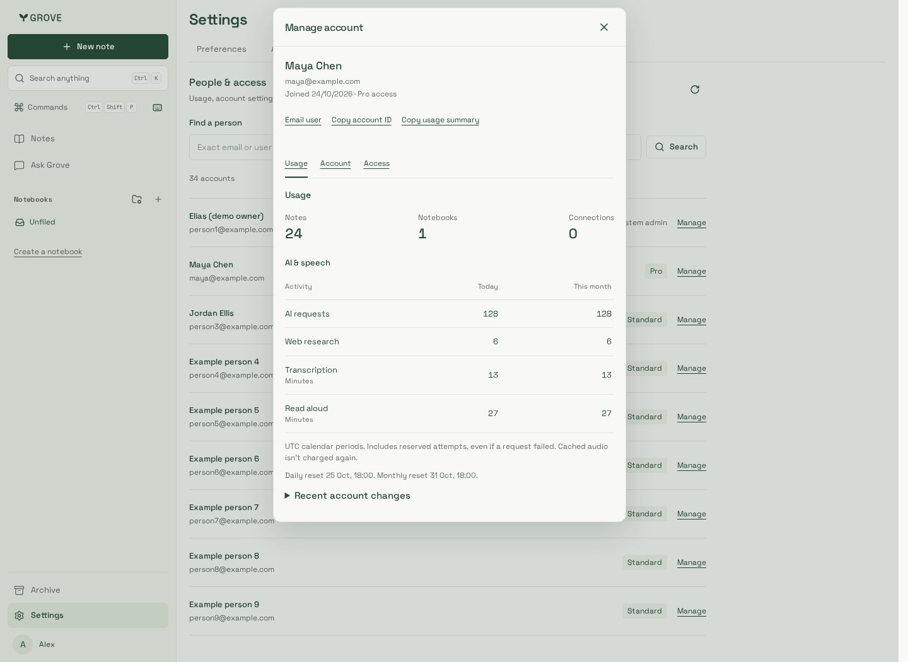
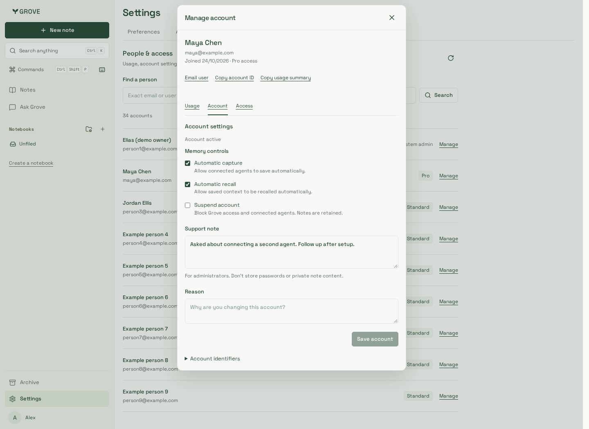
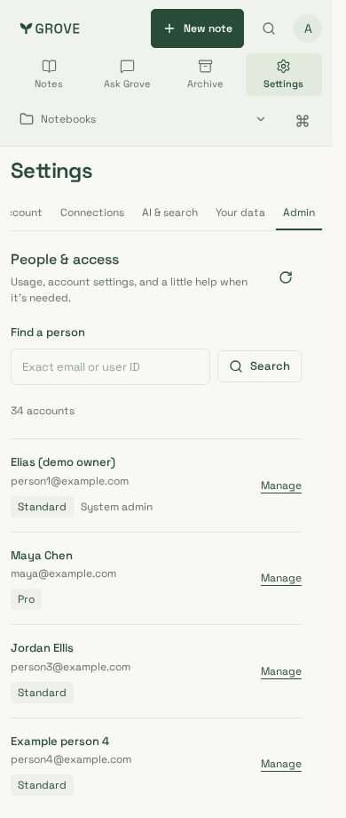
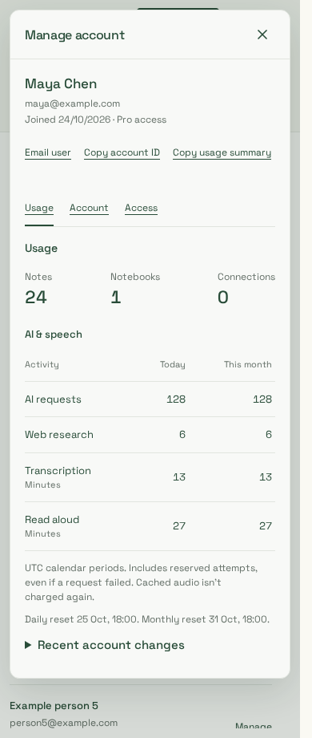
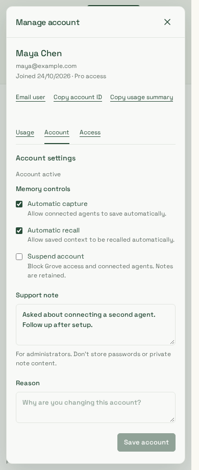

# Solo-owner People & access

Reviewed on 25 October 2026. These captures show the actual dashboard components
and production-built styles against a loopback API and disposable PostgreSQL,
with 34 synthetic identities only. No production users, credentials or private
note contents are shown. Counts and usage are seeded synthetic values, not live
customer activity or billing invoices.

| People                                             | Usage                                              | Account settings                                    |
| -------------------------------------------------- | -------------------------------------------------- | --------------------------------------------------- |
|  |  |  |
|      |      |      |

Chromium and supported WebKit journeys pass at **1440, 390 and 320px**:

- Browse both account pages and search exact email; return focus after dismissal.
- View selected-account note/notebook/connection counts and today/month usage;
  private-note canary text never appears.
- Review access controls; edit capture/support note, suspend, then restore.
- Simulate a lost support response after commit; retry uses the same operation ID
  and creates only one audit entry.
- Verify copied-ID feedback or clipboard-denied fallback.
- Revoke the current operator during an edit; server denial conceals account data
  and closes the inspector.
- WCAG A/AA automated checks, no horizontal overflow, and no page errors.

The existing full 239-case Chromium suite is also part of source verification.
This is not production deployment or production account-edit acceptance.
