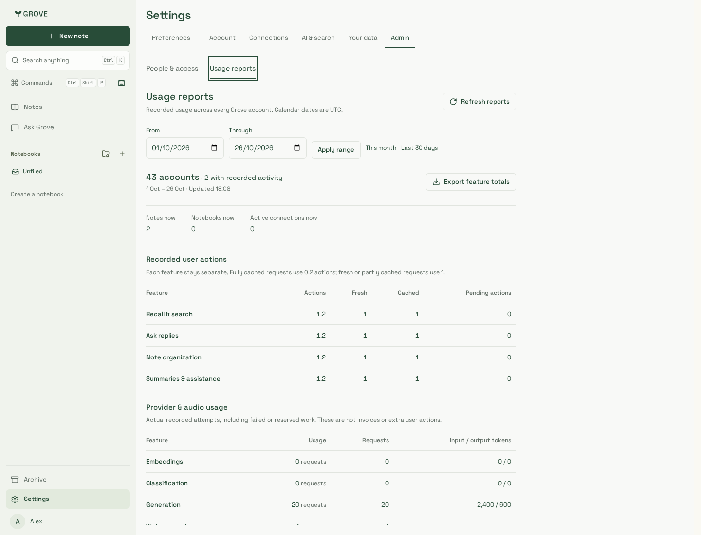
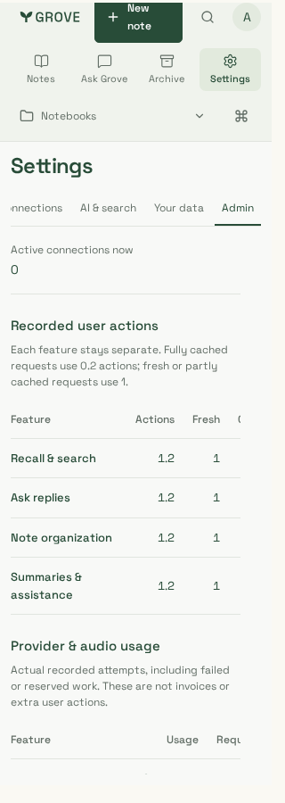
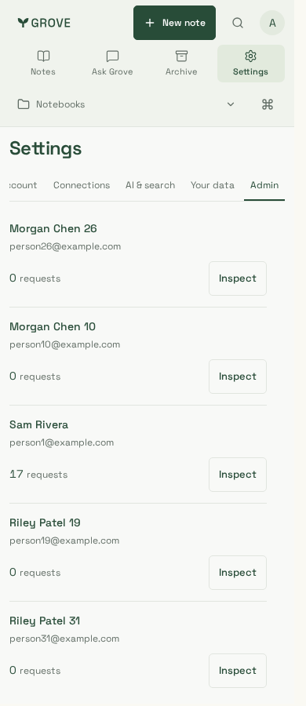
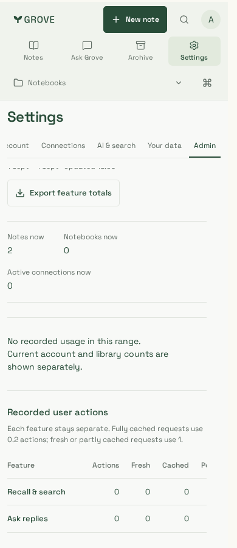

# All-account usage reports

Application source `24beccb`, production build `Kgmg87U9am-CDeMXOAF6A`.
Actual Admin components and production CSS with the real API and non-owner
PostgreSQL reads. All 43 accounts, names/emails, notes and counters are synthetic;
identity lookup is a local fixture, not Clerk/customer traffic. Private note text
is never returned in reports. No production data, paid inference or billing change.

| Global feature totals | Action breakdown, 320px | Activity and people, 390px | Empty historical range |
| --- | --- | --- | --- |
|  |  |  |  |

Chromium captures use 1440×1100, 390×900 and 320×900 viewports; mobile captures are
scrolled to the relevant report section. Tables remain horizontally scrollable
within their own labelled region. Both Chromium and pinned Noble WebKit journeys
pass across all three widths: on-demand reads, fractional action counts separate
from provider requests/audio minutes, CSV of global totals, feature selection,
43-user pagination, existing inspector, preserved data/retry after errors, empty
and invalid ranges, current role revocation, no leaked note text, WCAG A/AA and no
page overflow/errors. The public delivery record identifies source/build and gates.
