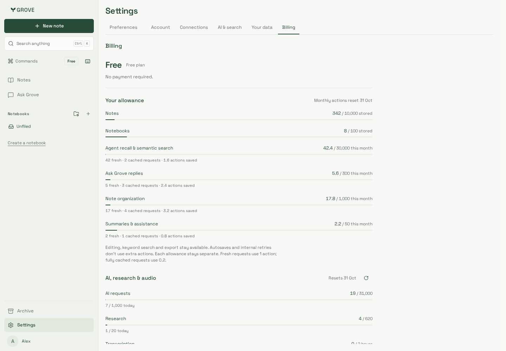
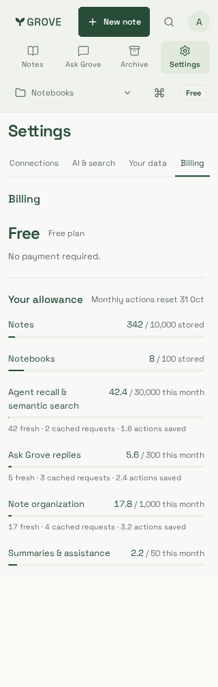
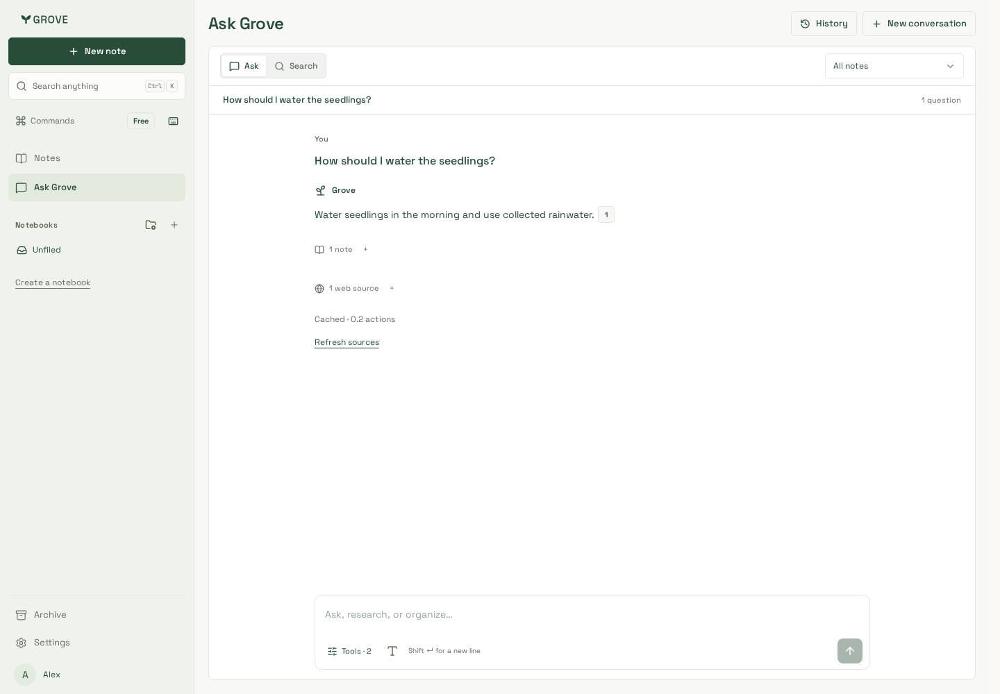
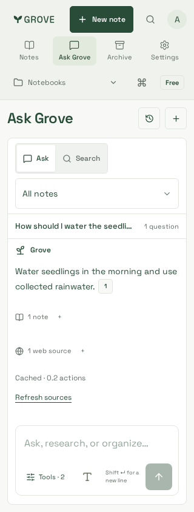

# Exact AI caching

Actual Billing and Ask Grove components with production CSS and synthetic accounts,
notes, web sources and API responses. No customer data or paid provider traffic.
These captures demonstrate presentation, not observed production cost savings.

| Weighted usage, desktop | Weighted usage, 320px | Cached answer, desktop | Cached answer, 320px |
| --- | --- | --- | --- |
|  |  |  |  |

The existing allowance meters retain separate limits. Counts distinguish fresh and
fully cached requests; savings are action units, not currency. A cached Ask receipt
shows 0.2 actions. Refresh sources creates a new request without clearing an unrelated
draft, while reopening the completed turn retains its original receipt.

Reviewed Chromium captures use 1440×1000 and 320×844 viewports. Targeted journeys
also exercise 390×844 in Chromium and supported Noble WebKit: fractional usage,
fresh/cached receipts, explicit refresh, draft retention, WCAG A/AA, no horizontal
overflow and no page errors. WebKit uses the pinned Playwright 1.64.1 Noble image
with Node 24.21.0, not an altered workstation installation. Supporting source/build
and final verification evidence is recorded in [delivery](../../../delivery.md).
