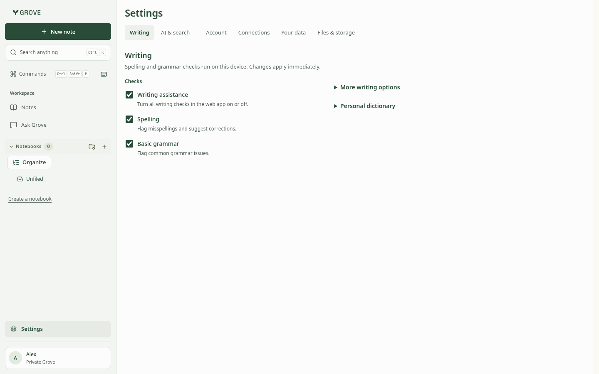
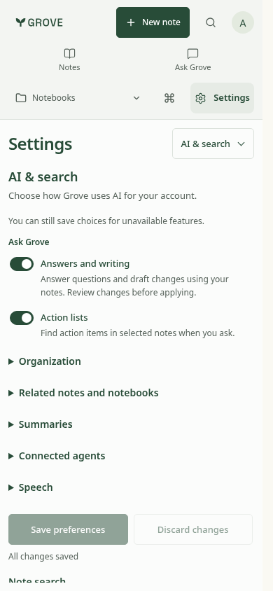
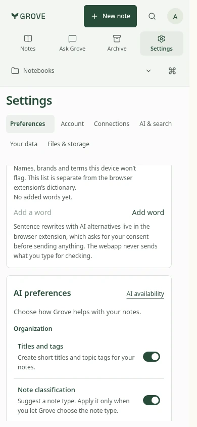
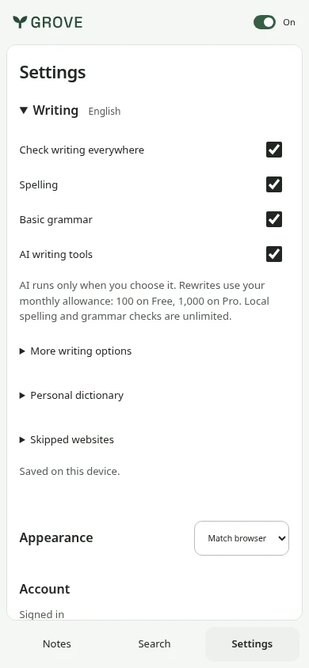
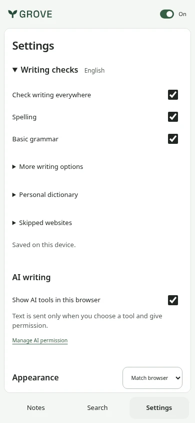

# Writing and AI settings

## Responsive workspace

Chromium fixture, optimized website CSS from `ba254222`, synthetic account preferences.
Writing changes apply on this device immediately; account AI choices use Save and Discard.
The phone section picker keeps the current destination visible while the content scrolls.

| Writing · 1440 × 900 | AI & search · 390 × 844 |
| --- | --- |
|  |  |

The 390 px capture requests a dark system color scheme; the workspace retains its existing light palette. These are synthetic browser views, not device or provider qualification.

## Earlier section separation

390 px captures of local builds. The web pages use synthetic account data and
the extension panels use test connections in installed Chromium packages. The
before images show PR #217; the after images show the stacked settings change.

| Web AI settings before | Web AI settings after |
| --- | --- |
|  |  |

| Extension writing settings before | Extension writing settings after |
| --- | --- |
|  |  |

[Browser approval with a prefilled, editable name and explicit note permissions](browser-approval.webp).
This shows the setup UI, not a live OAuth connection.
