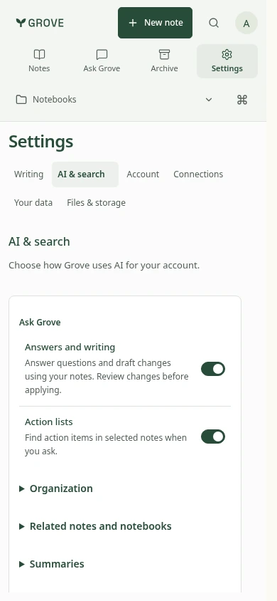

# Writing and AI settings

390 px captures of local builds. The web pages use synthetic account data and
the extension panels use test connections in installed Chromium packages. The
before images show PR #217; the after images show the stacked settings change.

| Web AI settings before | Web AI settings after |
| --- | --- |
|  |  |

| Extension writing settings before | Extension writing settings after |
| --- | --- |
|  |  |

[Browser approval with a prefilled, editable name and explicit note permissions](browser-approval.webp).
This shows the setup UI, not a live OAuth connection.
