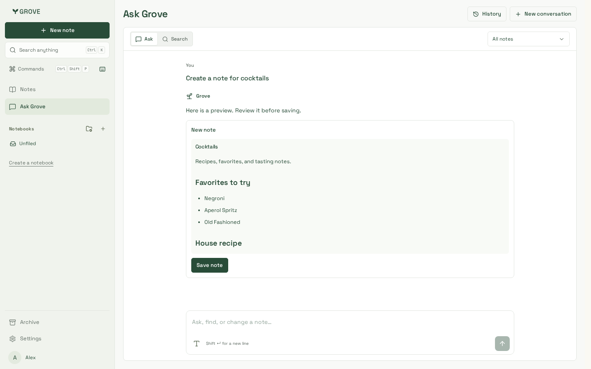
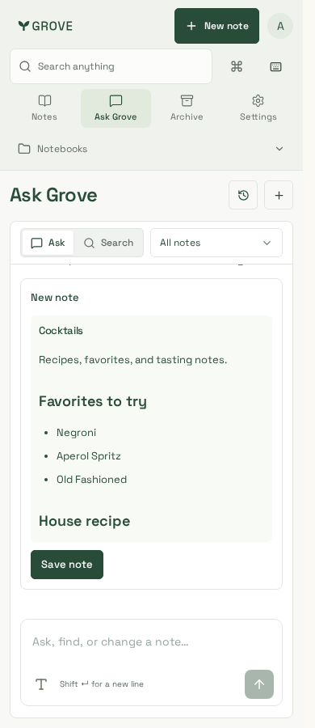
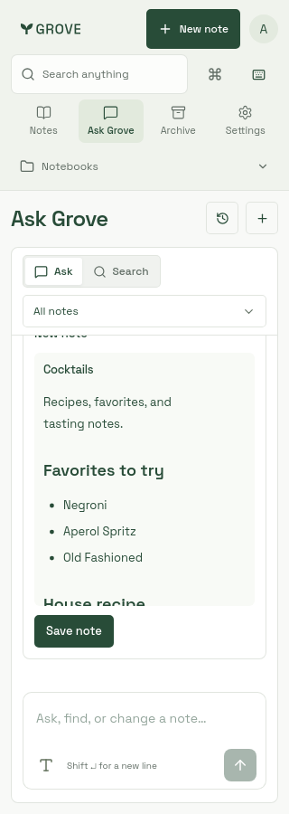

# Ask Grove new-note preview

Reviewed 23 October 2026 using synthetic cocktail-note content, production CSS build
`zJWm1lDCUK4a0jzuxRN9O` and Playwright 1.64.1.

| Desktop · 1440px | Phone · 390px | Narrow phone · 320px |
| --- | --- | --- |
|  |  |  |

New-note proposals contain one Markdown preview and **Save note**. There is no
empty Current note column or Review changes disclosure. The existing preview
scrolls internally for longer notes; edit and merge comparisons remain available.

Manual browser verification passes at 1440/390/320px in Chromium and WebKit:
single create preview, no comparison disclosure, Save/Open note/Undo, retained
edit/merge comparisons and no horizontal overflow. Four existing Chromium
conversation/composer/retry cases pass. Root/website lint, types and production
builds, five artifacts and bundle budgets pass. Notes entry remains 485,883 gzip
bytes; this change adds no eager editor dependency.
