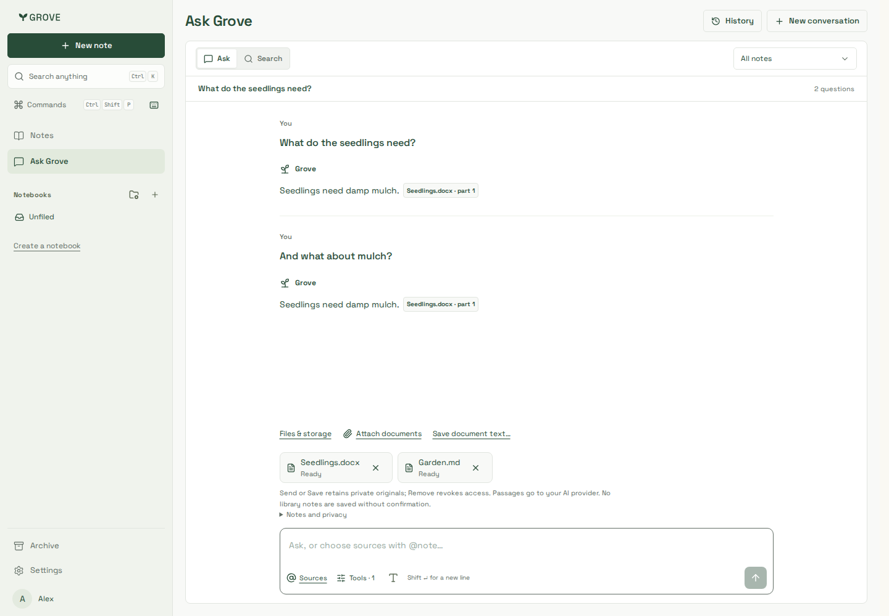
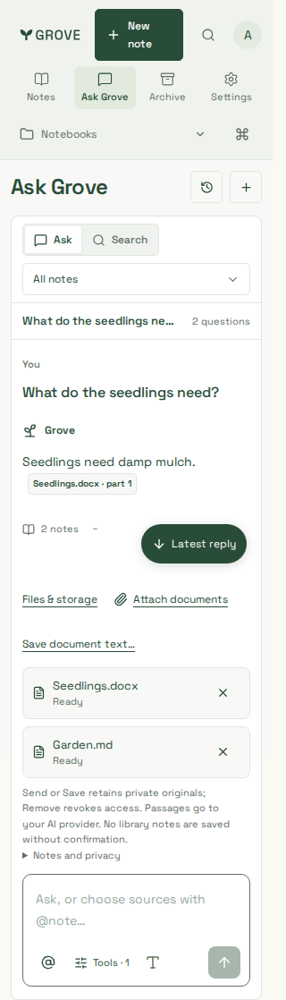
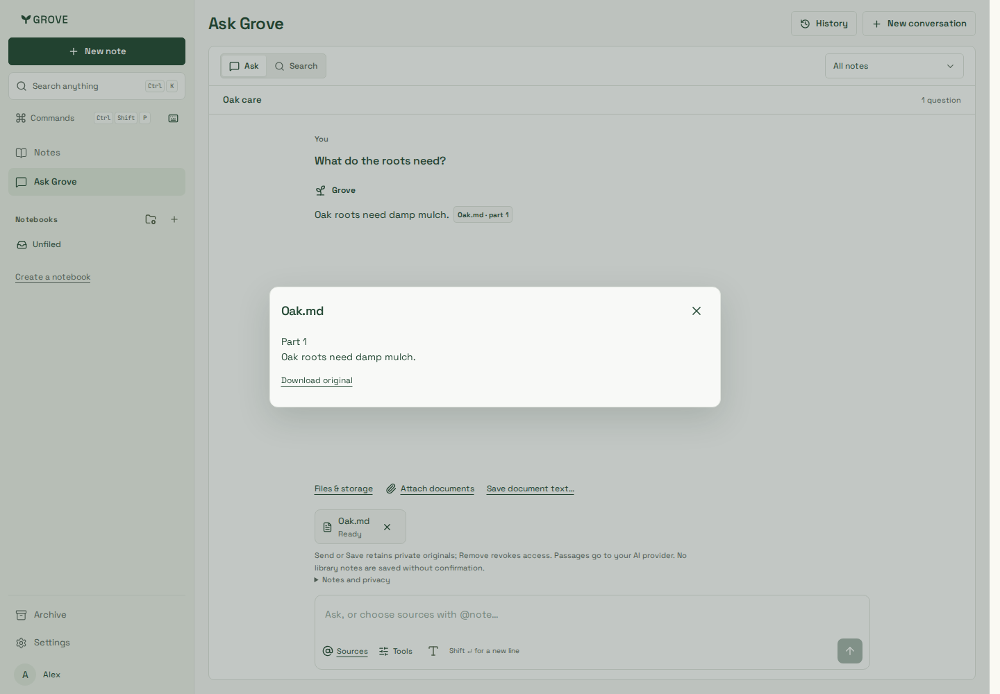
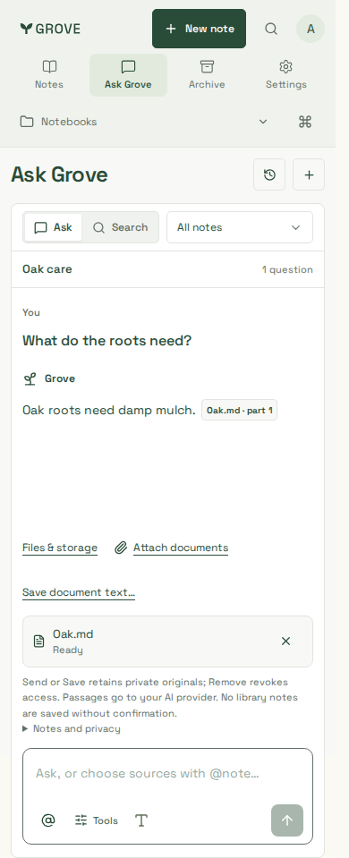

# Documents in Ask Grove

Synthetic identities and documents only. The real API/PostgreSQL/parser/private
source-store runner uses a deliberately synthetic generation provider; these are
not live-model answer-quality or production-rollout evidence. Production CSS and
actual workspace components are used in all captures.

| Real DOCX + Markdown, desktop                       | Real documents, 320px                        | Citation inspector                                 | 390px component fixture                               |
| --------------------------------------------------- | -------------------------------------------- | -------------------------------------------------- | ----------------------------------------------------- |
|  |  |  |  |

Reproduce real-service captures with `scripts/testing/ask-documents-browser.mjs`;
component/citation captures with `packages/website/tests/ask-documents.spec.ts` after
building the website. Reading starts automatically, no library note is created by
upload or Q&A, and full-text save opens an explicit import review. See the
[contract](../../../imports.md#ask-about-documents-first) and
[verification](../../../development/testing.md#documents-in-ask-grove).

The direct-import captures in [note-imports](../note-imports/README.md) are refreshed
for automatic preparation and the optional Ask handoff, not a second import system.
