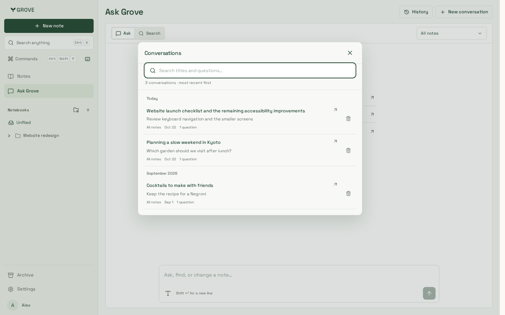
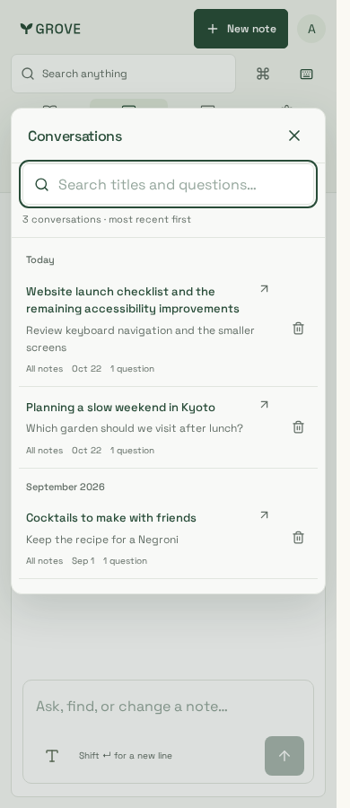
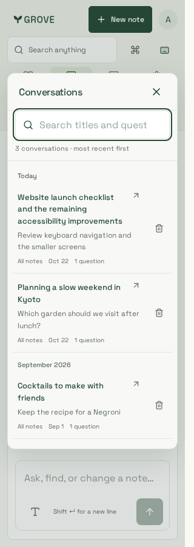
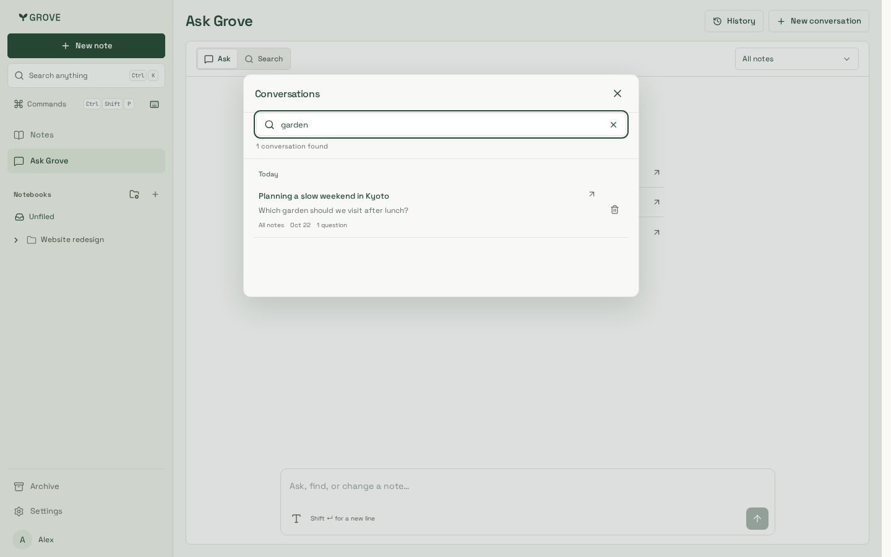
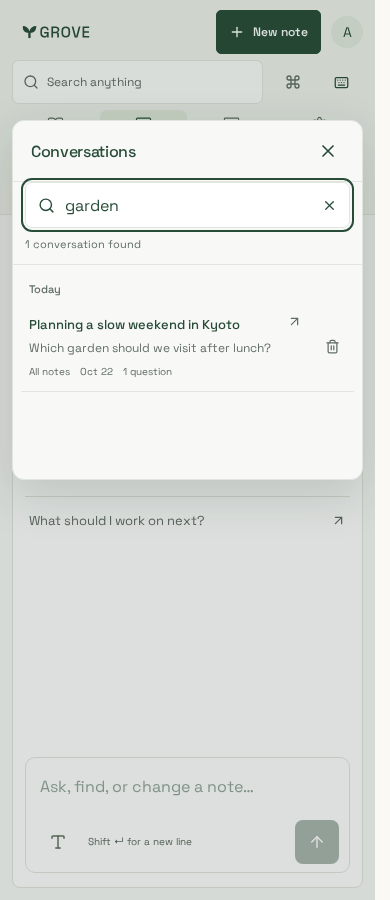
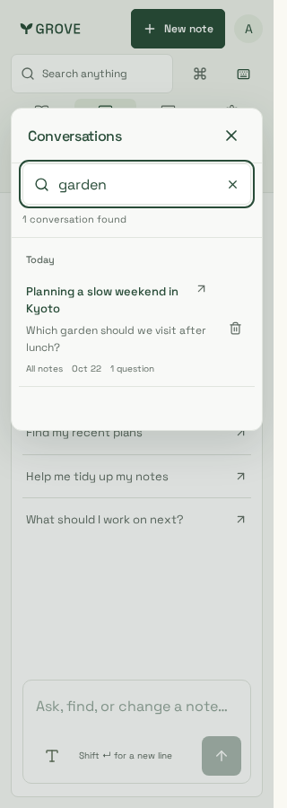
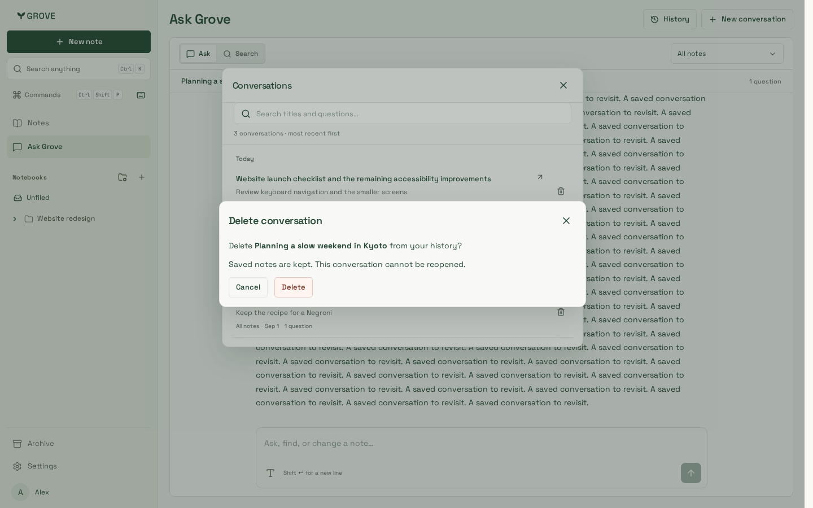
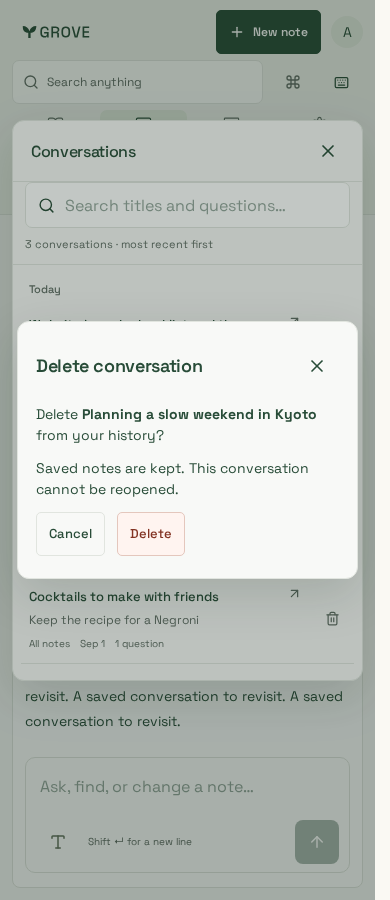
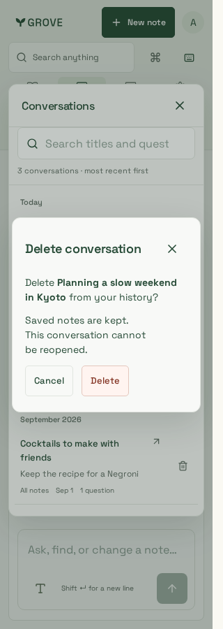

# Ask Grove history

Synthetic conversations captured on 23 October 2026 with production CSS build
`_aCUfYTQTESI1tvwKww6b`, Node 24.21.0 and Playwright 1.64.1. Desktop browsing,
phone search and narrow deletion were visually reviewed. Search stays fixed while
the content-sized list changes or scrolls; titles wrap and touch controls remain
separate. The 320px scenario also checks a 400px-high viewport.

| Browse · 1440px | Browse · 390px | Browse · 320px |
| --- | --- | --- |
|  |  |  |

| Search · 1440px | Search · 390px | Search · 320px |
| --- | --- | --- |
|  |  |  |

| Delete · 1440px | Delete · 390px | Delete · 320px |
| --- | --- | --- |
|  |  |  |

Verification covers keyboard focus, WCAG A/AA, overflow, literal server search,
pagination retry, opening failures, named confirmation/cancellation, per-conversation
drafts and scopes, cancelled opens, reading from the start and Latest reply. Submitting
the new-message scratch draft clears it rather than restoring it on the next New
conversation. Full Chromium and focused iPhone/WebKit results are recorded in
[delivery](../../../delivery.md#ask-grove-history-23-october-2026).
