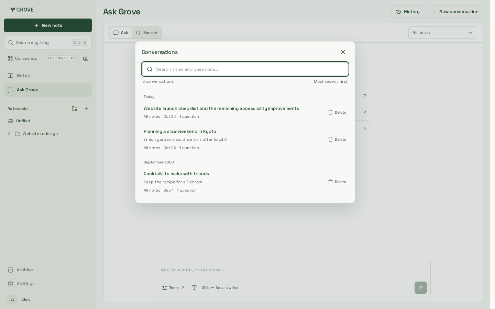
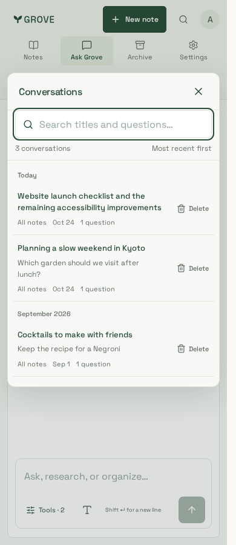
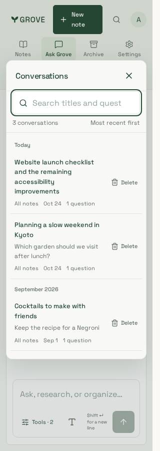
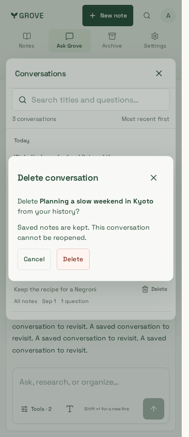
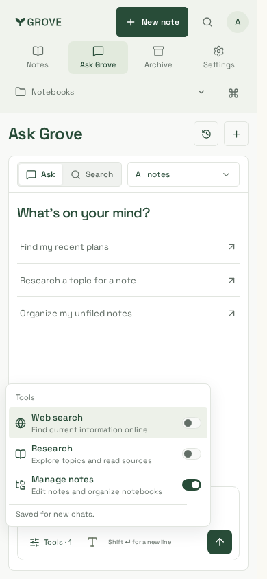
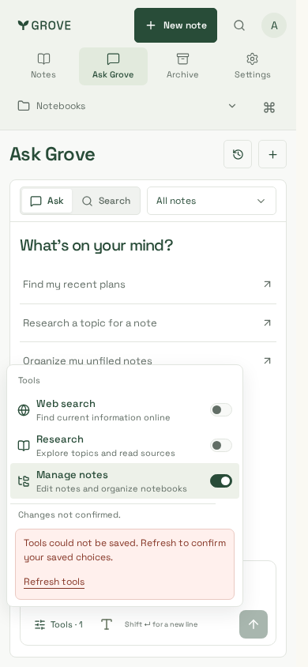

# Remembered tools and conversation history

Reviewed synthetic browser captures from application source `652143b`, production
Next build `V2OwYNz7NiIFY2gO8CV_F`, on Node 24.22.1 / pnpm 10.33.0.
The fixture uses the real workspace components and production CSS, with synthetic
account/API boundaries; it is not a live account or deployment acceptance claim.

| Desktop history · 1440×900              | Phone history · 390×900             | Narrow history · 320×900              |
| --------------------------------------- | ----------------------------------- | ------------------------------------- |
|  |  |  |

| Named confirmation · 390×900             | Automatically saved · 390×844         | Unconfirmed save and recovery · 390×844      |
| ---------------------------------------- | ------------------------------------- | -------------------------------------------- |
|  |  |  |

## Review and verification

- Distinct excerpts avoid repeating titles; internal opening arrows are removed.
  Readable metadata, a quiet Current badge and labelled, fixed-position Delete
  targets keep the notebook-index hierarchy clear without row movement.
- Search remains fixed above the scrolling results. Named confirmation starts on
  Cancel, retains failures for retry, keeps saved notes and restores useful focus.
  Existing empty conversations remain deletable; tools-only changes create none.
- Tool choices save automatically for new chats. Saved-chat changes update that
  chat and only the changed account-default switch. Drafts survive held/failed
  saves; unconfirmed saves expose Refresh tools and block sending until checked.
- Full Chromium: **239 passed**. Focused iPhone/WebKit: **seven passed**. These
  include keyboard/touch, 1440/390/320px overflow and WCAG A/AA audits. The Tools
  launcher now uses the existing forest token after an audit found marginal hover
  contrast. Physical-device keyboards and live provider behavior are not qualified.
- Root/website lint, types, production builds and nine artifacts pass. Integrated
  backend: **368 passed, four optional RabbitMQ/S3 skips**. Non-owner PostgreSQL
  coverage includes fresh service/connection/session readback, partial/default
  atomicity, tenant denial, old-chat independence and in-flight reply fences.
- Separate Node processes verify durable defaults after API/service
  reinitialization. A synthetic boundary check of the actual website proxy verifies
  PATCH forwarding, private/no-store, origin rejection and signed-out denial.
- Bundle budget passes: Notes entry **489,194 gzip bytes**, editor still deferred.

The initial unbounded backend run overlapped a build and hit local database
timeouts; bounded file concurrency passes without changing assertions or runtime
timeouts. Integration of speech #119 required applying its forward migration to
the disposable base fixture before rerunning; no retained database was reset.

See [test commands](../../../ask-tools.md#verification)
and the [current tool contract](../../../ask-tools.md). This feature adds no new
migration; deploy its API before the matching website.
