# Ask Grove tools — visual verification

UI source: `da27de5`, production website build `FcjGUIgoeCD_xTlv9lqIM`.
Captures use synthetic garden notes and model/search responses, the real
conversation API and a disposable PostgreSQL database with the non-owner API role.
No customer notes, provider credentials or billing pages are pictured.

Reviewed Chromium at 1440×1000, 768×1000, 390×844 and 320×844; WebKit at
390×844 and 320×844 using Playwright 1.64.1 Noble. The six end-to-end journeys
verify independent toggles, draft retention, actual activity, web citations,
note Save/Undo, notebook creation/filing Apply/Undo and sidebar invalidation.
Web search, Research and Manage notes use distinct icons and switches; the desktop
journey also exercises failed-save rollback, refresh recovery and default confirmation.
Tool-menu WCAG A/AA checks and page overflow checks pass in both engines.
Seven focused WebKit history/conversation regressions also pass on the integrated source.

The mobile research captures intentionally scroll to the saved-source section;
organization captures bring the proposed changes into view. The composer remains
reachable while the conversation scrolls. Eighteen captures were reviewed, with
three per row below; the PR shows only a representative preview row.

| Tools                                       | Cited research                                    | Notebook organization                                 |
| ------------------------------------------- | ------------------------------------------------- | ----------------------------------------------------- |
| 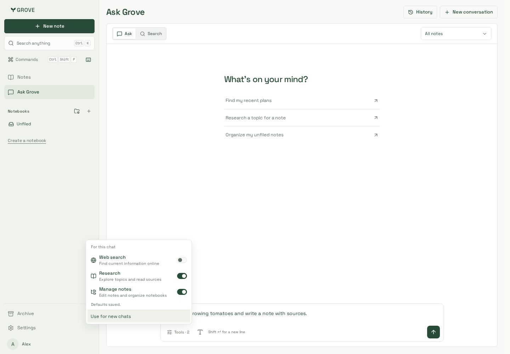            | 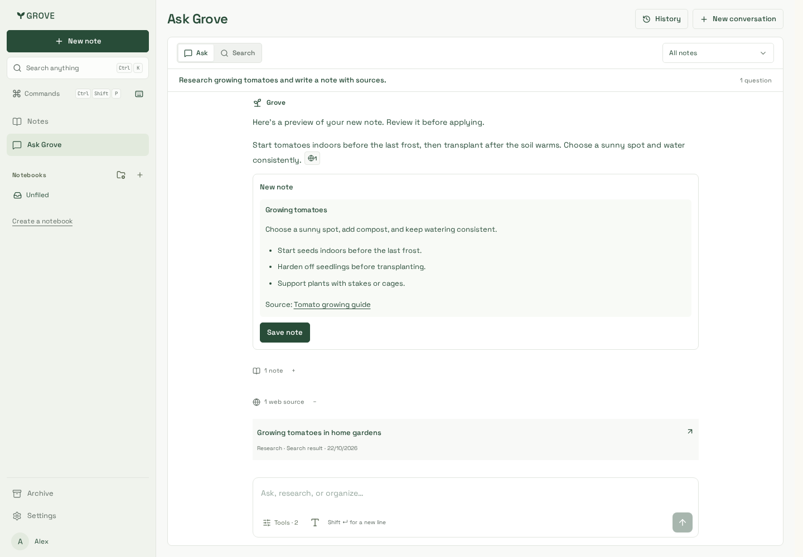            | 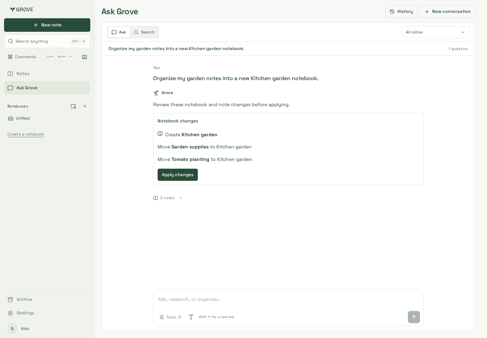            |
| 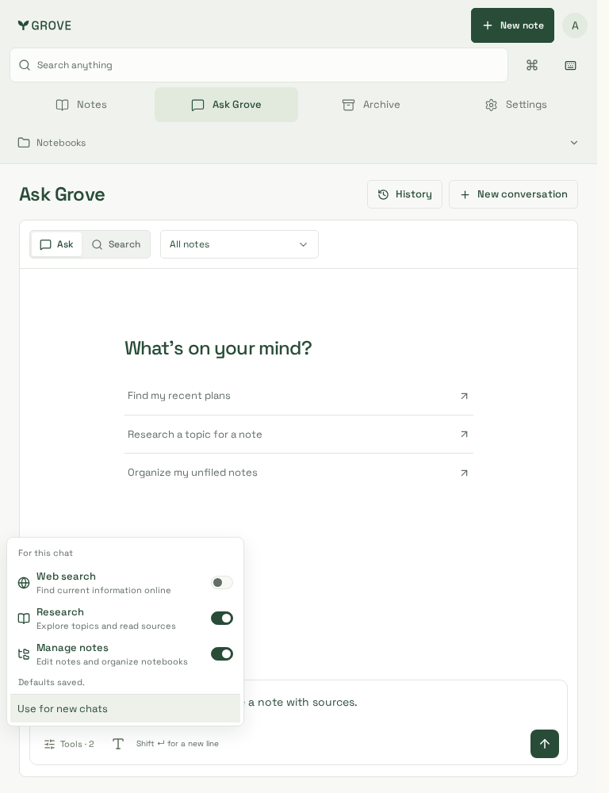              | 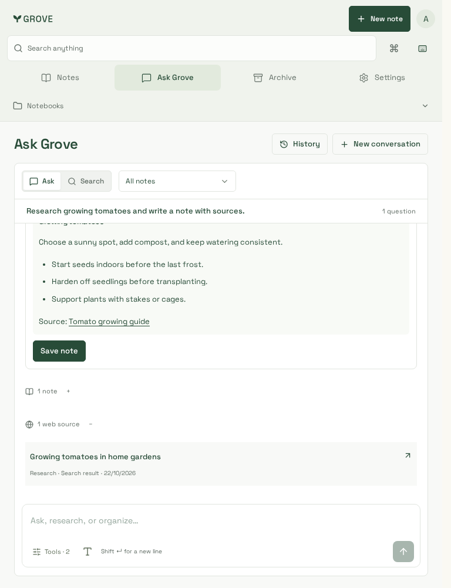              | 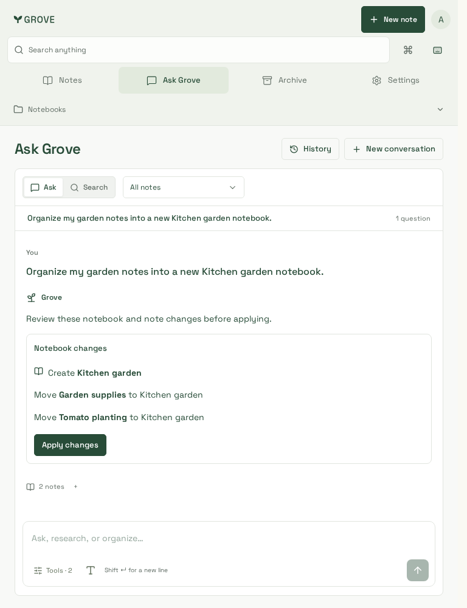              |
| 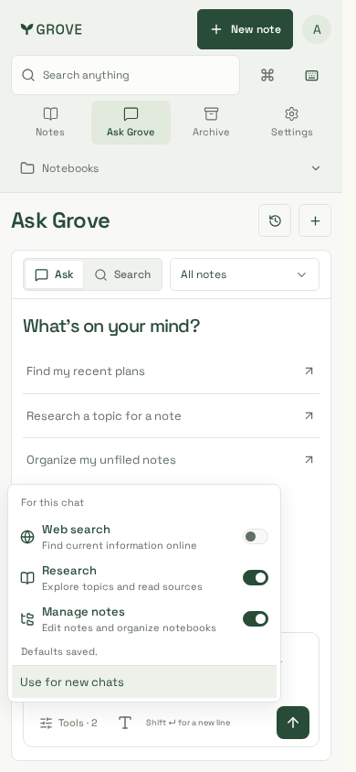               | 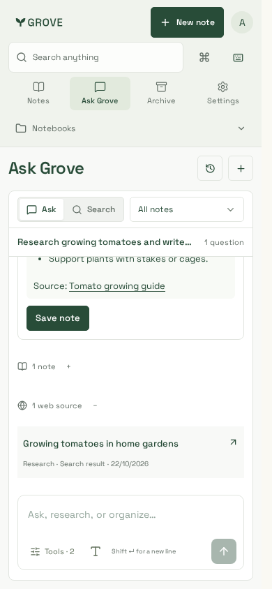               | 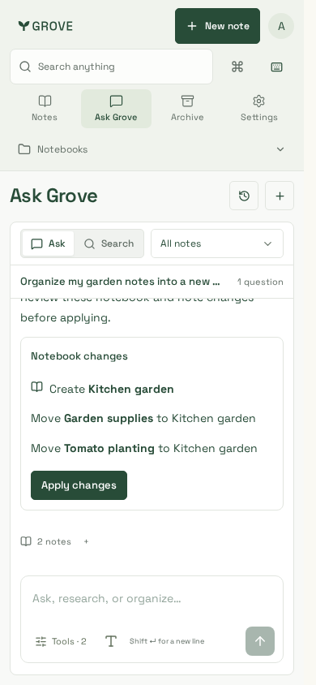               |
| 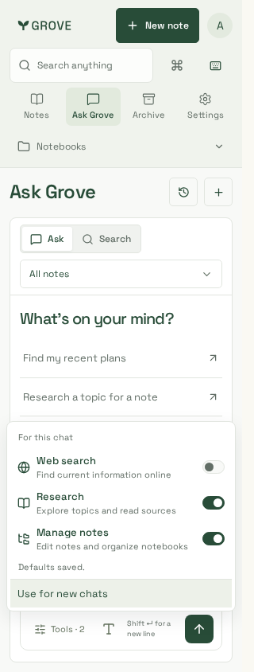               | 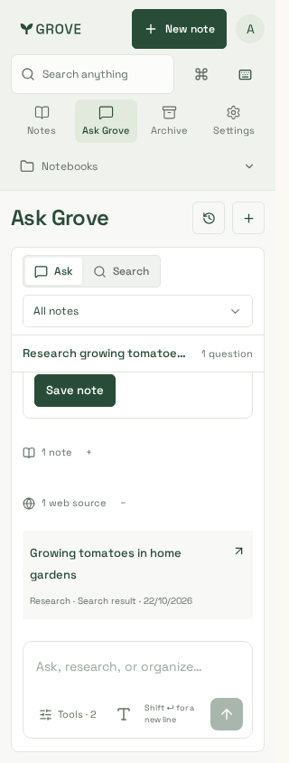               | 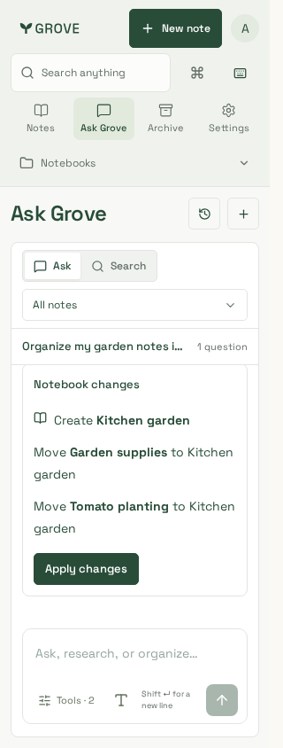               |
| 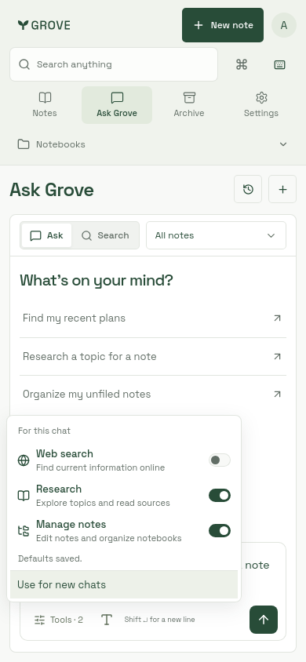 | 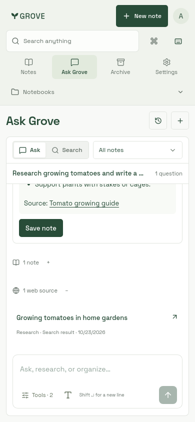 | 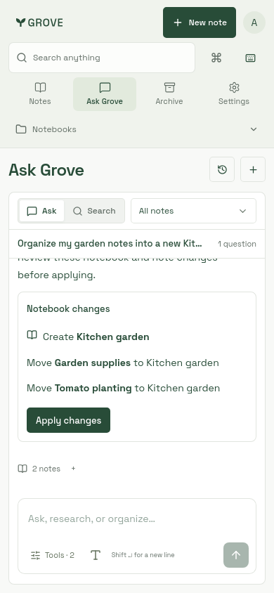 |
| 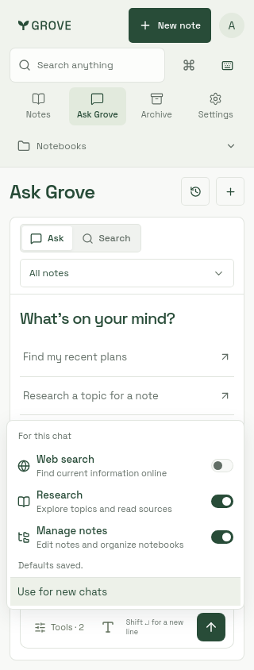 | 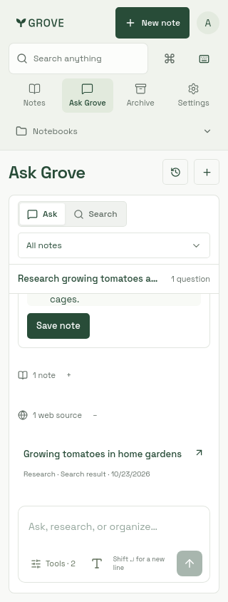 | 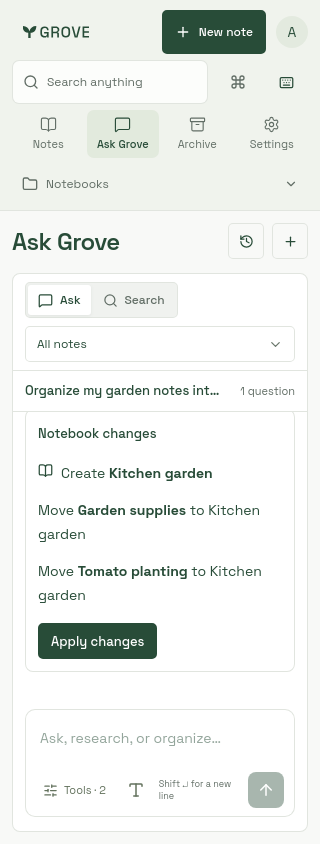 |

Hosted-provider acceptance is separate from these deterministic visual fixtures:
real Exa Lite and Tavily Basic search/extract calls pass. A final two-turn live
MiniMax + Exa run creates a cited MDN note, then previews/applies/undoes notebook
creation and filing. Initial invalid action shapes and omitted optional fields
led to narrower per-intent schemas and regression cases; general model quality
and physical mobile keyboard behavior are not qualified by this small sample.
