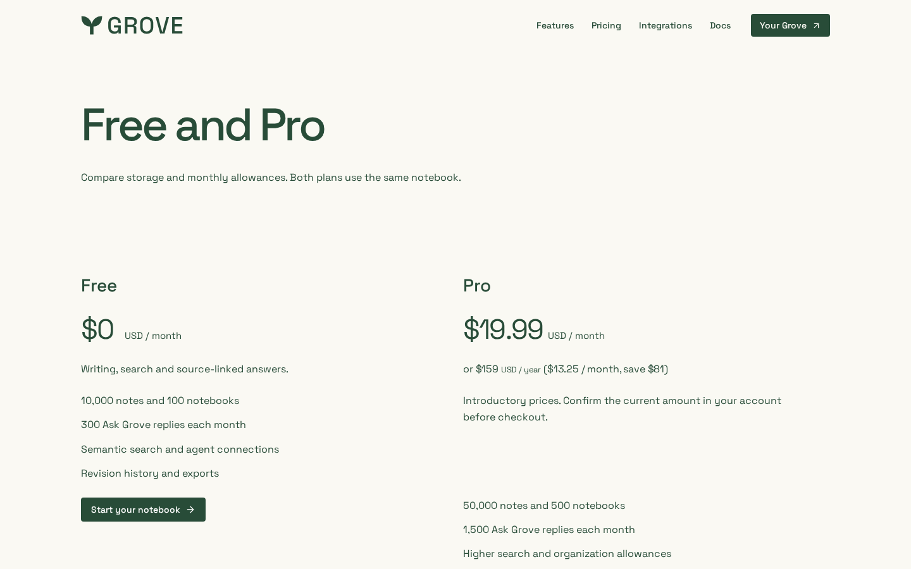
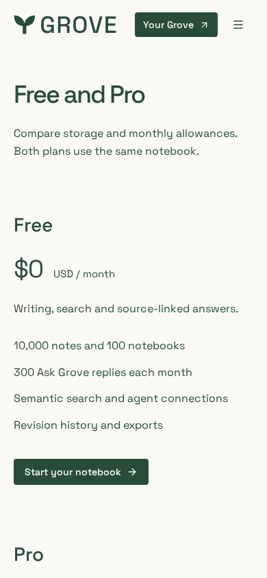
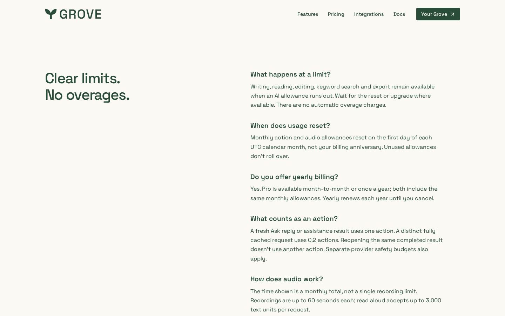

# Pricing comparison

Local optimized Next.js build from the pricing changes based on `9ee71cc9`,
18 November 2026. Chromium 156, en-US, optional cookies declined. The captures
use synthetic Flags SDK overrides for the existing monthly, yearly and billing
flags; they do not represent a live offer or payment.

| Purchases available | Purchases unavailable |
| --- | --- |
| [Desktop, 1440×960](plans-on-1440-light.png) | [Desktop, 1440×960, dark](plans-off-1440-dark.png) |
| [Phone, 390×844, full page](plans-on-390-light.png) | [Phone, 320×780, full page](plans-off-320-light.png) |

Checked the billing link, Free signup, guest and self-host destinations, keyboard
focus order and disclosure activation. The comparison fits without horizontal
scrolling. Separate monthly-only, yearly-only (including cents), and invalid
price fixtures exercise independent price display; no checkout was opened.

## Previous billing-period layout

Pro is offered month-to-month and once a year from the same page. The Pro card
lists **$19.99 USD / month** with a second line for **$159 USD / year**
($13.25 / month, save ~$81, computed from the live flags). A "Do you offer
yearly billing?" FAQ confirms both periods share the same monthly allowances.
No billing-period toggle or extra JavaScript: interval choice happens at
checkout in Settings → Billing.

Local production build, first-visit cookies declined, locale en-US. Prices come
from the `billing-pro-monthly-usd` (19.99) and `billing-pro-yearly-usd` (159)
code defaults; the account billing panel remains the source of truth for what
checkout offers.

| Pro card, desktop | Pro card, 390px | Yearly FAQ, desktop |
| --- | --- | --- |
|  |  |  |
