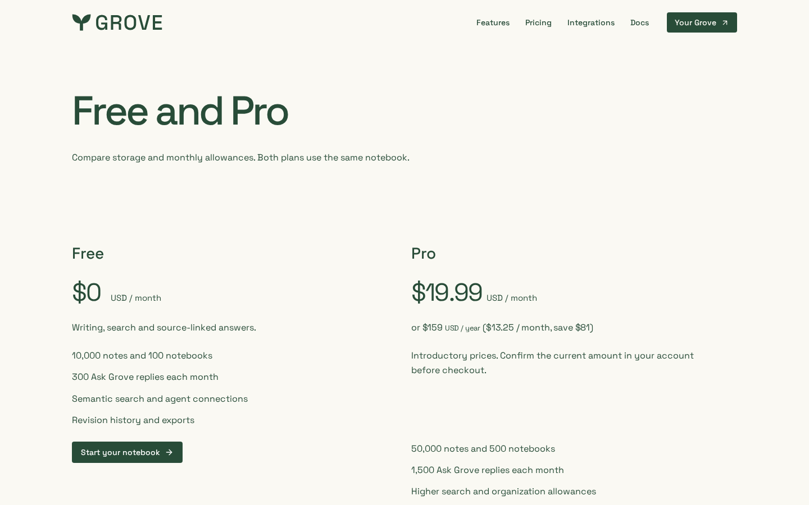
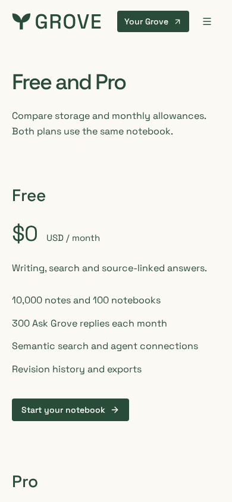
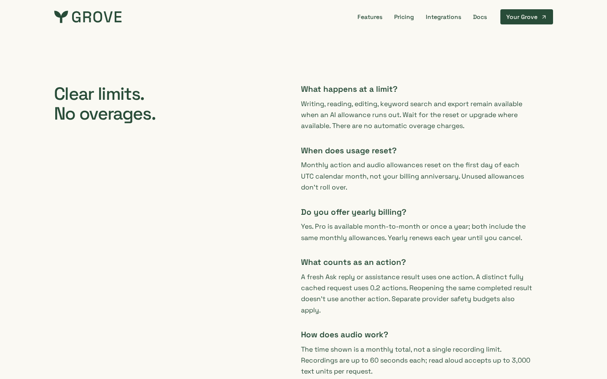

# Billing periods on /pricing

Pro is offered month-to-month and once a year from the same page. The Pro card
lists **$19.99 USD / month** with a second line for **$159 USD / year**
($13.25 / month, save ~$81, computed from the live flags). A "Do you offer
yearly billing?" FAQ confirms both periods share the same monthly allowances.
No billing-period toggle or extra JavaScript: interval choice happens at
checkout in Settings → Billing.

Local production build, first-visit cookies declined, locale en-US. Prices come
from the `billing-pro-monthly-usd` (19.99) and `billing-pro-yearly-usd` (159)
code defaults; the account billing panel remains the source of truth for what
checkout offers.

| Pro card, desktop | Pro card, 390px | Yearly FAQ, desktop |
| --- | --- | --- |
|  |  |  |
