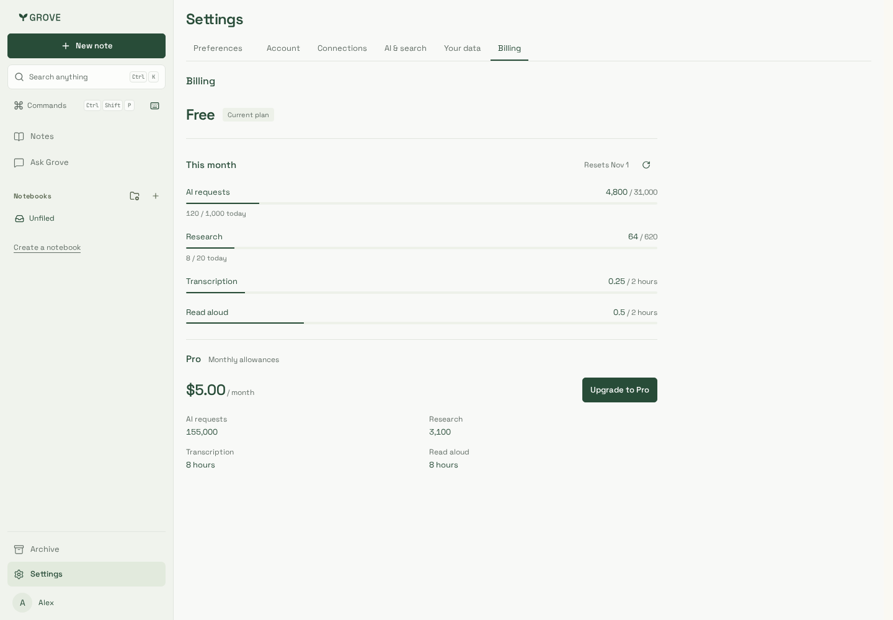
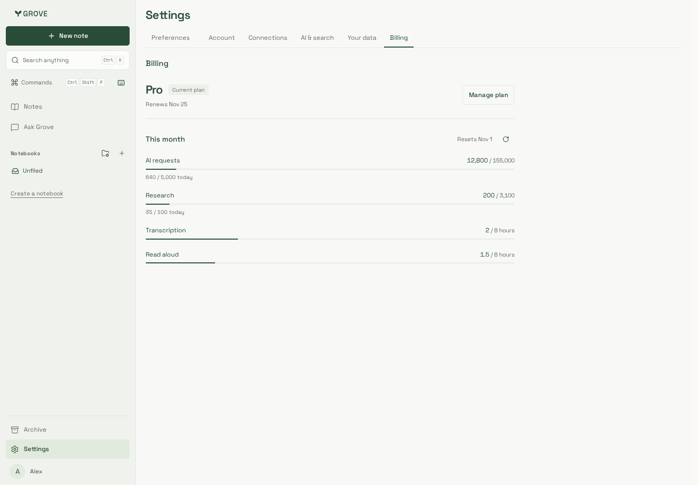
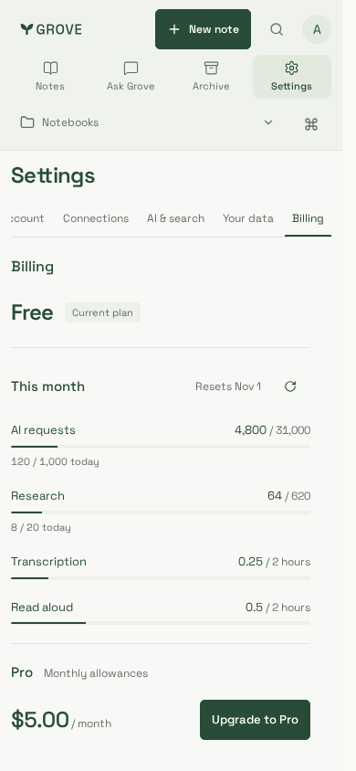
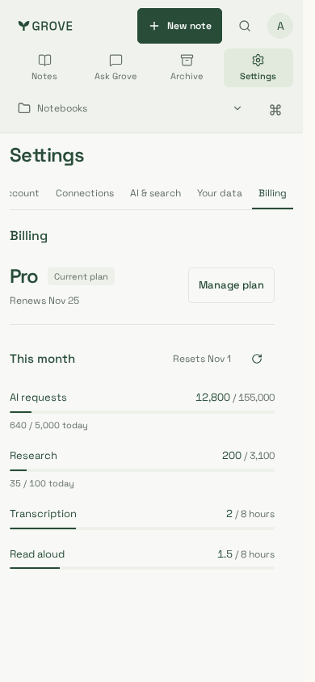

# More generous tiers — reviewed Billing captures

Four relevant synthetic captures from the actual Billing component and production
CSS; no personal notes, live subscription or provider charge. Desktop is
1440×1000; phone is 390×844. Mobile settings keep Billing visible in the existing
scrollable navigation. No layout redesign is introduced.

| Free desktop                                       | Pro desktop                                           | Free phone                          | Pro phone                         |
| -------------------------------------------------- | ----------------------------------------------------- | ----------------------------------- | --------------------------------- |
|  |  |  |  |

## Source and verification

- Backend source: `eb1554bb03cfe5ce543c1796004ebc4917139942`; the companion
  delivery commit adds the Billing display and this gallery.
- Website build: `cUeGWzNutYfIKQN_AY9E-`. Billing component Git blob:
  `99475284476acf2d4d7e98c5dcccb0edd1a046d7`.
- Node 24.21.0, pnpm 10.33.0, Playwright 1.64.1. Production telemetry build uses
  synthetic public identifiers, never production credentials.
- Full existing Chromium suite: **233 passed** on the final application. Backend:
  **381 passed**, four optional RabbitMQ/S3 checks skipped. All nine packaged
  artifacts and required root/site lint, types, builds and bundle budget pass.
- Additional actual-component journeys pass in Chromium and supported Noble
  iPhone 13/WebKit: Free/Pro at 1440/390/320px, correct independent 2/8-hour meters,
  daily AI/research limits, upgrade disclosure, exhausted/zero/custom values,
  old character-based API responses, checkout recovery, keyboard refresh, Free→Pro
  refresh and flag-off hiding. Automated WCAG A/AA checks and horizontal-overflow
  checks pass in both engines. The final custom one-hour allowance is singular.
- Native WebKit lacks system libraries on this host; the supported
  `mcr.microsoft.com/playwright:v1.64.1-noble` image supplies them. No system
  packages or personal browser profile settings were changed.

The task-local browser verifier uses an owned loopback API/real-component fixture,
not a fake production endpoint. These checks do not prove live Stripe payment,
provider billing, production rollout, physical-device interaction or full-lecture
audio ingestion. Runtime counters/reservations are independently tested against
real disposable PostgreSQL with non-owner API/worker roles. See
[verification](../../../development/testing.md) and
[cost assumptions](../../../development/tier-costs.md).
