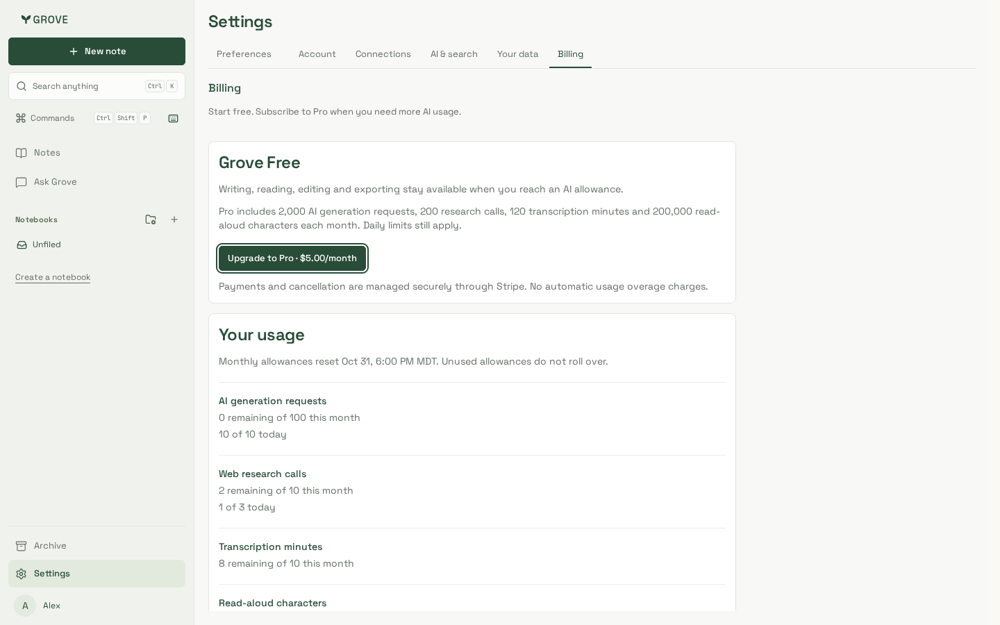
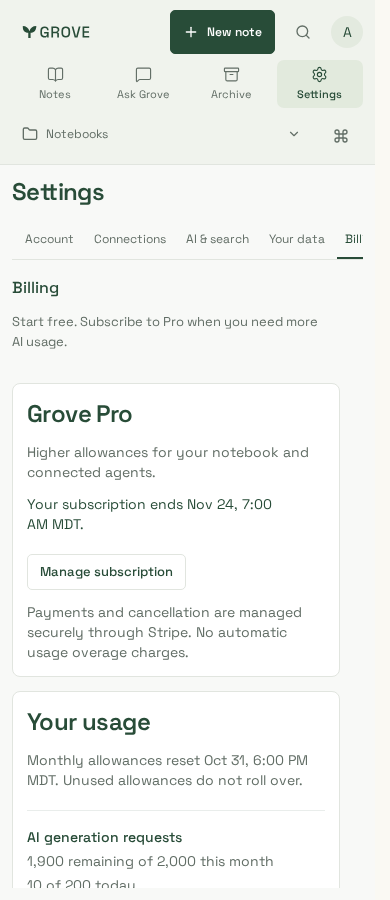
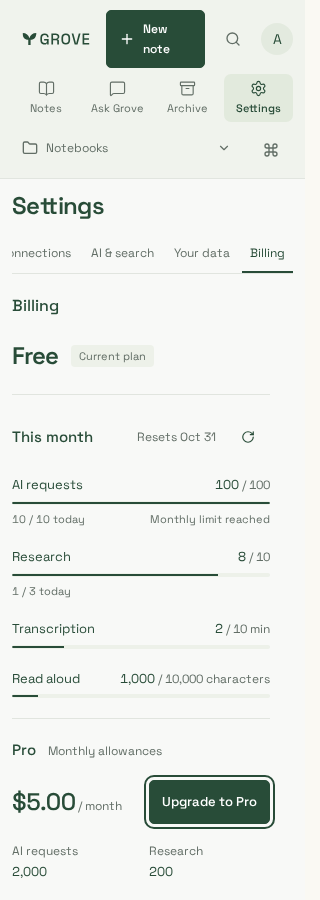
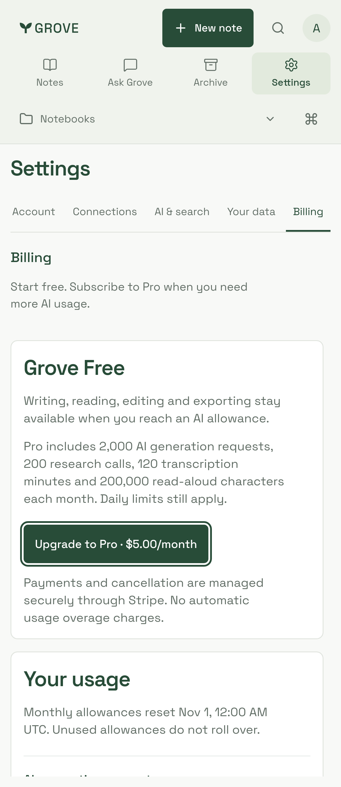
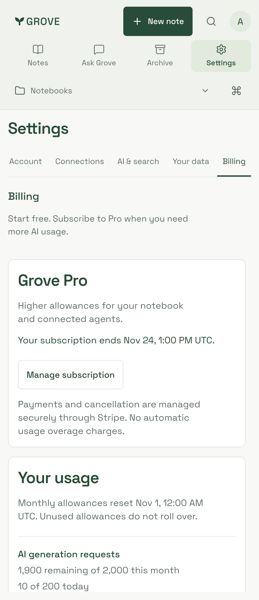
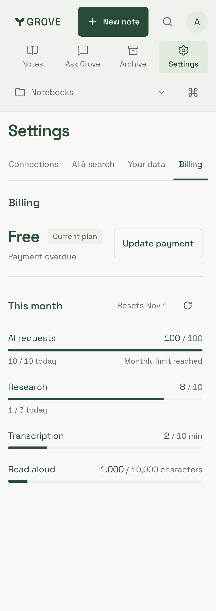

# Billing interface

Synthetic Free/Pro accounts, Stripe-hosted destination fixtures and fixed UTC reset
dates. The displayed **$5 USD/month** matches the approved launch amount and numeric
Vercel flag. Accounts and usage in the screenshots are synthetic; no payment is made.

The actual Billing component is bundled by the isolated dashboard fixture and
uses production CSS from Next build `G2R_z51IolyDrH-zwVD3R`, based on billing source
`25265ea` plus the pricing/concealment follow-up. Node24.21.0 / pnpm10.33.0, Chromium and
Playwright1.64.1 Noble container iPhone/WebKit; locale en-US, local timezone shown
in each capture. Pro's monthly allowances are disclosed before opening Checkout.

| Free, desktop | Pro cancellation, phone | Free, narrow phone |
| --- | --- | --- |
|  |  |  |

Each engine covers widths1440,390 and320 for `free`, `pro` and `payment` captures.
The additional `usage-320` capture scrolls the narrow settings content to the
remaining allowances and reset explanation. Links below show the WebKit subset:

| Free | Pro | Payment attention |
| --- | --- | --- |
|  |  |  |

Both-engine journeys check exhausted generation allowance, 5-dollar monthly prices,
zero writes on open, keyboard focus, double-submit suppression, hosted Checkout,
Pro state after return, period-end cancellation, portal access while enabled,
complete removal of billing details after a flag-off 404,
load/retry/past-due recovery, WCAG A/AA and no document overflow or browser errors.
Backend tests separately cover real PostgreSQL/RLS and actual Stripe SDK requests
to a loopback provider. These screenshots do not establish real Stripe payment,
Vercel flag targeting, physical-device keyboard or production rollout acceptance.
