# Browser extension evidence

## Richer local proofing — 6 November 2026

Unsigned product `1.11.15`, refinement following `0d628aeb`; exact source/checks are
in [PR #189](https://github.com/miniaxolotl/grove/pull/189). Chrome ZIP SHA-256:
`7db496198f1bf5e647df0b76c7a87409f5baf62f0acabee627079fbafa2c1b67`. Installed
Chromium `156.0.8078.4` with synthetic text and no provider or network calls.

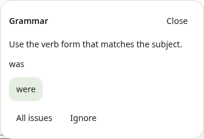

The in-page card names the problem in words, shows the original wording and one
reviewed replacement, and offers **All issues** to return to the whole list without
rechecking, **Ignore**, and **Add word** for names. Corrections replace only the
selected range with native Undo; nothing is applied automatically.

Local English rules now cover, each with its own switch under Settings → Writing:
wordy phrases, verb agreement, acronym plurals and confused words alongside the
earlier bracket/quote, a/an, repetition, spacing and capitalization rules. New
checks include **all of the** → **all the**, **PR's are** → **PRs are**,
**1990's** → **1990s**, **They was** → **They were**, **he don't** → **he doesn't**,
**should of** → **should have**, **its a** → **it's a**, **their is** → **there is**,
**suppose to** → **supposed to**, **use to** → **used to** (never after _didn't_),
preposition + **and I** → **and me**, **22th** → **22nd**, common eggcorns
(**weather or not**, **free reign**, **baited breath**, **escape goat**) and
two-word spelling fixes (**alot** → **a lot**, **noone** → **no one**). Spelling
alternatives follow the original word's capitalization. An article before a
plural-looking noun abstains rather than suggesting a worse article.

The card capture is the real suggestion popup in a synthetic fixture page, cropped
to the card. Deliberately not checked: much/many, less/fewer, this/these with a
noun, noun–verb number agreement, comma splices, passive voice and hyphenation,
which need parsing or countability a bounded local checker cannot do safely.
Fixture success does not qualify live models, Firefox writing or branded browsers.

## Compact note sharing — 6 November 2026

Unsigned product `1.11.15`, refinement following `cc9e3129`; exact source/checks
are in [PR #189](https://github.com/miniaxolotl/grove/pull/189). Chrome ZIP SHA-256:
`9081b522d10788522fdfafaf954fcc3df32e8f412996145a7189b0da433d372b`.
Actual installed Chromium `156.0.8078.4` with synthetic notes/auth/HTTP and fake
sharing URLs, not a real publication or browser-store build.

| Create link                                                                                      | Copy link                                                                                    | Link options                                                                                          | Short, dark panel                                                                          |
| ------------------------------------------------------------------------------------------------ | -------------------------------------------------------------------------------------------- | ----------------------------------------------------------------------------------------------------- | ------------------------------------------------------------------------------------------ |
| 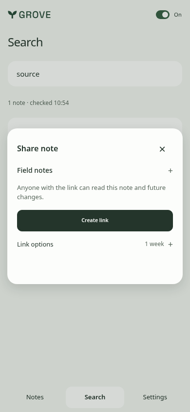 | 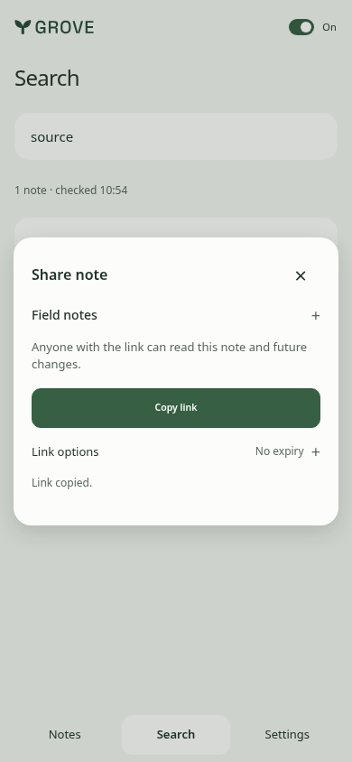 | 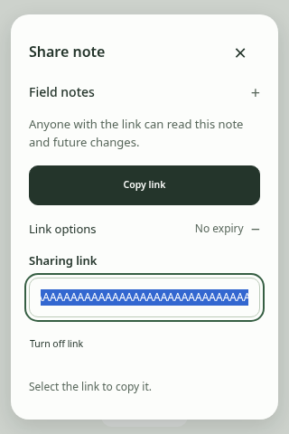 | 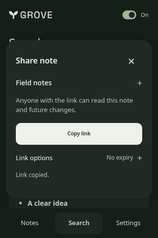 |

Create/Copy are 390 × 844; Options/Dark are 320 × 480. The established Editorial
greeting direction (`1378124550`), sage palette, type and note entry points stay.
Sharing answers “Can I share this note?” in one compact native surface, using the
same plus/minus disclosure pattern as Notes Details. The note title expands its
safe preview. Expiry, URL and Turn off link sit under Link options. A lighter
backdrop and smaller overlay shadow leave the surrounding note recognizable;
there is no new route, wizard, decorative motion or automatic publication.

Installed journeys check collapsed defaults, optional preview, one-week expiry,
one primary action, initial/pending/completed geometry, manual clipboard recovery,
reconciliation focus and Escape back to the reader. Light/dark 280/320/390/768px
and short-panel overflow/axe checks run alongside existing scope/revocation,
uncertain-publication and typing-during-save safeguards. Permission, version/replay,
backend/queue and provider contracts are unchanged. Fixture success does not qualify
live sharing, Firefox sharing, native grant/update prompts or branded browser UI.

Visual review: hierarchy 8/10, usability 9/10, identity 8/10. The three changes from
the previous gallery are a collapsed preview, one main Create/Copy action and
quiet secondary link controls. A first accessibility pass caught a summary whose
accessible name omitted its visible note title; its name now includes that title.
The final layout reserves the real action/status area while opening and checking
instead of recentering the dialog. Installed captures/geometry/axe are used because
the generic inspector cannot install the isolated extension origin; no generic
inspector pass is claimed. Source-lint shadow warnings belong to real overlays.

## Earlier streamlined panel — 6 November 2026

Unsigned product `1.11.15`, refinement following `3d9a07a6`; exact source and CI
are recorded in [PR #189](https://github.com/miniaxolotl/grove/pull/189).
Chrome ZIP SHA-256:
`103b4764613477b89e3bb83a4e08aeb85a7c58b0406ecaf44111a2adae0e1214`.
Installed Chromium `156.0.8078.4`, synthetic notes/auth/provider responses and fake
sharing URLs only. No live note was published.

| Writing alternatives                                                                     | Formatted Search and note menu                                                                            | Sharing                                                                       | Settings                                                                               |
| ---------------------------------------------------------------------------------------- | --------------------------------------------------------------------------------------------------------- | ----------------------------------------------------------------------------- | -------------------------------------------------------------------------------------- |
| 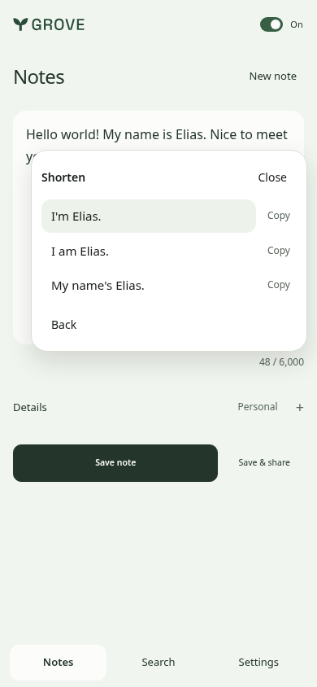 | 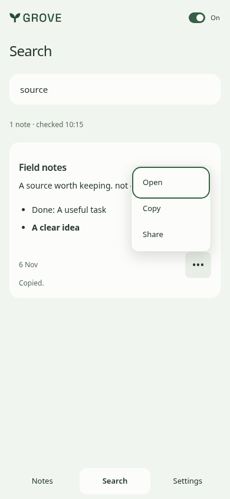 | 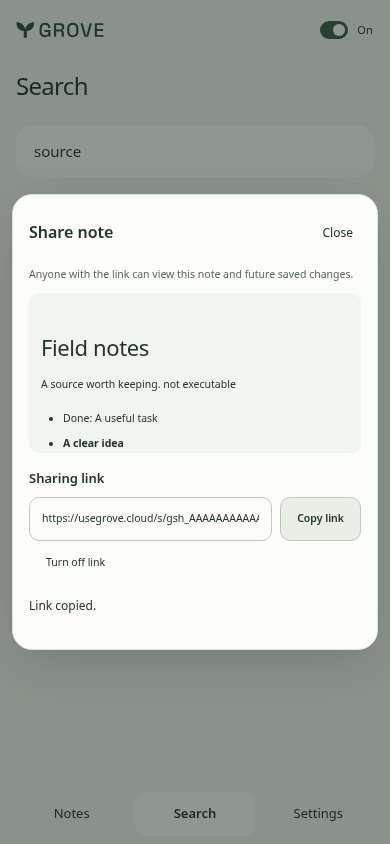 | 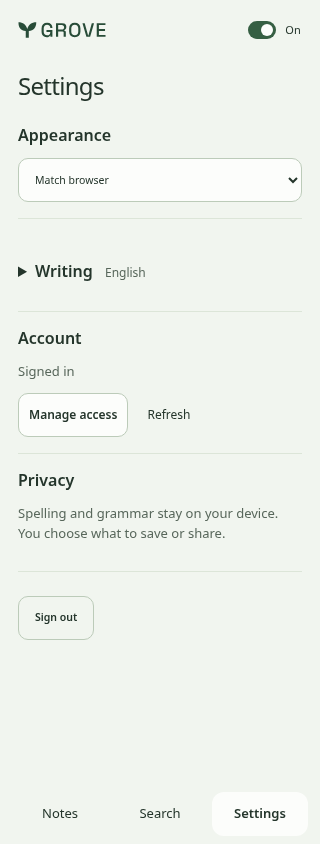 |

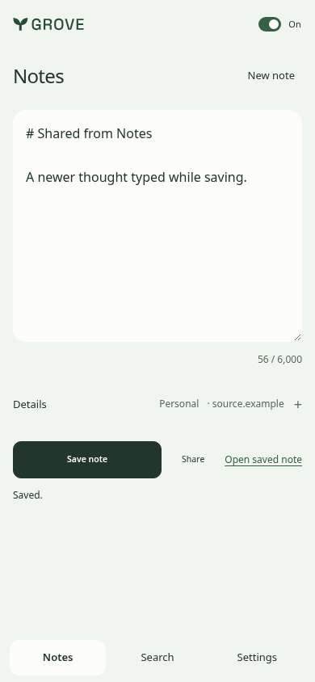

Standard views are 390 × 844; Settings is 320 × 844. Keep the existing Editorial
greeting direction, seed `1378124550`, sage surfaces and bundled Space Grotesk/Grove
mark. No new imagery, decorative motion, dashboard chrome or fictitious metrics.
Settings stays last; equal gutters and smaller editor/dialog padding free space.
Writing leads with alternatives, not original/context diagnostics. Search uses
bounded safe Markdown previews and one keyboard-accessible menu per result; bulk
selection/copy is removed entirely. Notes/Search share one focused public-link
dialog with explicit permission, saved-version review and publication confirmation.

Installed checks cover mounted search rows/scroll/input, arrows/Escape/menu focus,
copy/replace/Undo, clipboard failure, first-edit source pinning, exact save retries,
public-link uncertainty/reconciliation/revocation, permission removal before link
copy, and typing during Save & share. 280/320/390/768px, short/dark and axe checks
remain part of the installed journeys. Real PostgreSQL tests cover default-off
sharing permission, scoped native HTTP, retained 038→039 upgrade and RLS. Firefox
159 smoke checks native install/sidebar, formatted search and reader/copy, not
Firefox writing or sharing qualification. Live model quality, real browser grant/
update prompts, branded Chrome and visible Edge-sidebar presentation remain separate.

Visual review: hierarchy/usability/identity 8/10. Empty AI status space was removed;
preview HTML is omitted and checklist labels stay on the task's line. The sharing
preview's scrolling region is named and keyboard-focusable. No source-lint failures;
retained shadows belong to overlays. Installed screenshots/geometry/axe substitute
for the generic inspector, which cannot install this isolated extension origin;
no generic-inspector pass is claimed. Earlier sections retain historical packages.

## Earlier context-aware writing with the notebook — 6 November 2026

Unsigned product `1.11.15`, combining the writing branch with development
`37d4e0fd` (approved icons, coordinated version and personal notebook redesign).
Chrome ZIP SHA-256:
`e021ffed1bc6d938dbe707b75fd4783c250bc183ae2567482269b47bebb7f812`.
Installed Chromium `156.0.8078.4`, synthetic account/text and HTTP/provider output.

| Rewrite context                                                                                    | Narrow alternatives                                                                                    | Notes                                                                                                      | Parsed reader                                                                        |
| -------------------------------------------------------------------------------------------------- | ------------------------------------------------------------------------------------------------------ | ---------------------------------------------------------------------------------------------------------- | ------------------------------------------------------------------------------------ |
| 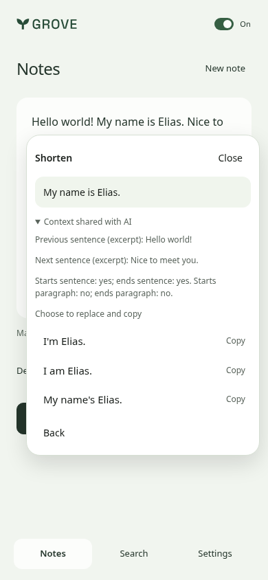 | 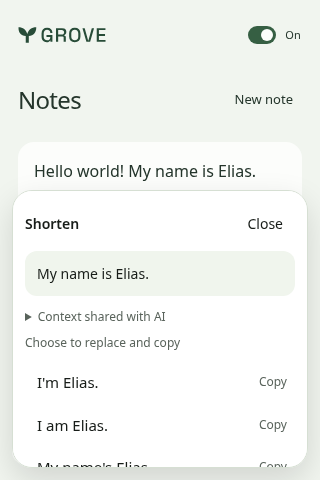 | 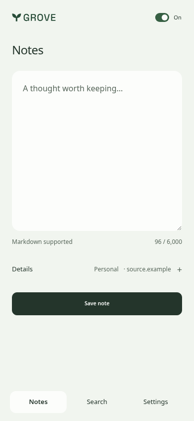 | 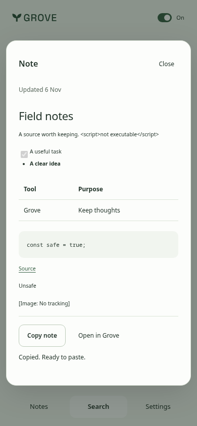 |

Standard captures are 390 × 844; the narrow review is 320 × 480. The merged
**Notes / Search / Settings**, all-granted-scope debounced search, safe GFM reader,
approved icons and first-edit source pinning are preserved. Notebook selection
and automatic source metadata share Details; source-link fields remain removed.
Authored text stays unchanged with provenance separate; quoted external captures
retain attribution and their full size limit. Exact uncertain-save identity remains.

Explicit rewrites include up to 500 UTF-16 units each of previous/next sentence
excerpts and containing-sentence fragments, plus start/end sentence/paragraph
flags. The current same-editor snapshot supplies the context only after choosing
a tool. **Context shared with AI** shows the exact bounded values; opening a menu
does not transmit them. Fresh `rewrite-context-v3` consent is required. Word
alternatives stay selection-only, and replacing a sentence leaves its neighbors
unchanged with native Undo. Context uses existing encrypted temporary staging,
expiry, cancellation and exact replay identity; no new queue or background service.

Installed journeys cover both Chromium manifest profiles, source-navigation/edit
races, context payload and preview, selected-only replacement, clipboard failure,
Undo, domain opt-outs, debounced search and safe parsed reading. 320/390/768px,
short/dark, focus, overflow and axe checks remain part of the same run. Native
Firefox 159 smoke additionally checks install/sidebar/save/search/parsed reading
and reviewed copying, not writing/AI semantics. Real provider quality, native
writing prompts, branded Chrome and visible Edge-sidebar presentation remain
unqualified. No production rollout or live model request is shown.

The merged notebook keeps its approved Editorial greeting direction, seed
`1378124550`, sage face, bundled Space Grotesk and Grove mark. Context disclosure
is secondary to the selection and alternatives, not another always-open panel.
Visual review retains hierarchy/usability/identity at 8/10; honest empty Notes
and Search remain quiet. Source lint has zero failures; retained shadows belong
to overlays. Installed measurements substitute for a generic inspector that
cannot install the isolated extension origin; no generic-inspector pass is claimed.
Earlier sections below describe their own historical packages, not this combined UI.

## Earlier personal writing sheet — 6 November 2026

Installed unsigned development package, product `1.11.14`, redesign refinement on
`feat/extension-writing-assistance` after `a6725ab9`. Chrome ZIP SHA-256:
`3fab6e30c52e1532da420d3d5bb427cd4e895b973c741fee659b6e6f56f7fc6c`.
Chromium `156.0.8078.4`, synthetic drafts/account and HTTP/provider fixtures. These
are installed UI views, not production, live-model or branded-host qualification.

| Capture                                                                                            | Settings                                                                             | Word choices                                                 | Sentence tools                                                                              |
| -------------------------------------------------------------------------------------------------- | ------------------------------------------------------------------------------------ | ------------------------------------------------------------ | ------------------------------------------------------------------------------------------- |
| 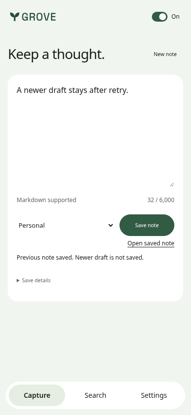 | 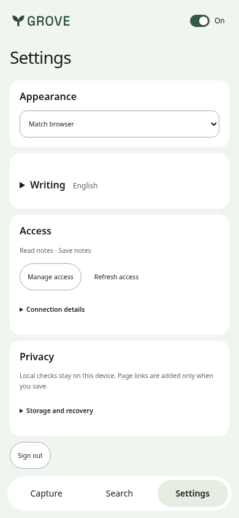 | 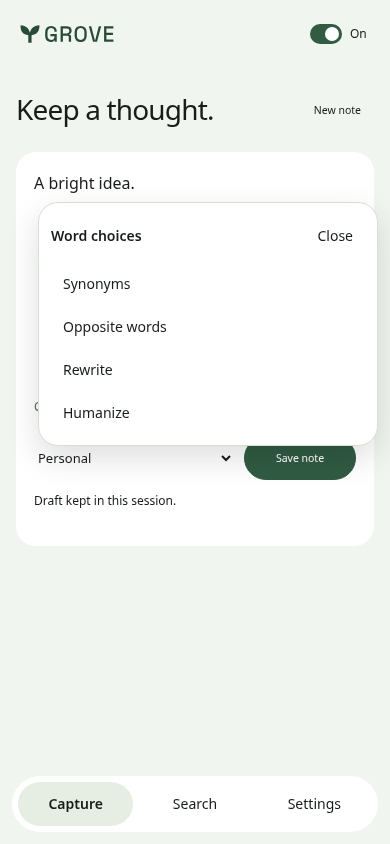 | 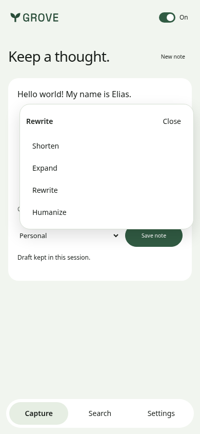 |

| Local correction                                                                             | Alternatives                                                                                                    | Short review                                                                          | Dark review                                                                    |
| -------------------------------------------------------------------------------------------- | --------------------------------------------------------------------------------------------------------------- | ------------------------------------------------------------------------------------- | ------------------------------------------------------------------------------ |
| 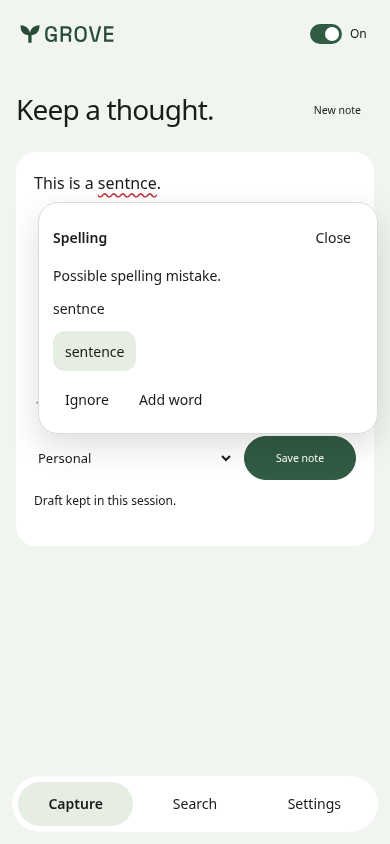 | 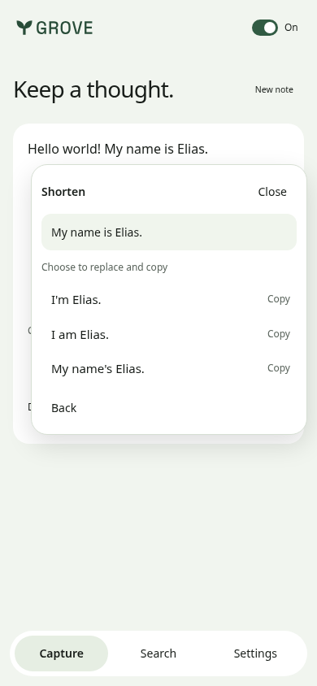 | 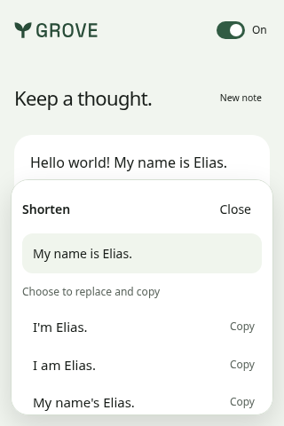 | 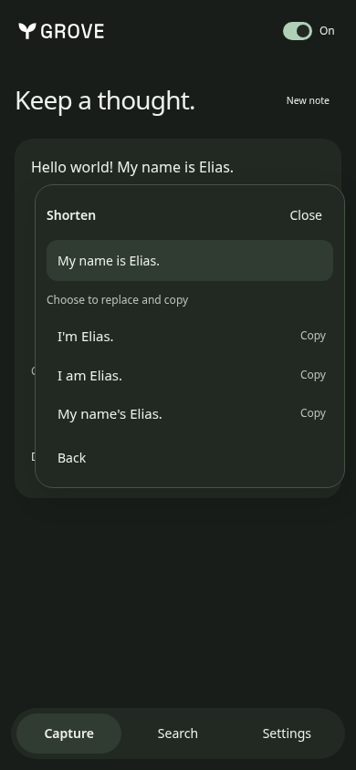 |

[Narrow Capture, 320px](redesign-minimal-capture-320.png) ·
[Wide Capture, 768px](redesign-minimal-capture-768.png).
Standard captures are 390 × 844. The short review is 320 × 480; later actions
remain reachable by scrolling inside the popover. The original selection remains
visible, with no change to editor geometry.

Both installed Chromium manifest profiles pass signed-out default-on checking
without HTTP, browser-wide Off across navigation, parent/subdomain exceptions,
local metadata exclusions, all six explicit tools, consent reuse, native Undo,
copy-only and copy/replace, clipboard failure without losing the edit, pending
focus and newer-edit/expiry guards. Save automatically records active-page
provenance without quoting authored text; uncertain retry retains the exact request.
320/390/768px overflow/axe and short/dark checks pass. Final warm local RPC p95:
4.80/5.80 ms over 30 bounded samples/profile, not cold-start or universal latency.

Direction: **editorial-greeting**, seed `1016700116`, with Grove's existing Space
Grotesk/mark and a sage face. The narrow writing sheet adapts the personal-home
composition rather than inventing a desktop dashboard grid. Capture answers “what
do I want to keep?”, Search “which note do I need?”, Settings “where should writing
help run?”. The source/save receipt and contextual word choices are the product's
own elements. No external imagery or invented production data.

Visual review: hierarchy 8/10, usability 8/10, identity 8/10. Final review repaired
the saved-note link squeezing the notebook name at 320px; a real installed
regression now requires the selected name to fit. Honest short drafts/empty search
remain sparse, and expanded Settings scrolls independently of navigation. Source
taste lint has zero failures; warnings are actual modal/popover shadows and
ShadowRoot identifiers. The generic inspector cannot install this isolated origin;
installed screenshots, geometry/focus assertions and axe substitute for it, not a
claimed inspector pass. Native writing/permission prompts, rich editors and live
semantic quality remain unqualified. Older captures below retain their original
source and behavior; they do not describe the redesigned package.

## Earlier explicit sentence tools — 6 November 2026

Installed unsigned development package, product `1.11.14`, built from the writing
increment after `c489ed36`. Chrome ZIP SHA-256:
`1550dade9413ec30ea8455fb6e995216f07c682c86caee74db0d98279884f344`.
Chromium `156.0.8078.4`, synthetic account/sentences and HTTP/model output fixtures;
these are actual installed UI views, not live-model quality evidence.

| Selection menu                                                                   | Reviewed alternatives                                                                            | Short, narrow review                                                                | Dark review                                                                  |
| -------------------------------------------------------------------------------- | ------------------------------------------------------------------------------------------------ | ----------------------------------------------------------------------------------- | ---------------------------------------------------------------------------- |
| 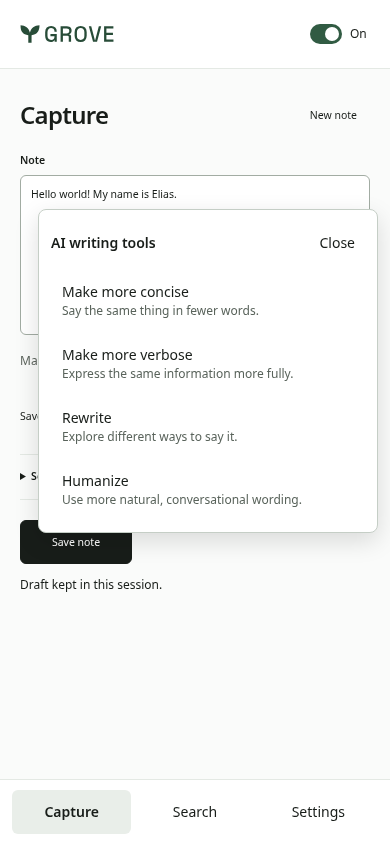 | 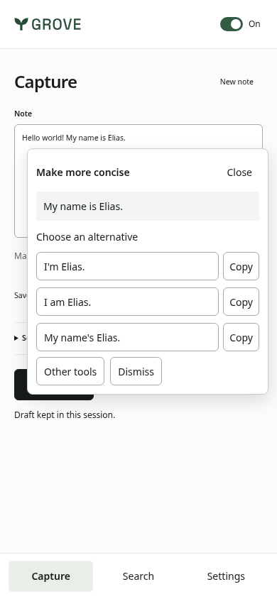 | 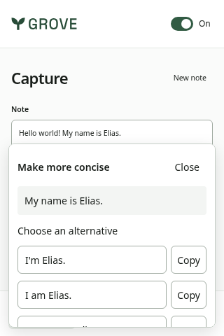 | 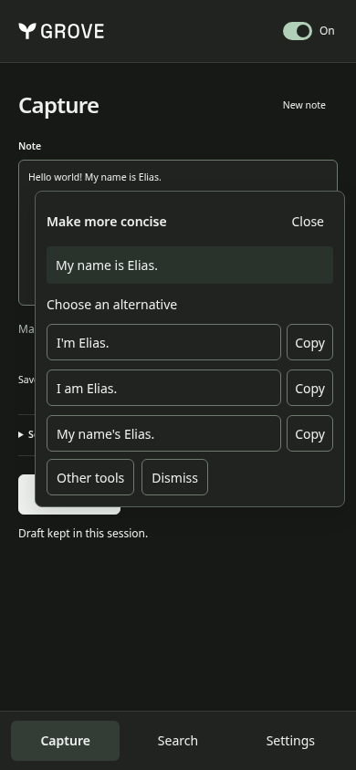 |

Standard views are 390 × 844; the short view is 320 × 480 and scrolls within the
popover to reach later alternatives/actions. The selection remains visible; the
popover does not change editor geometry. Both Chromium manifest profiles pass the
four-tool/native-Undo, first-use consent, cross-editor consent reuse, copy-without-edit,
pending-focus, newer-edit cancellation, expired-output, aged-session renewal and
independent AI-Off journeys. Focused AI review axe checks have zero violations in
light/short and dark states. Final warm bounded local-check RPC p95 was 3.70/5.10 ms
(30 samples/profile), not a cold-start or universal latency guarantee.

The provider fixture deliberately makes no live calls. Semantic equivalence, native
Firefox/branded Chrome/Edge writing, real permission prompts/removal and production
configuration/migration remain unqualified. Rich-text/contenteditable is unsupported.
The [feature guide](../../../browser-extension.md#explicit-ai-writing-tools) owns
authorization, encryption, expiry, configuration and rollout prerequisites.

## Local English writing — development evidence

Installed Chromium `156.0.8078.4`, synthetic account/drafts and HTTP fixtures,
390 × 844 viewport. Chrome-package ZIP SHA-256:
`ba33b0076b6b9be30de7edd37ce2f33d9f2ad0570b794c4d83af96b2e8ee3695`
(product `1.11.14`, writing-assistance development source, not a published release).

| One-click correction                                                                                | Disclosed writing settings                                                                                      |
| --------------------------------------------------------------------------------------------------- | --------------------------------------------------------------------------------------------------------------- |
| 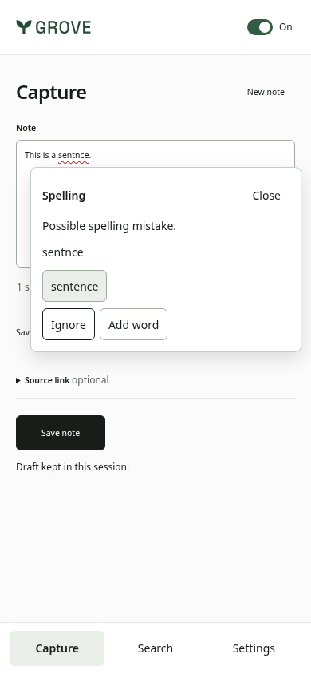 | 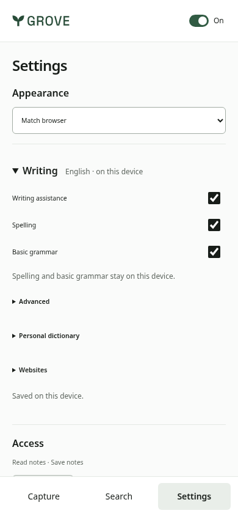 |

The installed journeys cover native correction/Undo, delayed-result rejection,
focus retained when alternatives arrive, bounded long-draft mirrors, metadata-only
exclusions instrumented in the actual isolated extension world, site disable and
stable settings controls. Warm local RPC p95 was 3.70/3.90 ms over 30 bounded
6,000-unit samples in Chrome/Edge manifest profiles; both used Chromium, not actual
branded Edge. This is synthetic warm latency, not cold-start or universal frame-time
acceptance. These local-only captures do not qualify AI rewrites; current synthetic
AI evidence is above. Rich-text editors, native permission prompts, Firefox and
branded-browser writing qualification remain unfinished. Older captures below
show the earlier panel and do not establish writing-assistance acceptance.

## Personal notebook redesign — 6 November 2026

Runtime/build source `6bd2799e`, product `1.11.15`. These are actual installed
unsigned-package screenshots with synthetic notes/auth/HTTP responses, not mockups
or evidence of a new production release. Earlier sections below are historical.

| Notes                                                                               | Global search                                                                          | Formatted reader                                                                                  | Settings                                                                         |
| ----------------------------------------------------------------------------------- | -------------------------------------------------------------------------------------- | ------------------------------------------------------------------------------------------------- | -------------------------------------------------------------------------------- |
| 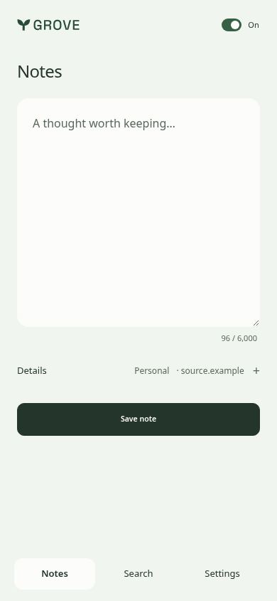 | 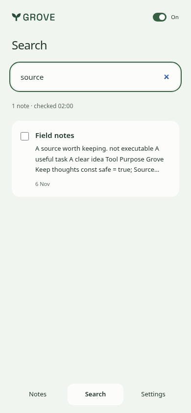 |  | 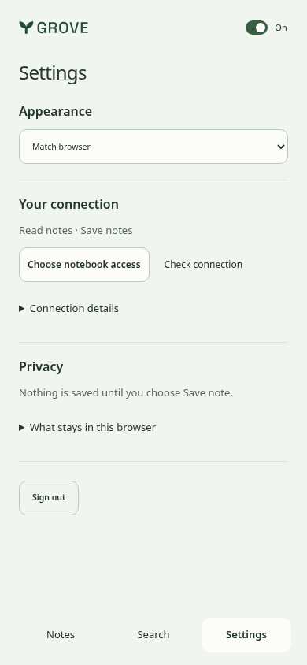 |

[Narrow Settings, 320px](notebook-settings-320.png) ·
[Wide Notes, 768px](notebook-notes-768.png) ·
[Dark Settings](notebook-settings-dark-390.png).

The owner requested a radical, polished but noncorporate redesign. Direction:
**Editorial greeting**, seed `1378124550`, preserving Grove's wordmark, approved
icons and Space Grotesk. The face is a sage garden-like ground around a paper
editor and tonal note rows. The desktop composition is adapted to a native narrow
panel, not a dashboard grid. Notes answers “what do I want to keep?”, Search “where
is that thought?”, and Settings “what can this browser access?”. Source and notebook
fields share one Details disclosure; no redundant source/search mode or submit
control remains. Copy terminology names the action instead of “review context”.

Installed checks cover Chromium `156.0.8078.4` and actual Edge `155.0.4283.62`:
real cross-origin tab navigation, title changes, unavailable-page clearing, a held
metadata/first-keystroke race, reload, explicit source removal and New note. Local
prefill makes no Grove requests. Search verifies one debounced request per word,
all-scope request shape, late-response fencing, clearing, stale recovery and stable
rows/focus. The reader parses GFM through the existing parser stack, renders through
a DOM allowlist, and exercises copy, table/code/checklist output and unsafe content.
There are no script/image/iframe elements or JavaScript links in the rendered fixture.

The final run has zero axe violations or overflow at 280/320/390/768px, with
additional reader, short-panel, pause, cross-panel and dark checks. Firefox `159.0`
passes temporary install, native sidebar, save, automatic search, formatted reading
and bulk-copy review. Web-ext reports zero errors/notices and one tokenizer false
positive: upstream Markdown's `parse(...).document().write(...)` consumes tokens;
it is not DOM `document.write`. The real DOM entity-decoder assignment was removed
by selecting the upstream worker-safe decoder, with a packaged regression against
HTML injection sinks. No warning or accessibility rule was disabled.

Visual review at all three primary widths: consistent shared edges, readable type,
one clear job per view and no ornamental controls. The final fixes give result
titles their own hierarchy, remove raw Markdown syntax from snippets, share status
space with selection actions and allow dismissing actual errors. Hierarchy 8/10,
usability 8/10, identity 8/10; empty search and a blank editor intentionally remain
quiet rather than inventing content. Sample “Field notes” and the malicious HTML/
image examples are synthetic verification material, never customer data.

Source taste lint reports zero failures; its one shadow warning is the actual modal.
The generic URL inspector does not install this isolated extension; the installed
browser measurements and screenshots are used instead. Branded Chrome, visible
native Edge-sidebar presentation, live Clerk, physical-device/IME timing and store
acceptance remain unqualified. Original PDF/Word files are not fetched/extracted;
their already-imported Markdown is readable. Reproduce with the commands below.

## Listing and toolbar icons — 6 November 2026

Runtime/build source `d19d5c75`, product `1.11.14`. All 23 PNG/SVG files come
byte-identically from the Marketing studio's **Listing & toolbar icons** set
(`grove/extensions/icons`); hashes are retained in the extension's
[`source.json`](../../../../packages/browser-extension/assets/icons/source.json).
No general profile icon, recolouring or artwork regeneration is used.

| Listing/fallback mark                                                                                                        | Firefox light toolbar                                                         | Firefox dark toolbar                                                        |
| ---------------------------------------------------------------------------------------------------------------------------- | ----------------------------------------------------------------------------- | --------------------------------------------------------------------------- |
|  |  |  |

Firefox `159.0` temporary installation is tested in a disposable profile with the
real native toolbar pinned. Switching Firefox's built-in light/dark themes selects
the expected packaged `dark-*`/`light-*` icon URLs respectively. These are unscaled
crops of the actual browser toolbar, not marketing mockups. The same run passes
native sidebar, capture, search and reviewed-context smoke with synthetic HTTP/auth.

Chrome/Edge use the supplied backed mark, not Firefox-only `theme_icons` or a
request-process theme observer. Installed Chromium `156.0.8078.4` and actual Edge
`155.0.4283.62` package journeys pass. This does not newly qualify branded Chrome
installation, visible native Edge-sidebar presentation, live Clerk or any store.
Artifact checks verify every imported file's hash, square PNG dimensions, RGBA
transparency, declared listing sizes, Firefox theme pairs and reproducible ZIPs.

For native visual reproduction, install the Firefox ZIP temporarily, pin Grove's
toolbar button, then switch Firefox's own light and dark themes. The panel's
Appearance setting is independent. Existing package/native commands below apply.

## Minimal panel — 6 November 2026

Runtime source `9f8f5ef5` refines #185 after reconciling later #184 at `783aa580`, product `1.11.14`.
These are actual installed-package views in Chromium `156.0.8078.4`, using the
existing synthetic HTTP/auth fixture, not marketing mocks or live accounts.

| Capture                                                                                | Search                                                                        | Contextual page lookup                                                             | Settings                                                                        |
| -------------------------------------------------------------------------------------- | ----------------------------------------------------------------------------- | ---------------------------------------------------------------------------------- | ------------------------------------------------------------------------------- |
|  |  |  |  |

[Wide capture view, 768px](minimal-capture-768.png).
[Dark Settings](minimal-settings-dark-390.png) · [Paused panel](minimal-off-dark-390.png).

Compared with the initial package below: main destinations reduce from four to
three; the note editor precedes notebook selection; technical account/API and save
version details are disclosed on demand. Settings no longer repeats empty recovery
sections or exposes technical IDs by default. Context review appears only after a
selection, including selections from page matches. No feature or consent gate is
removed. The source link remains editable, never fetched or disclosed on tab change.
The final refinement keeps page URLs full-width with the current-page action beside
the label and the disclosure associated with the input. Controls have a consistent
44px minimum height; navigation labels are 14px. Settings uses tighter section
spacing and a quieter Refresh access action, without another toggle or new controls.

Installed-package checks exercise both Chromium manifests at 320/390/768px across
Capture, both Search modes and Settings, with zero axe violations/overflow and at
most one primary action per view. At 390×480, Save remains reachable above the persistent
navigation with source details expanded. Held/failed search preserves inputs and
existing results; unchanged rows retain identity after refresh; selection controls
do not shift results. Exact retry preserves the newer draft, pending recovery stays
visible until confirmed, and sign-out clears another mounted panel. Native Firefox
159.0 also passes temporary-install/sidebar/capture/search/context smoke with
synthetic HTTP/auth. This is not live OAuth or branded Chrome/Edge qualification.

The latest parent's single header switch, shared recall surface/keyed renderer,
native-Origin admission, custom-port Firefox permissions, scoped resets and save
recovery are retained rather than replaced by the older child. Notes and This page
keep independent input/cursor/results state within the one result surface. The
parent's light/dark/system appearance, keyboard focus and cross-panel
preference changes are preserved. Additional paused/dark checks cover 280px as well;
opening a paused panel makes no Grove requests and retains unknown-save receipts.
The reconciled supplemental host run also uses actual Edge `155.0.4283.62`; native
panel API acceptance is not asserted as visible Edge-sidebar qualification.

Visual review retains the existing achromatic-ledger direction (seed 1300687580),
Grove's Space Grotesk and actual wordmark; no new direction or redraw.
Capture answers “what should I keep?”, Search “which note do I need?”, Settings
“what can this connection access?”. Review at all three widths: hierarchy 8/10,
usability 8/10, identity 8/10. The deliberate empty space is an honest short note or
small result set, not fabricated content. The main remaining limits are the
native/live acceptance gates below and owner feedback, not additional decoration.

App-source taste lint reports zero failures; the retained shadow warning is the
real modal overlay. The generic URL inspector cannot install/reach this isolated
extension origin; installed-host screenshots, overflow/focus checks and axe are
used instead, not reported as a passing generic inspector run.

Reproduce with the commands below, directing `EXTENSION_SCREENSHOTS` to a separate
output directory. The additional `*-minimal-<view>-<width>.png` captures cover every
main view at all three widths. Earlier captures below remain historical evidence.

## Local acceptance and presentation — 6 November 2026

Runtime/build source: `44aa5131`, product
version `1.11.14`. Images come from the actual installed unsigned packages,
not a marketing mock or the website. The panel captures use synthetic notes and
HTTP/auth responses. The Firefox native capture uses a labelled local OAuth issuer
and the real Grove API, disposable PostgreSQL and worker. Neither is live Clerk
qualification or a production account/provider grant.

| Capture and safe retry                                                                                            | Search and literal source text                                                                       | Organized Settings                                                                               | Off, dark appearance                                                                     |
| ----------------------------------------------------------------------------------------------------------------- | ---------------------------------------------------------------------------------------------------- | ------------------------------------------------------------------------------------------------ | ---------------------------------------------------------------------------------------- |
|  |  |  |  |

| Dark Settings                                                                       | Native Firefox beside a local source                                                              |
| ----------------------------------------------------------------------------------- | ------------------------------------------------------------------------------------------------- |
|  |  |

## Reproduce

```sh
pnpm build:extension
pnpm --filter website exec playwright install chromium
EXTENSION_SCREENSHOTS=/tmp/opencode/grove-extension-screenshots pnpm test:extension:browser
MOZ_REMOTE_ALLOW_SYSTEM_ACCESS=1 python scripts/testing/browser-extension-firefox.py
pnpm dlx web-ext@10.8.0 lint --source-dir packages/browser-extension/dist/firefox
```

The standard installed-package run uses locked Chromium `156.0.8078.4` for both
Chromium manifests. These captures additionally used actual Edge `155.0.4283.62`
for the Edge package via `EXTENSION_EDGE_BINARY`, from an isolated extracted official
package (SHA-256 `3e53834d9d6e505bc57e6bff44d92cfe8cf0bed9064e88efc5b0d8f1c75f70fa`).
Firefox `159.0` temporarily installs the ZIP in an isolated profile, opens its native
sidebar through a real WebDriver gesture and checks capture/search/context.

## Observations and limits

- Panel screenshots use 390 × 844 CSS-pixel viewports. The header and navigation
  stay outside the independently scrolling content area. The streamlined Settings
  fits appearance, access, privacy and Sign out at 390px without duplicated enable
  controls or empty recovery sections. Tests reach Sign out at 280/320/390/768px
  in a 600px-tall window and check that it is above, not behind, navigation.
  Firefox's native screenshot is a 1100 × 850 browser-window capture with a narrow
  sidebar and local source, not evidence of mobile extension support.
- Installed-package checks cover 280/320/390/768px overflow and axe, literal
  untrusted source display, loss after commit, exact retry without duplicate notes,
  preservation of a newer draft, reviewed version-bound context, page lookup,
  panel reload and sign-out clearing another mounted panel. The saved receipt
  explicitly distinguishes the original note from the newer unsaved draft. Off
  removes browser menus, blocks trusted RPC, retains unknown-save receipts and
  makes no requests on panel reload. Cross-panel theme/enablement changes,
  appearance changes while off, dark Settings, keyboard-toggle focus and safe
  resume are exercised. Source taste lint has zero failures; its sole shadow
  warning is the real dialog overlay.
- Chromium reports the native panel opened. Actual Edge accepts `sidePanel.open`,
  but its visible sidebar/`onOpened` event was not observed in either headless or
  virtual-display execution; that native visual acceptance remains open. Firefox's
  native sidebar is observed open. These do not qualify every toolbar, context-menu,
  shortcut, OS, suspension, token-expiry or restart journey.
- Branded Chrome `157.0.8103.38` did not load the unpacked extension through the
  attempted headless automation path (no installed entry/worker; panel navigation
  was blocked). This is not silently counted as a passing Chrome-host test. The
  Chromium package/native panel checks pass; branded/manual Chrome acceptance is
  still required before a supported three-browser release.
- Native local OAuth now passes in Chromium156, actual Edge155 and Firefox159,
  using HTTPS discovery/DCR/S256, a deliberately short initial token, refresh and
  real Connections approval without delete permission. Real API capture/database
  readback, search/context, connection revocation and sign-out pass in all three;
  Chromium/Edge additionally verify source lookup and a separate durable worker's
  completed export/download. Pause/reload/theme/resume retains the saved draft in
  all three. These supplemental harnesses are under
  `/tmp/opencode/grove-extension-local/`; they contain no live provider credentials
  and do not ship. The browser's self-signed local TLS warning is expected.
- The local Firefox run exposed unsupported explicit-port host permission
  patterns; hostname-only patterns restore actual privileged fetch while CSP and
  OAuth validation retain exact ports. It does not use wildcard CORS or a fetch
  stub. The API's native-origin exception admits verified OAuth only, not sessions
  or API keys; real grant/revocation regression tests pass.
- Live Clerk consent/callback/refresh/revocation and authenticated production fetch
  are still not established by the local issuer or seeded fixtures. Production migration `037`,
  compatible deployment, signing, store IDs and store publication remain unperformed.
- A separate `EXTENSION_PUBLIC_NETWORK=1` installed-package run verified privileged
  read-only API resource metadata and issuer discovery through the exact packaged
  hosts in Chromium and actual Edge. It made no authenticated request, registration,
  grant, write or provider mutation. This removes a public-fetch/CORS uncertainty,
  not the remaining authenticated/live-consent gates.
- No install-to-first-use timing or physical keyboard/IME/device claim is made.

## Visual review

Achromatic ledger, seed `1300687580`, with Grove's bundled Space Grotesk and mark.
The source citation and exact save receipt are the product-specific elements;
editing and disclosure, rather than decoration, lead the screen. The repeated
left/right edges, restrained borders and reserved feedback area keep the narrow
panel legible. Sparse search results remain honest rather than adding fake notes.
Settings groups related controls, keeps technical IDs/retention details behind
disclosure and shows recovery only for pending receipts. The sole on/off switch
stays in the header; repeated connection status, resume buttons and composer panels
are removed. Search and This page retain their distinct consent forms but use one
results/status/pagination/context surface and keyed row renderer. Per-view results
and selection survive switching; unchanged rows are reused through refresh.

App-source taste lint reports zero failures; its one shadow warning is the real
modal overlay, not a resting card. The generic URL inspector cannot install an
extension or reach its isolated extension origin; installed-host screenshots,
overflow measurements and axe are used instead. Final image review: hierarchy 8/10,
usability 8/10, identity 8/10. The question is “what can I keep or find beside this
page?”; the composer and source/receipt remain the signature, not decorative data.
The top issues found and repaired were repeated enablement controls, an overlong
Settings page and duplicate recall/result surfaces. The same achromatic-ledger
direction/seed is retained, with no redraw or external imagery. Remaining work is
native/live acceptance, stronger all-host recovery/IME qualification and owner review,
not a claim of award-level polish.
