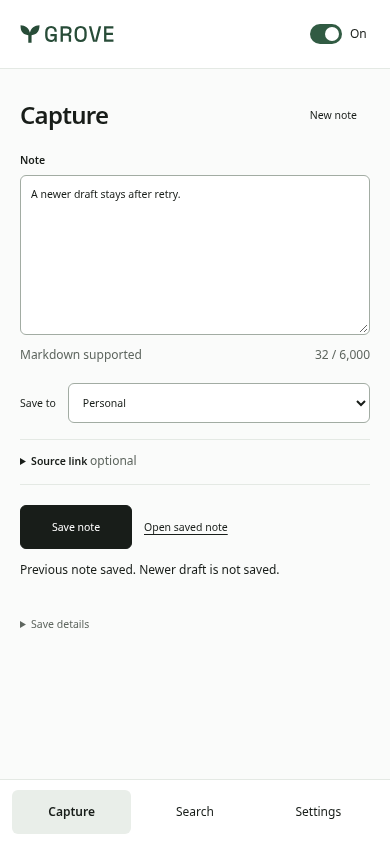
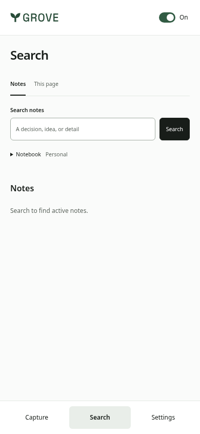
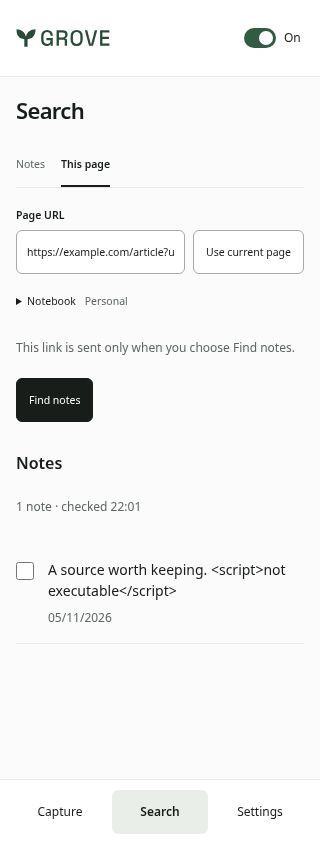
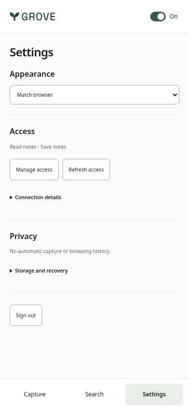
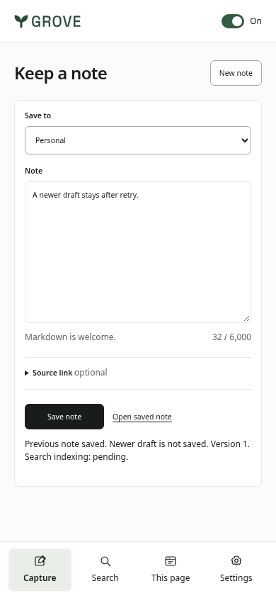
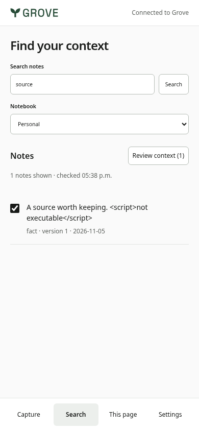
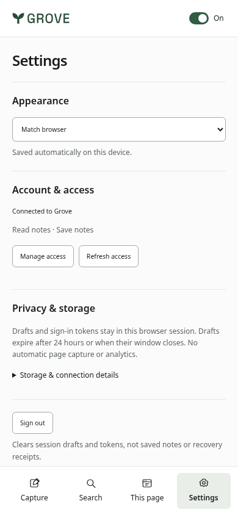
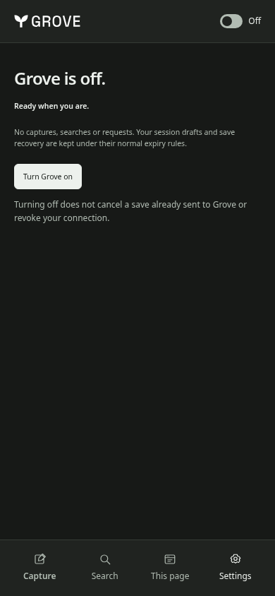
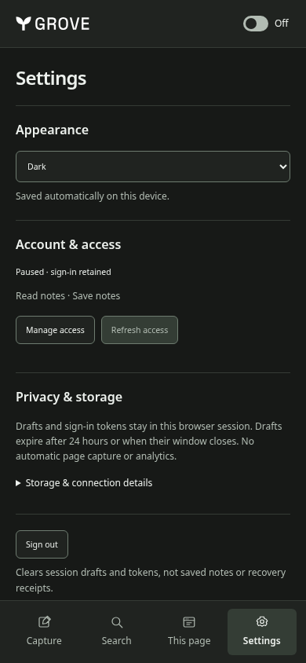
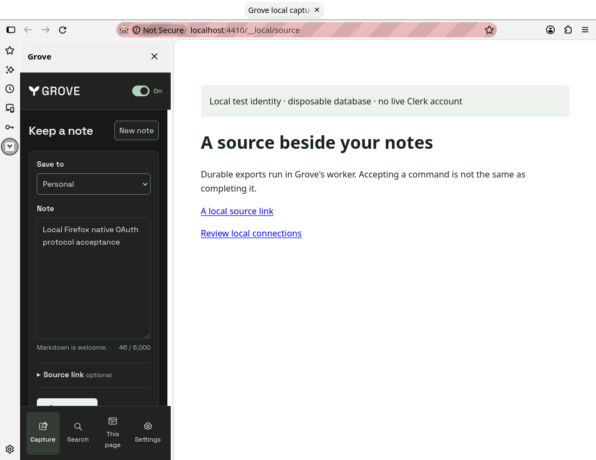

# Browser extension evidence

## Minimal panel — 6 November 2026

Runtime source `0811d788` reconciles #185 with later #184 at `783aa580`, product `1.11.14`.
These are actual installed-package views in Chromium `156.0.8078.4`, using the
existing synthetic HTTP/auth fixture, not marketing mocks or live accounts.

| Capture                                                                                | Search                                                                        | Contextual page lookup                                                             | Settings                                                                        |
| -------------------------------------------------------------------------------------- | ----------------------------------------------------------------------------- | ---------------------------------------------------------------------------------- | ------------------------------------------------------------------------------- |
|  |  |  |  |

[Wide capture view, 768px](minimal-capture-768.png).
[Dark Settings](minimal-settings-dark-390.png) · [Paused panel](minimal-off-dark-390.png).

Compared with the initial package below: main destinations reduce from four to
three; the note editor precedes notebook selection; technical account/API and save
version details are disclosed on demand. Settings no longer repeats empty recovery
sections or exposes technical IDs by default. Context review appears only after a
selection, including selections from page matches. No feature or consent gate is
removed. The source link remains editable, never fetched or disclosed on tab change.

Installed-package checks exercise both Chromium manifests at 320/390/768px across
Capture, both Search modes and Settings, with zero axe violations/overflow and at
most one primary action per view. At 390×480, Save remains reachable above the persistent
navigation with source details expanded. Held/failed search preserves inputs and
existing results; unchanged rows retain identity after refresh; selection controls
do not shift results. Exact retry preserves the newer draft, pending recovery stays
visible until confirmed, and sign-out clears another mounted panel. Native Firefox
159.0 also passes temporary-install/sidebar/capture/search/context smoke with
synthetic HTTP/auth. This is not live OAuth or branded Chrome/Edge qualification.

The latest parent's single header switch, shared recall surface/keyed renderer,
native-Origin admission, custom-port Firefox permissions, scoped resets and save
recovery are retained rather than replaced by the older child. Notes and This page
keep independent input/cursor/results state within the one result surface. The
parent's light/dark/system appearance, keyboard focus and cross-panel
preference changes are preserved. Additional paused/dark checks cover 280px as well;
opening a paused panel makes no Grove requests and retains unknown-save receipts.
The reconciled supplemental host run also uses actual Edge `155.0.4283.62`; native
panel API acceptance is not asserted as visible Edge-sidebar qualification.

Visual review retains the existing achromatic-ledger direction (seed 1300687580),
Grove's Space Grotesk and actual wordmark; no new direction or redraw.
Capture answers “what should I keep?”, Search “which note do I need?”, Settings
“what can this connection access?”. Review at all three widths: hierarchy 8/10,
usability 8/10, identity 8/10. The deliberate empty space is an honest short note or
small result set, not fabricated content. The main remaining limits are the
native/live acceptance gates below and owner feedback, not additional decoration.

App-source taste lint reports zero failures; the retained shadow warning is the
real modal overlay. The generic URL inspector cannot install/reach this isolated
extension origin; installed-host screenshots, overflow/focus checks and axe are
used instead, not reported as a passing generic inspector run.

Reproduce with the commands below, directing `EXTENSION_SCREENSHOTS` to a separate
output directory. The additional `*-minimal-<view>-<width>.png` captures cover every
main view at all three widths. Earlier captures below remain historical evidence.

## Local acceptance and presentation — 6 November 2026

Runtime/build source: `44aa5131`, product
version `1.11.14`. Images come from the actual installed unsigned packages,
not a marketing mock or the website. The panel captures use synthetic notes and
HTTP/auth responses. The Firefox native capture uses a labelled local OAuth issuer
and the real Grove API, disposable PostgreSQL and worker. Neither is live Clerk
qualification or a production account/provider grant.

| Capture and safe retry                                                                                            | Search and literal source text                                                                       | Organized Settings                                                                               | Off, dark appearance                                                                     |
| ----------------------------------------------------------------------------------------------------------------- | ---------------------------------------------------------------------------------------------------- | ------------------------------------------------------------------------------------------------ | ---------------------------------------------------------------------------------------- |
|  |  |  |  |

| Dark Settings                                                                       | Native Firefox beside a local source                                                              |
| ----------------------------------------------------------------------------------- | ------------------------------------------------------------------------------------------------- |
|  |  |

## Reproduce

```sh
pnpm build:extension
pnpm --filter website exec playwright install chromium
EXTENSION_SCREENSHOTS=/tmp/opencode/grove-extension-screenshots pnpm test:extension:browser
MOZ_REMOTE_ALLOW_SYSTEM_ACCESS=1 python scripts/testing/browser-extension-firefox.py
pnpm dlx web-ext@10.8.0 lint --source-dir packages/browser-extension/dist/firefox
```

The standard installed-package run uses locked Chromium `156.0.8078.4` for both
Chromium manifests. These captures additionally used actual Edge `155.0.4283.62`
for the Edge package via `EXTENSION_EDGE_BINARY`, from an isolated extracted official
package (SHA-256 `3e53834d9d6e505bc57e6bff44d92cfe8cf0bed9064e88efc5b0d8f1c75f70fa`).
Firefox `159.0` temporarily installs the ZIP in an isolated profile, opens its native
sidebar through a real WebDriver gesture and checks capture/search/context.

## Observations and limits

- Panel screenshots use 390 × 844 CSS-pixel viewports. The header and navigation
  stay outside the independently scrolling content area. The streamlined Settings
  fits appearance, access, privacy and Sign out at 390px without duplicated enable
  controls or empty recovery sections. Tests reach Sign out at 280/320/390/768px
  in a 600px-tall window and check that it is above, not behind, navigation.
  Firefox's native screenshot is a 1100 × 850 browser-window capture with a narrow
  sidebar and local source, not evidence of mobile extension support.
- Installed-package checks cover 280/320/390/768px overflow and axe, literal
  untrusted source display, loss after commit, exact retry without duplicate notes,
  preservation of a newer draft, reviewed version-bound context, page lookup,
  panel reload and sign-out clearing another mounted panel. The saved receipt
  explicitly distinguishes the original note from the newer unsaved draft. Off
  removes browser menus, blocks trusted RPC, retains unknown-save receipts and
  makes no requests on panel reload. Cross-panel theme/enablement changes,
  appearance changes while off, dark Settings, keyboard-toggle focus and safe
  resume are exercised. Source taste lint has zero failures; its sole shadow
  warning is the real dialog overlay.
- Chromium reports the native panel opened. Actual Edge accepts `sidePanel.open`,
  but its visible sidebar/`onOpened` event was not observed in either headless or
  virtual-display execution; that native visual acceptance remains open. Firefox's
  native sidebar is observed open. These do not qualify every toolbar, context-menu,
  shortcut, OS, suspension, token-expiry or restart journey.
- Branded Chrome `157.0.8103.38` did not load the unpacked extension through the
  attempted headless automation path (no installed entry/worker; panel navigation
  was blocked). This is not silently counted as a passing Chrome-host test. The
  Chromium package/native panel checks pass; branded/manual Chrome acceptance is
  still required before a supported three-browser release.
- Native local OAuth now passes in Chromium156, actual Edge155 and Firefox159,
  using HTTPS discovery/DCR/S256, a deliberately short initial token, refresh and
  real Connections approval without delete permission. Real API capture/database
  readback, search/context, connection revocation and sign-out pass in all three;
  Chromium/Edge additionally verify source lookup and a separate durable worker's
  completed export/download. Pause/reload/theme/resume retains the saved draft in
  all three. These supplemental harnesses are under
  `/tmp/opencode/grove-extension-local/`; they contain no live provider credentials
  and do not ship. The browser's self-signed local TLS warning is expected.
- The local Firefox run exposed unsupported explicit-port host permission
  patterns; hostname-only patterns restore actual privileged fetch while CSP and
  OAuth validation retain exact ports. It does not use wildcard CORS or a fetch
  stub. The API's native-origin exception admits verified OAuth only, not sessions
  or API keys; real grant/revocation regression tests pass.
- Live Clerk consent/callback/refresh/revocation and authenticated production fetch
  are still not established by the local issuer or seeded fixtures. Production migration `037`,
  compatible deployment, signing, store IDs and store publication remain unperformed.
- A separate `EXTENSION_PUBLIC_NETWORK=1` installed-package run verified privileged
  read-only API resource metadata and issuer discovery through the exact packaged
  hosts in Chromium and actual Edge. It made no authenticated request, registration,
  grant, write or provider mutation. This removes a public-fetch/CORS uncertainty,
  not the remaining authenticated/live-consent gates.
- No install-to-first-use timing or physical keyboard/IME/device claim is made.

## Visual review

Achromatic ledger, seed `1300687580`, with Grove's bundled Space Grotesk and mark.
The source citation and exact save receipt are the product-specific elements;
editing and disclosure, rather than decoration, lead the screen. The repeated
left/right edges, restrained borders and reserved feedback area keep the narrow
panel legible. Sparse search results remain honest rather than adding fake notes.
Settings groups related controls, keeps technical IDs/retention details behind
disclosure and shows recovery only for pending receipts. The sole on/off switch
stays in the header; repeated connection status, resume buttons and composer panels
are removed. Search and This page retain their distinct consent forms but use one
results/status/pagination/context surface and keyed row renderer. Per-view results
and selection survive switching; unchanged rows are reused through refresh.

App-source taste lint reports zero failures; its one shadow warning is the real
modal overlay, not a resting card. The generic URL inspector cannot install an
extension or reach its isolated extension origin; installed-host screenshots,
overflow measurements and axe are used instead. Final image review: hierarchy 8/10,
usability 8/10, identity 8/10. The question is “what can I keep or find beside this
page?”; the composer and source/receipt remain the signature, not decorative data.
The top issues found and repaired were repeated enablement controls, an overlong
Settings page and duplicate recall/result surfaces. The same achromatic-ledger
direction/seed is retained, with no redraw or external imagery. Remaining work is
native/live acceptance, stronger all-host recovery/IME qualification and owner review,
not a claim of award-level polish.
