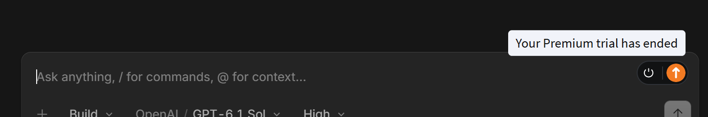
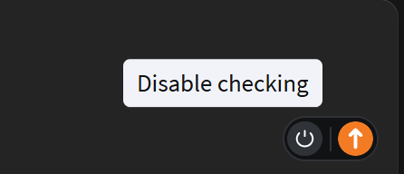

# Writing controls: supplied references

These two user-supplied crops illustrate the requested field affordance. They are
not Grove screenshots, an implemented redesign or verified evidence of an installed
LanguageTool version. See the [planning proposal](../../../extension-writing-coverage.md).

| Right-edge control group                                                                              | Clear disable tooltip                                                                        |
| ----------------------------------------------------------------------------------------------------- | -------------------------------------------------------------------------------------------- |
|  |  |

Use the placement, separate quick toggle and clear state as interaction references.
Do not reproduce the trial-ended notice: Grove's local spelling/grammar checks stay
available signed out and offline. No new after-screenshot is claimed by this
documentation-only proposal.
