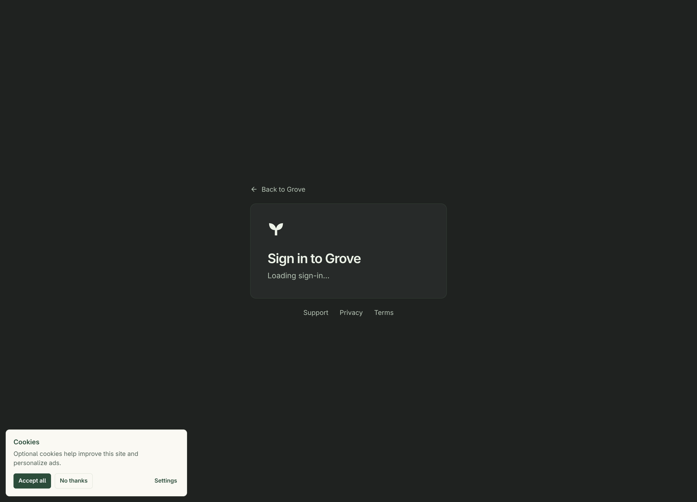
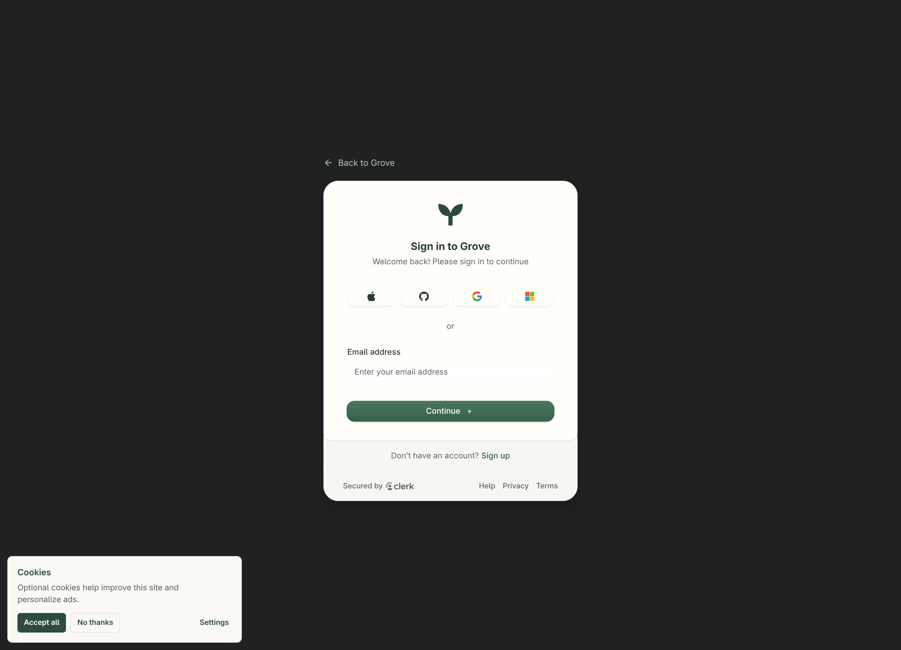

# Clerk build-time key verification

Live Chrome remote-debugging captures, 19 November 2026, 2582 × 1862 image pixels.
Both show the public sign-in route without submitted credentials or optional
cookie consent. No account data is included.

| Stale prebuilt output                                       | Fresh production build                                       |
| ----------------------------------------------------------- | ------------------------------------------------------------ |
|  |  |

Before: the document embedded the old `clerk.usegrove.cloud` public-key host,
Clerk script requests failed CORS, and the form remained at “Loading sign-in…”.

After: the document and loaded resources use `clerk.grovenote.app`; Clerk reports
loaded and displays the email field and four provider choices. The original
CORS error is absent. The sign-up form was independently checked in Chrome and
also initialized without console errors; no extra capture was needed.

This was a configuration-only rebuild of admitted website version **1.11.25**:
production source `505cf22c56d39d5087e7b680e17ecbdc1d3bf9b5`, release source
`1a03079f088612c7d0333ff169197d58508c3a86`. Deployment
`dpl_HGBvTqxYkpLxnPMQdJjCpV6ziEML` preserves that release identity. No newer source,
API/worker image, database schema, provider registration or user account was changed.

These captures prove public form initialization, not successful account login,
provider callback completion, verification-email delivery or authenticated API/MCP
access. See [sign-in verification](../../../social-sign-in.md#verify-the-deployed-public-key)
for the deployment checks and acceptance boundary.
