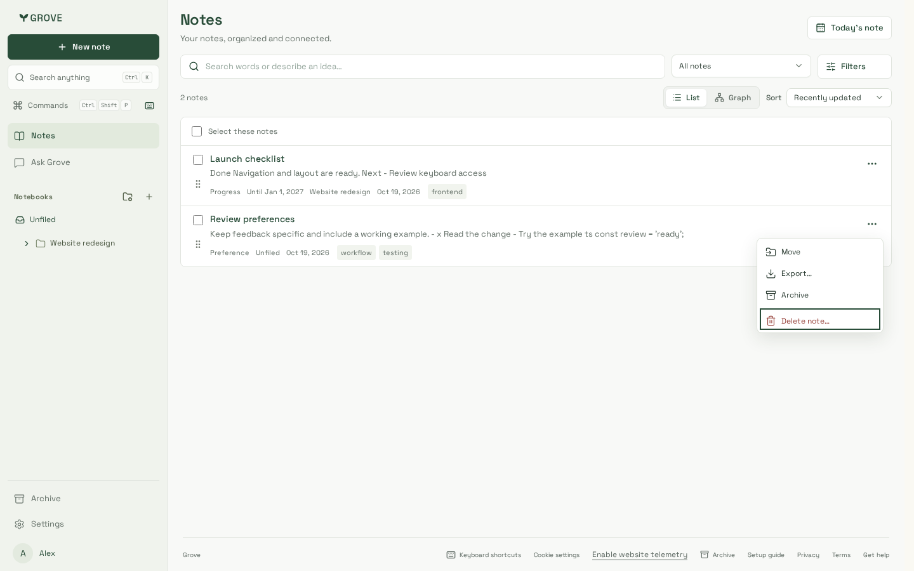
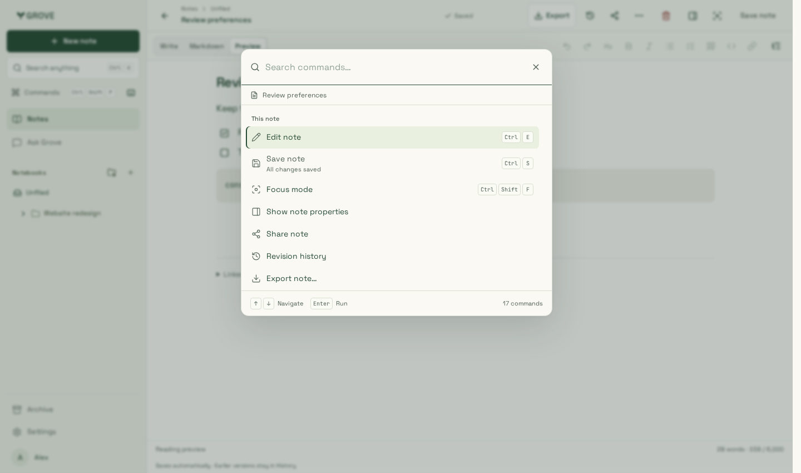

# Command palette, search and note tools

Reviewed 22 October 2026 with synthetic notes, actual workspace components and
production-built CSS. The shared surface is at most 560 × 480px, with fixed search
and footer positions and independently scrolling results.

- `desktop.png`: contextual note title, prioritized editing actions, quiet icon
  rows, platform keycaps and the explanation for an unavailable Save action.
- `mobile-390.png` / `mobile-320.png`: compact placement, reachable close control,
  16px search input, 44px touch targets and touch-specific guidance.
- `empty-320.png`: useful search suggestions without moving the input or dialog.
- `landscape.png`: results and dismissal remain reachable at 844 × 260px.
- `large-text.png`: enlarged labels wrap, long context truncates, and the footer
  reflows within the shared surface.
- `search-mobile.png`: the same shell with notebook scope and real note links,
  after a failed search and keyboard retry.
- `reader-desktop.png` / `reader-mobile.png`: the persistent Write / Markdown /
  Preview row and task actions, with mobile formatting in the shared action menu.
- `writing-desktop.png` / `writing-320.png`: one editor instance and fixed document
  viewport; a scrolled narrow note keeps its mode, outline and save controls reachable.
- `properties-320.png`: shared inspector overlay with native modal focus, independently
  scrolling fields and no change to the reader's bounds or scroll position.
- `checklist-desktop.png` / `checklist-mobile.png`: nested, repeated, quoted and
  ordered tasks after saved toggles. Fenced and escaped examples stay plain text.
- `sidebar-desktop.png` / `sidebar-mobile.png` / `sidebar-320.png`: readable notebook
  labels, inset keyboard focus, compact actions and all four phone destinations.
- `sidebar-scroll-320.png`: sticky notebook controls above a long, scrolling tree.
- `sidebar-large-text.png`: enlarged labels wrap into readable navigation rows.
- `row-menu-desktop.png` / `row-menu-mobile.png` / `row-menu-320.png`: shared dropdown
  actions overlay the list, with bounded placement and unclipped keyboard focus.

Commands keep input focus while arrows move a stable command identity; Home/End
retain native text editing. Queries rank labels before aliases such as “create”
and “journal.” Availability changes and first-save routing keep the menu usable.
Delete stays in a separate management group and still opens its confirmation.

The browser checks cover 1440, 768, 390 and 320px, short viewports, 2× Chromium
pinch zoom, enlarged text, reduced motion, disabled-click focus, nested dialog
scope and Axe. Editor checks compare document/action/footer rectangles across all
three modes and inspector opening, and retain reading position after focus/expand
return. Task changes use the existing save/version and undo path; held saves, failed
saves, retry, conflicts, reload, CRLF source offsets and read-only revision views are
exercised. The iPhone/WebKit checks run in the pinned Playwright container.
Software-keyboard geometry is exercised through viewport resizing; physical
iOS/Android keyboards were not part of this verification.

Before-state screenshots remain in [note workspace](../note-workspace/).

## Verification

Application source `a4a6ae6a5e9d3a64e510c6f0ee21bf6a69de57cf` includes merged
settings/AI-preferences #75; the final test harness is `8e9248f`. Production build
`wZpMFgUKls4GEMiY0tvkb` uses Node 24.21.0, pnpm 10.33.0 and Playwright 1.64.1.
All **193 Chromium** and **39 focused iPhone/WebKit** cases pass, along with
root/website lint, types, builds and five artifact checks. Notes entry is
**481,536 gzip bytes**, within budget with the editor deferred. Desktop captures
use Chromium; mobile captures use the pinned Noble WebKit container.
