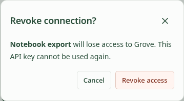
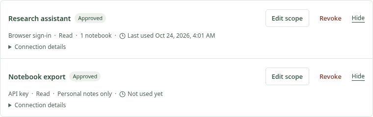
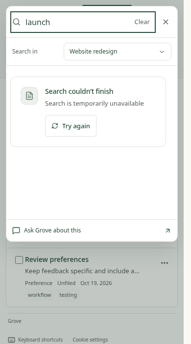
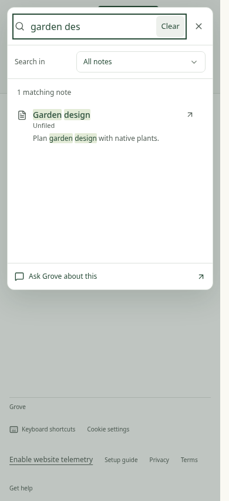

# Connections, search and import

The examples in this gallery use synthetic workspace data. See the [workspace guide](../../../workspace.md) for the corresponding actions.

### Connections

The confirmation opens with **Cancel** focused. Captured with a synthetic API key in the local Chromium fixture at 390 × 844, cropped to the dialog.

- [Desktop setup](setup.png) — Settings at 1440 × 900, with direct actions for the extension, agents and API keys.
- [Last use](last-use.png) — compact connection rows from the same viewport: status, access, scope and last use on one line, with a key that has not been used yet. None of it requires opening Connection details.
- [Phone setup](setup-mobile.png) — setup actions at a 390 × 844 touch viewport, cropped to the action list. Both dialogs opened and closed by touch.

Captured in Playwright Chromium from the local dashboard fixture and compiled website CSS, using the Connections changes based on `49022855`. Store installation, live providers and physical devices were not exercised.

### Search

- [Recent notes](search-recent.png) and [loading](search-loading.png) — the desktop palette stays anchored and shows a one-line status with **Cancel search** while looking up a phrase (1440 × 800).
- [Cancelled](search-cancelled.png) and [empty](search-empty.png) — cancelling keeps the phrase and scope; resuming can return no matches (390 × 800, empty state cropped to the dialog).
- [Retry](search-error.png) — an unavailable search keeps the selected notebook and offers a keyboard-operable retry (390 × 700).
- [Matching passage](search-results.png), [Ask results](search-ask.png) and [library results](search-library.png) — the matching note is reachable by keyboard in each view (390 × 850, 390 × 900 and 1280 × 720 respectively).

Captured from the synthetic Playwright Chromium dashboard fixture on `49022855` plus the search changes, with compiled website CSS from build `fjiHs0Lc4h5cm4Kx44M0v`. The fixtures exercise browser requests and UI recovery, not live ranking or provider latency. See [note search](../../../search.md).

## Preview gallery

| Setup | Last use | Import destination | Notebook search |
| --- | --- | --- | --- |
|  |  |  |  |

| Searching | Cancelled | Retry | Results |
| --- | --- | --- | --- |
|  |  |  |  |
