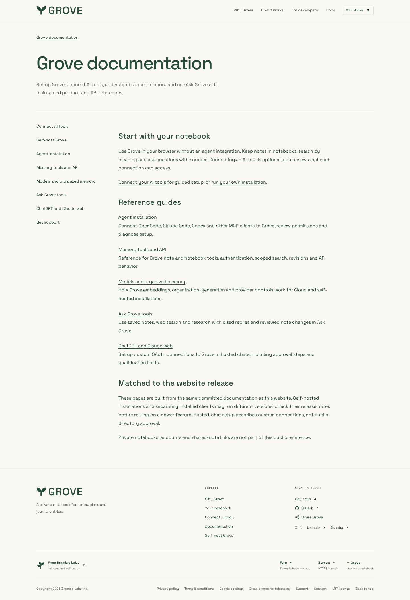
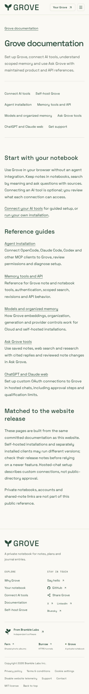
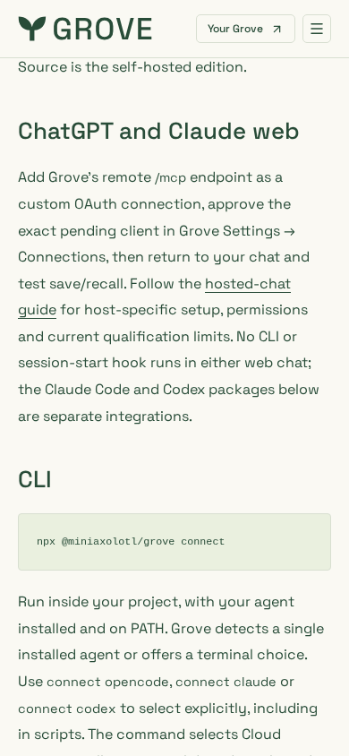

# Maintained Grove references

Actual local production build of this PR, Chromium, 1× scale, JavaScript disabled
and reduced motion. The existing light theme and typography are retained. The hub
images are full-page at 1440×1000 and 390×844; the client image is a mobile viewport
scrolled to the CLI heading. No account, connection or real notebook data is used.

| Hub, 1440px                                   | Hub, 390px                                  | Client reference, 390px                       |
| --------------------------------------------- | ------------------------------------------- | --------------------------------------------- |
|  |  |  |

Reviewed navigation, readable text, code and overflow. Separate axe 4.14.0 audits
passed WCAG A/AA on all six docs routes at 390px. Browser regressions also check
320/390/768/1440px and no-JavaScript content. The audit used an explicit browser
context; axe rejected an initial single-page convenience context, which is not
counted as a completed audit.

These are source-build screenshots, not deployed website, native-device or hosted
chat acceptance. Existing brand/font licensing remains in the design kit.
