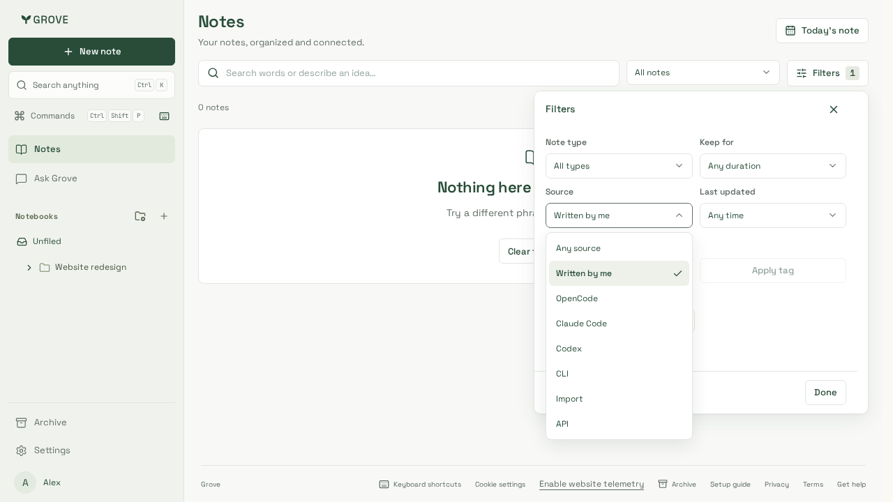
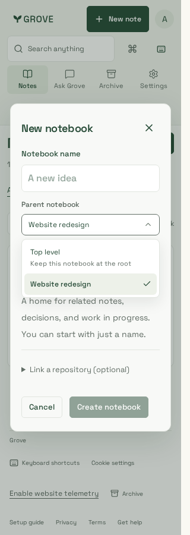
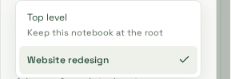

# Dropdown contrast baseline repair

Source: development `22e76b4` plus the isolated `controls.css` repair that removes
the `select-in` opacity animation. Captured from the telemetry-enabled production
build with Node 24.21.0, pnpm 10.33.0 and Playwright 1.64.1 Chromium. Fixtures are
synthetic notebooks; no customer/provider data is used.

- `desktop.png`: keyboard-selected source dropdown in the library filters at 1280 × 720.
- `mobile.png`: parent-notebook dropdown in the New notebook dialog at 320 × 900.
- `detail.png`: unaltered 289 × 100 crop of that mobile capture, highlighting the
  description/selected state; not a separate test scenario.

| Desktop filters                         | Mobile dialog                                  | Contrast detail                        |
| --------------------------------------- | ---------------------------------------------- | -------------------------------------- |
|  |  |  |

The PR description previews these three images in one row; full-resolution
captures and their source/verification context remain here.

The existing `shared dropdowns support keyboard selection, typeahead, modal
dismissal and narrow touch layouts` test runs WCAG A/AA checks on both surfaces.
Before repair the full suite reported 202 passes and one failure (including its
retry): description text reached only 4.45:1 during the opening fade, below 4.5:1.
Diagnostic computed styles confirmed the popup's animated opacity, while the
settled foreground was already `#626e66`. The temporary diagnostic was removed;
the existing tests and thresholds are unchanged.

The repair keeps the dropdown opaque from its first rendered frame, preserving
layout, keyboard/touch behavior and the existing description colour. Eight focused
repetitions and the full 203-case Chromium suite pass without retries. Both
captures were visually reviewed. It deliberately leaves independent PR #82's
colour/UI changes untouched. No pipeline, backend, schema or provider behavior
changes. These browser captures are not physical-device acceptance.
