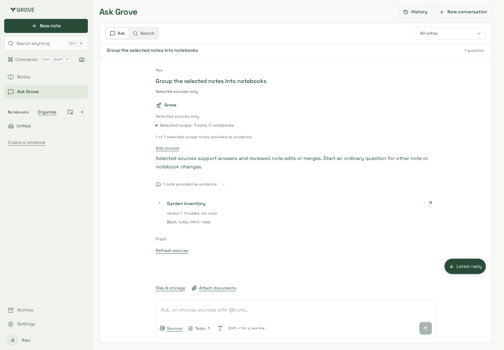
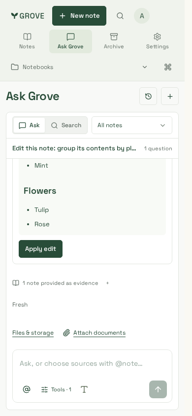

# Explicit context selection — reviewed captures

## Selected-source action recovery — 4 November 2026

API/application source **`6a1acaa`**, with unchanged website source and production
CSS build **`PZ-YR2JVYHrJmPV5U3shn`** (Node 24.21.0 / pnpm 10.33.0). The isolated
dashboard uses the actual API, MemoryService and non-owner PostgreSQL role. The
labelled deterministic generation adapter returns a batch intent for notebook
organization and an edit intent for content changes; it fails if unsupported
actions dispatch answer inference. No production account or paid model is used.

| Unsupported notebook action, 1440×1000                                                                        | Reviewed content edit, 390×844                                                             |
| ------------------------------------------------------------------------------------------------------------- | ------------------------------------------------------------------------------------------ |
|  |  |

Both states pass main-region WCAG A/AA checks, page-error and horizontal-overflow
checks. The source remains at version 1; no edit was applied for these captures.
The notebook request uses planning only, while the supported edit uses planning
and answering. Backend regressions separately verify Apply/Undo, unchanged replay,
strict/mixed selected-source modes and all unsupported batch/lifecycle intents.
These are Chromium synthetic fixtures, not production or physical-device acceptance.

## Earlier source-selection captures

Application source: search-quality integration of **`d8d78df`** with **`dbe27d0`**,
retaining subscription visibility, note-writing guidance and explicit context.
Production website build: **`J4mEDYRWCDRlQZxNEuBUm`**, Node 24.21.0 / pnpm 10.33.0.
The build uses the combined files before the merge commit. All seven captures and
both-engine journeys were refreshed after integration; source citation status and
search title/passage evidence are both preserved. Context migration is now 030,
after merged search 029; old disposable migration history was not rewritten.

Real Ask components use production CSS through the isolated dashboard fixture,
backed by actual API/MemoryService/non-owner PostgreSQL and a labelled deterministic
generation adapter. All accounts/content are synthetic. Screenshots are Chromium
captures at 1440×1000, 390×844 and 320×844. Supported WebKit assertions exercise the
same journeys at all three sizes, not physical-device qualification.

| Capture                                               | Review                                                                        |
| ----------------------------------------------------- | ----------------------------------------------------------------------------- |
| [Chooser](chooser-desktop.png)                        | Duplicate titles distinguished by path, excerpt and preview button            |
| [Read-only preview](preview-desktop.png)              | Scrollable inspector, no mutation controls; chooser state/focus retained      |
| [390px selection](selected-390.png)                   | Chips, strict control, deliberate automatic-mode escape and reachable Send    |
| [320px selection](selected-320.png)                   | Compact source icon, wrapping controls and accessible navigation              |
| [Partial notebook answer](partial-answer-desktop.png) | Visible strict scope and 12-of-17 evidence coverage, not an exhaustive review |
| [Source recovery](source-recovery-desktop.png)        | Rejected question/choices kept separately; Edit sources does not resend       |
| [Insufficient evidence](insufficient-390.png)         | Empty notebook stays empty; Add sources retains question/selection            |

## Verification

Both engines pass source search/duplicate titles, nested preview/focus, strict mode,
selected/provided/cited distinctions, large-notebook coverage, last-chip send guard,
mention completion/cancellation, new-ID recovery and selected-note Apply/Undo at
all three sizes. WCAG2A/AA/2.1AA, horizontal bounds and zero page-error checks pass.
Each engine additionally verifies 390px unsent selection retention across Notes/Ask,
accepted-but-lost HTTP replies replaying exact body/context/ID, newer-draft safety,
empty-evidence guidance and Add sources without automatic sending/broadening.

Integrated regressions pass **244 Chromium** and **18 focused WebKit** cases: seven
Ask tools/history, three reading/composer/sidebar and eight search scenarios. Distinct result
directories prevent a previously observed trace-file ENOENT collision. An occupied
fixture port and fixed OAuth callback were retried with free/separate resources.
No assertions were weakened. The initial narrow-footer and enlarged New note
overflow were reproduced before compact-footer/wrapping-label corrections. Visual
review removed duplicate preview headings and restored inspector padding.

Use the documented disposable DB, production website build and existing
`tests/fixtures/dashboard-server.mjs` with isolated `DASHBOARD_TEST_PORT` and
`DASHBOARD_API_FIXTURE_PORT` pointing at a loopback-only synthetic API. This optional
proxy exists only in the fixture, never production routes. Run existing Chromium
and `playwright.ask-webkit.config.ts` with distinct `--output` directories/free ports.
New component journeys were also driven by a task-local Playwright verifier.

Physical keyboards/OS selection and paid-model answer accuracy remain unqualified.
See [contract](../../../explicit-context.md) and
[evaluation limits](../../../development/explicit-context-results.md).
