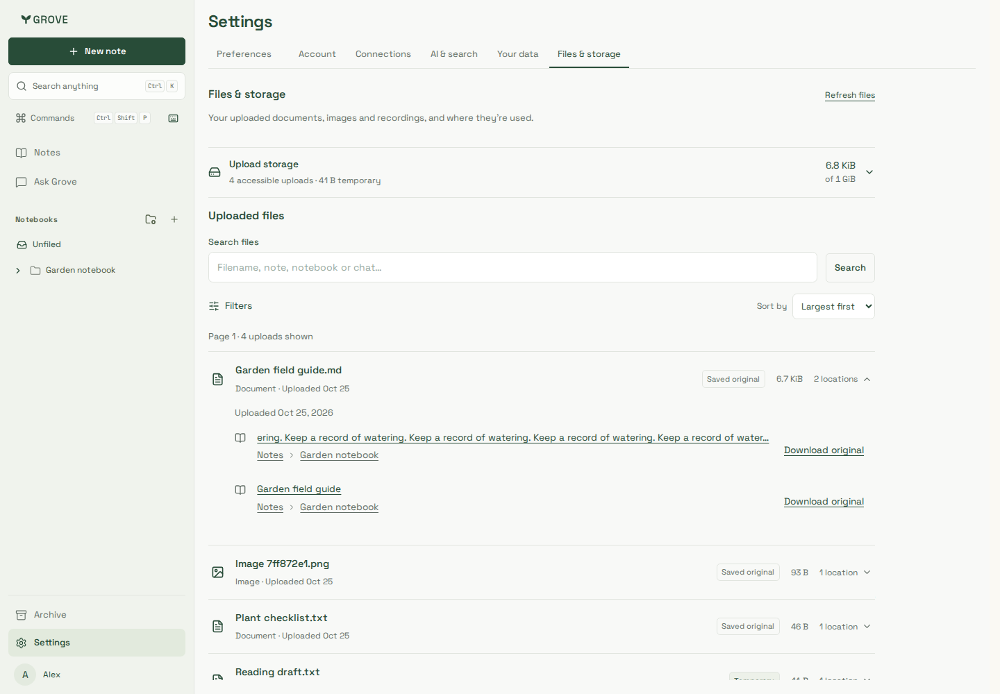
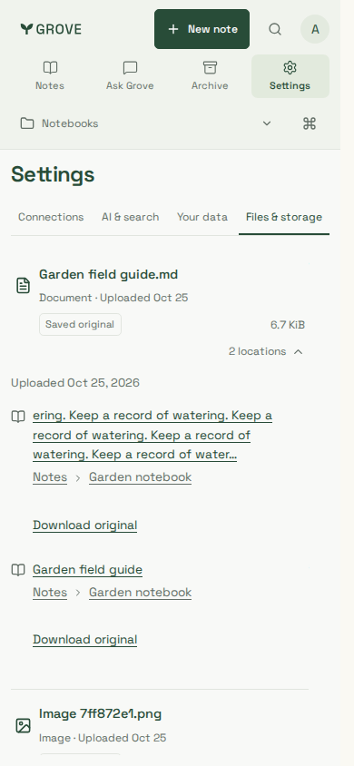
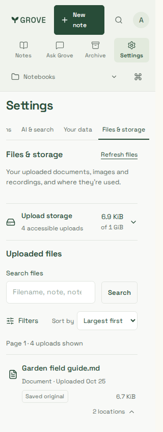

# Files experience refinement

Refined file ledger: compact expandable storage, global sorting, location-aware
search, filter disclosure/active chips and notebook paths. Current desktop and
mobile captures use synthetic identities/documents only, real API/PostgreSQL,
extraction workers/private original store and production CSS.

`scripts/testing/files-browser.mjs` checks newest/name/size controls, notebook/name
search, temporary/image/context filters, exact original bytes, keyboard expansion,
unclipped notebook-root links, source removal, WCAG A/AA, overflow and page errors.
Both Chromium and supported-container WebKit use1440/390/320px. Storage counts evolve
between viewports as originals are removed/replaced; no retained bytes are refunded.
The390 capture uses normal scrolling to the expanded locations;320 starts at the top.

| Desktop ledger                         | Notebook locations                   | Compact mobile start                   |
| -------------------------------------- | ------------------------------------ | -------------------------------------- |
|  |  |  |
