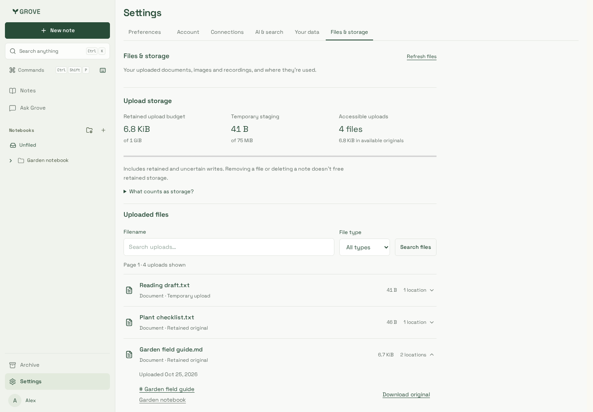
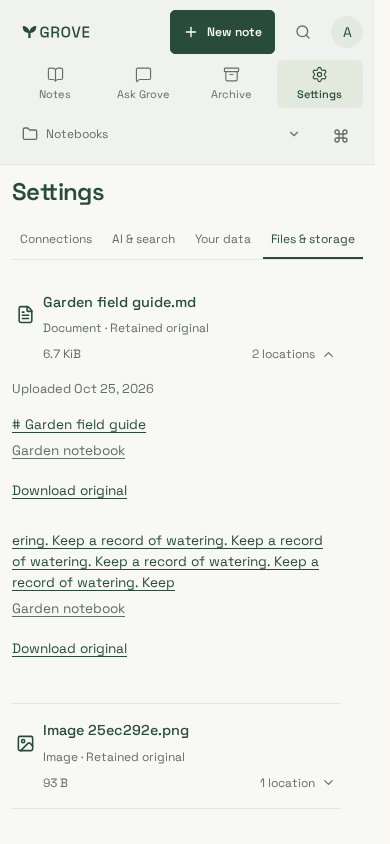
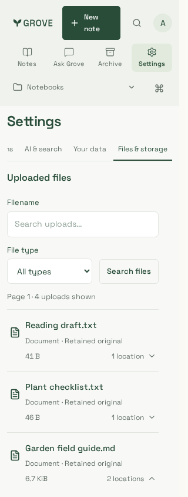

# Files & storage

Real workspace components and production CSS, synthetic documents/identity only,
backed by disposable PostgreSQL/non-owner API, extraction workers and private
original storage. Generated by `scripts/testing/files-browser.mjs` in Chromium;
the same journeys also run in supported-container WebKit at1440/390/320px.

The account evolves between viewport checks: removed originals continue to count
against retained safety budget, while replacement uploads create separate originals.
Downloads are checked byte-for-byte; staging and notebook/chat/source visibility
use real service state, not mocked counts. No live-model/production acceptance.
Mobile captures scroll normally to the file list or expanded locations.

| Overview                                 | Notebook locations                         | Narrow file list                  |
| ---------------------------------------- | ------------------------------------------ | --------------------------------- |
|  |  |  |
