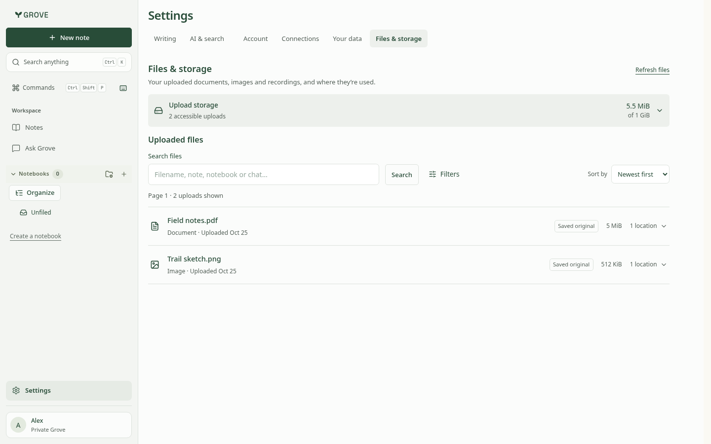
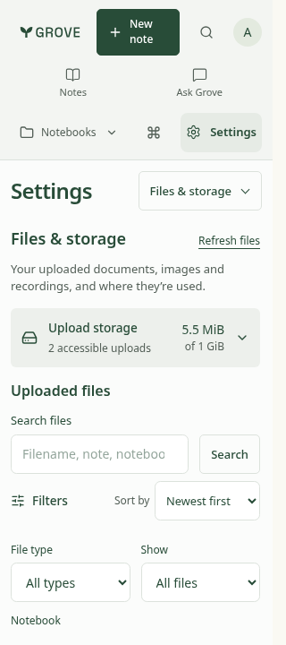
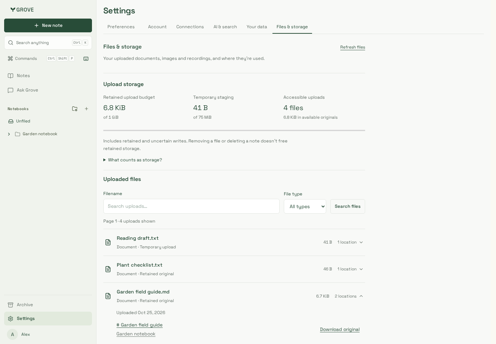
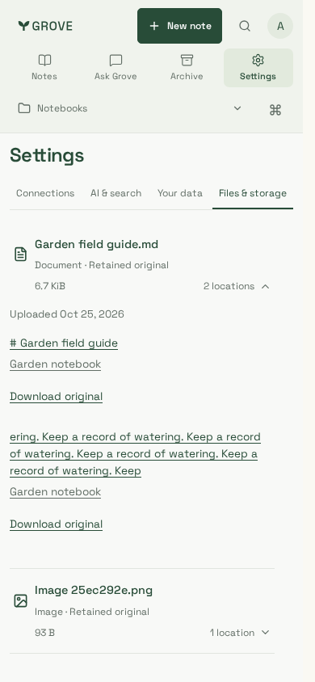
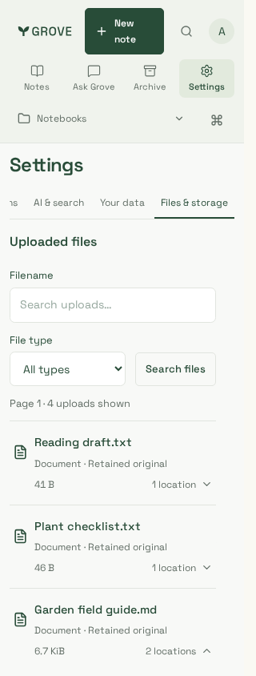

# Files & storage

## Responsive file controls

Optimized website CSS at `ba254222`, Chromium dashboard fixture, two synthetic uploads.
Search, filters and sort precede results in reading order. Opening Filters at 320 px exposes file type, view and notebook without covering the query. The storage disclosure retains the account-wide budget details.

| Inventory · 1440 × 900 | Filters · 320 × 720 |
| --- | --- |
|  |  |

These captures use fixture responses, not a storage service. Service-backed evidence follows.

## Service-backed inventory and locations

Real workspace components and production CSS, synthetic documents/identity only,
backed by disposable PostgreSQL/non-owner API, extraction workers and private
original storage. Generated by `scripts/testing/files-browser.mjs` in Chromium;
the same journeys also run in supported-container WebKit at1440/390/320px.

The account evolves between viewport checks: removed originals continue to count
against retained safety budget, while replacement uploads create separate originals.
Downloads are checked byte-for-byte; staging and notebook/chat/source visibility
use real service state, not mocked counts. No live-model/production acceptance.
Mobile captures scroll normally to the file list or expanded locations.

| Overview                                 | Notebook locations                         | Narrow file list                  |
| ---------------------------------------- | ------------------------------------------ | --------------------------------- |
|  |  |  |
