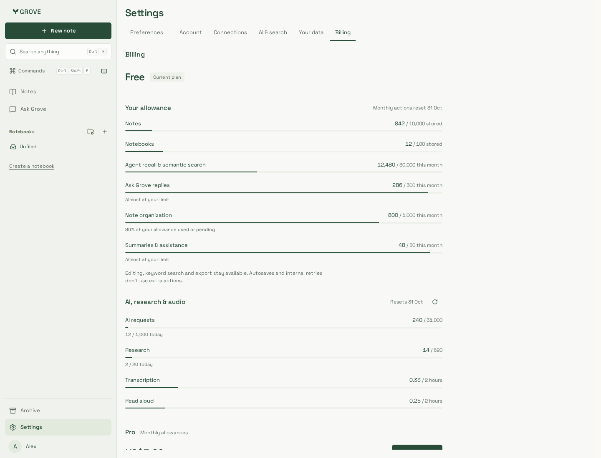
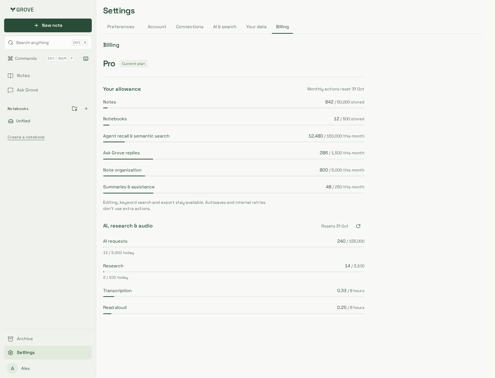
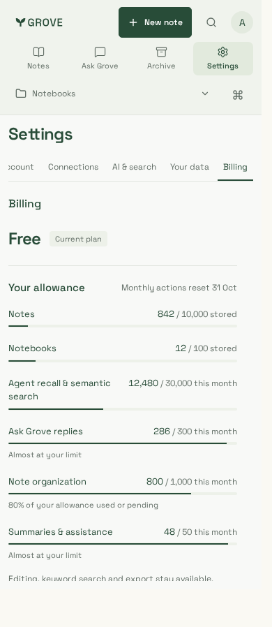
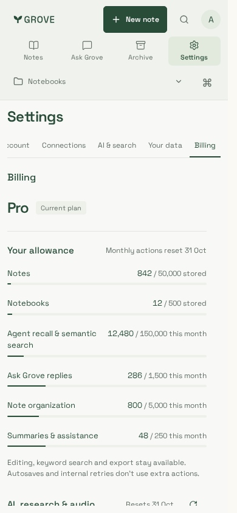

# Free/Pro action allowances

Actual Billing component with production CSS and synthetic account/API responses.
Desktop: 1440×1100. Phone: 390×844. No private notes, paid provider call or real
subscription is used. The Free captures show the 80% and 95% warnings; Pro shows
the approved larger action/storage limits without changing audio/research budgets.

| Free desktop                              | Pro desktop                        | Free phone                    | Pro phone                   |
| ----------------------------------------- | ---------------------------------- | ----------------------------- | --------------------------- |
|  |  |  |  |

## Verification scope

Source: `d012ddbe9d1a7c3a92dd09dda2dcbdf89553615e`, including merged admin
support #129 and forward migration order 027 → 028. Production website build:
`VMRgAIPjlRxwzZ26D8Ns9`. The companion evidence commit records these captures;
Billing source/CSS are unchanged from the verified source.

Chromium and supported Noble iPhone/WebKit actual-component journeys pass at
1440/390/320px for both tiers, including normal/warning/exhausted storage and action
states, usage refresh, unlimited meter/upsell concealment, older API responses,
flag-off hiding, zero page errors, horizontal bounds and WCAG A/AA checks. All four
captures are visually reviewed. Reset dates use the viewer's local time; the title
retains the exact reset, so UTC November 1 may display October 31 locally.

The isolated local fixture is not a production authentication or Stripe payment
acceptance test. Source/build identities and final gates are recorded in
[delivery evidence](../../../delivery.md). Source tables, shared leases and tenant
isolation are separately verified with disposable PostgreSQL API/worker roles.
