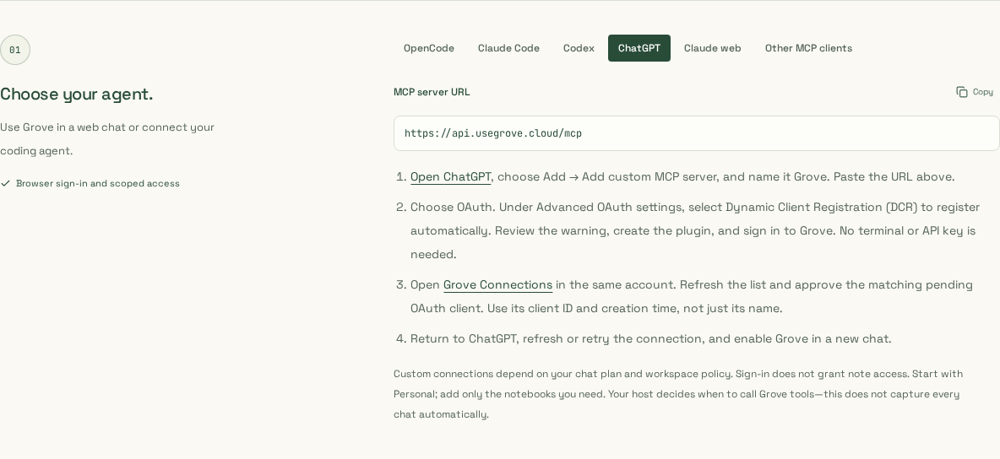
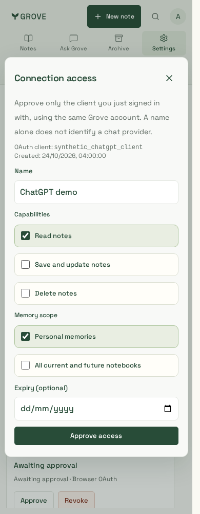
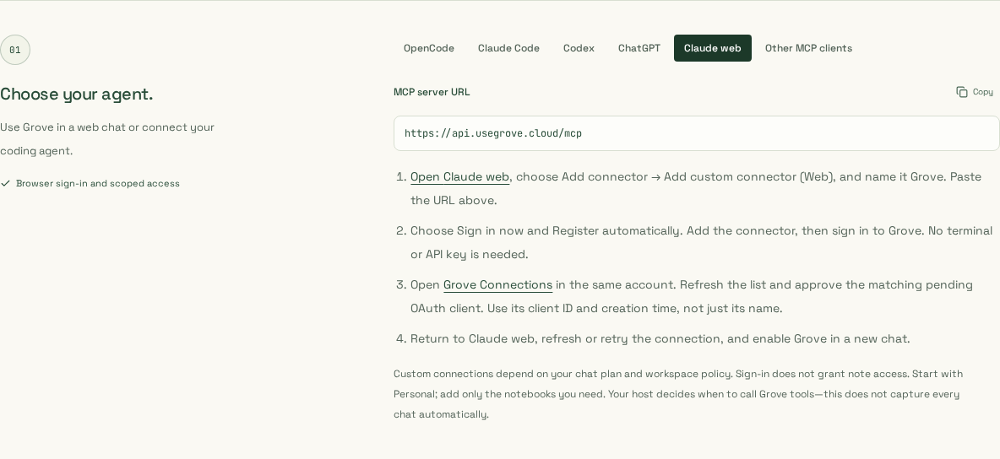
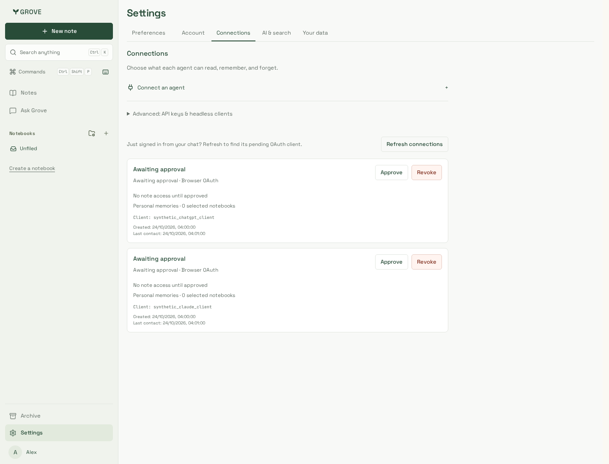

# Hosted chat setup — reviewed captures

Captured and visually reviewed on 24 October 2026. Application files match
`7e0a272` (backend `61fa285`). The production Next.js build
`JxNQer6QAGO5JqCZnFp2f` was made with those UI files before their commit;
its build metadata therefore names the earlier backend commit. No runtime file
changed between that build, these captures and the UI commit.

Local Node 24.21.0 / pnpm 10.33.0 / Playwright 1.64.1 Chromium. Marketing uses
the real production-built `/install` route; Connections uses actual application
components, production CSS and a synthetic HTTP fixture. All names/client IDs
are synthetic. No live credentials, private notes, provider consent or real host
tool results appear in these images. Cookie notices were dismissed through their
normal controls, and tab transitions completed before capture; images are unedited.

| Capture                                    | Viewport / crop                     | Scenario                                                                                  |
| ------------------------------------------ | ----------------------------------- | ----------------------------------------------------------------------------------------- |
| [ChatGPT](chatgpt-desktop.png)             | 1440×1100; setup-step crop 1184×544 | Hosted URL, OAuth/DCR steps, separate Grove approval and honest automation limits.        |
| [Claude web](claude-web-desktop.png)       | 1440×1100; setup-step crop 1184×544 | Distinct web connector instructions, separate from Claude Code.                           |
| [Pending connections](pending-desktop.png) | 1440×1100                           | Two unapproved clients identified by ID/creation time; no note access; explicit refresh.  |
| [Phone approval](approval-phone.png)       | 390×1000                            | Exact-client context and read-only Personal review; write/delete/all-notebook access off. |

Install and approval checks pass WCAG A/AA/2.1AA and no-horizontal-overflow at
1440/390/320px. All 232 Chromium scenarios and the 10 focused iPhone/WebKit
connection scenarios pass. WebKit ran in the Playwright 1.64.1 Noble container;
this is browser emulation, not physical-device or real-host acceptance.

## Preview

| ChatGPT setup                                              | Phone approval                                                |
| ---------------------------------------------------------- | ------------------------------------------------------------- |
|  |  |

Additional captures:

See [feature and qualification limits](../../../hosted-chat.md). These screenshots
document source UI changes, not deployment or publication in either directory.
