# Grove interface refresh

Matched captures from the baseline `a30ec65f` and the UI refresh in
[PR #217](https://github.com/miniaxolotl/grove/pull/217). These show local
production website builds and the installed Chromium extension, not a deployed
release. The workspace and shared reader use synthetic fixtures, not live
accounts or real share links. Cookie prompts were dismissed in both sets.

## Final polish

These pairs compare the previous PR revision (`42f628a3`) with the lighter
reader and the corrected mobile workspace header. The full-size gallery below
compares the original baseline with the latest UI.

| Mobile Notes before | Mobile Notes after |
| --- | --- |
| 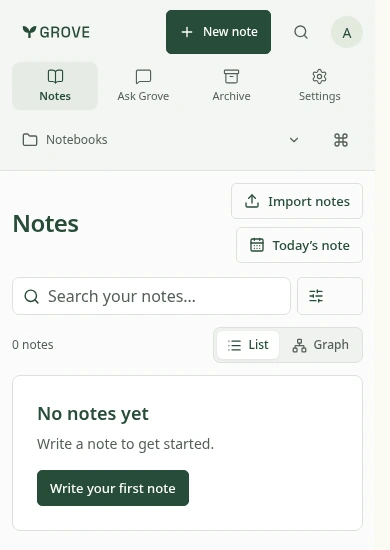 | 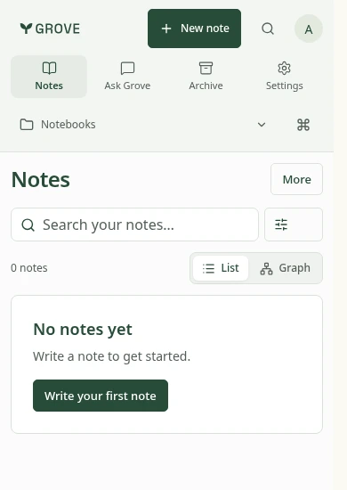 |

| Mobile header before | Mobile header after |
| --- | --- |
| 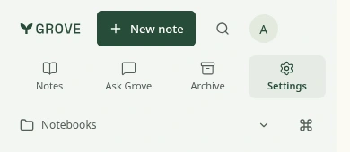 | 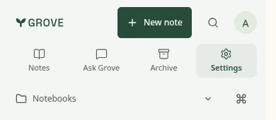 |

| Shared quotation before | Shared quotation after |
| --- | --- |
| 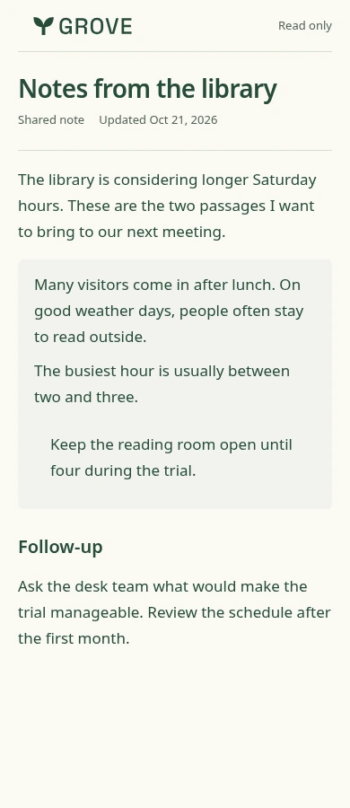 | 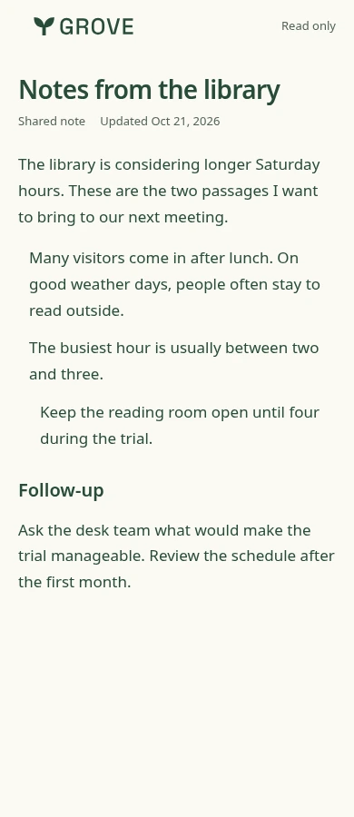 |

## Full-size comparisons

| Area | Phone | Tablet | Desktop |
| --- | --- | --- | --- |
| Public landing page | [Before](before/home-390.webp) / [After](home-390.webp) | [Before](before/home-768.webp) / [After](home-768.webp) | [Before](before/home-1440.webp) / [After](home-1440.webp) |
| Signed-in Notes workspace | [Before](before/workspace-390.webp) / [After](workspace-390.webp) | [Before](before/workspace-768.webp) / [After](workspace-768.webp) | [Before](before/workspace-1440.webp) / [After](workspace-1440.webp) |
| Settings and writing checks | [Before](before/settings-390.webp) / [After](settings-390.webp) | [Before](before/settings-768.webp) / [After](settings-768.webp) | [Before](before/settings-1440.webp) / [After](settings-1440.webp) |
| Public setup | [Before](before/setup-390.webp) / [After](setup-390.webp) | [Before](before/setup-768.webp) / [After](setup-768.webp) | [Before](before/setup-1440.webp) / [After](setup-1440.webp) |
| Shared notebook | [Before](before/shared-390.webp) / [After](shared-390.webp) | [Before](before/shared-768.webp) / [After](shared-768.webp) | [Before](before/shared-1440.webp) / [After](shared-1440.webp) |
| Signed-out extension panel (390 px) | [Before](before/extension-welcome.webp) / [After](extension-welcome.webp) | | |

## Expanded pass previews

### Settings

| Before | After |
| --- | --- |
| 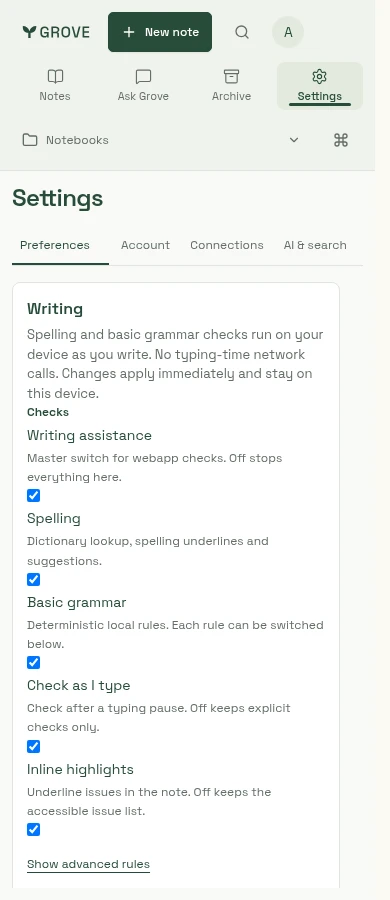 | 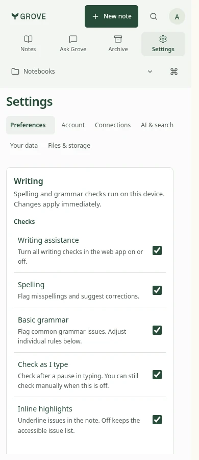 |

### Setup

| Before | After |
| --- | --- |
| 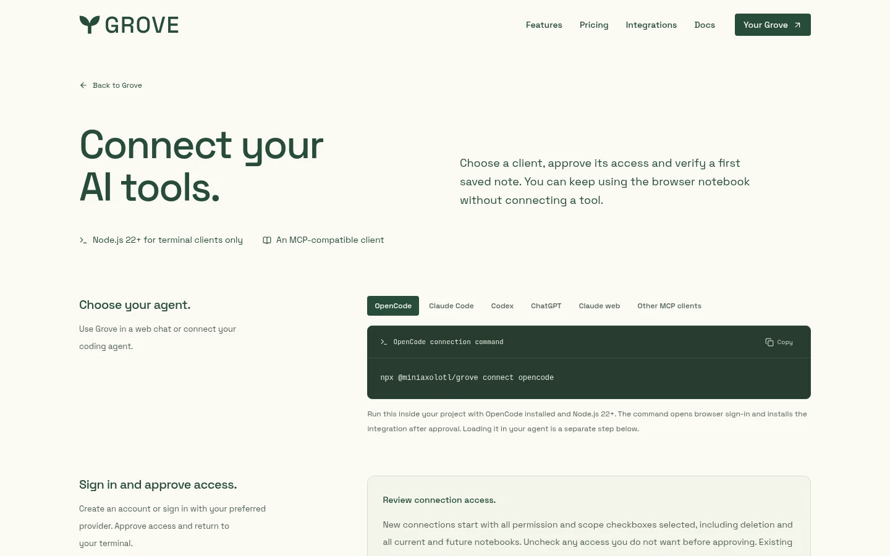 | 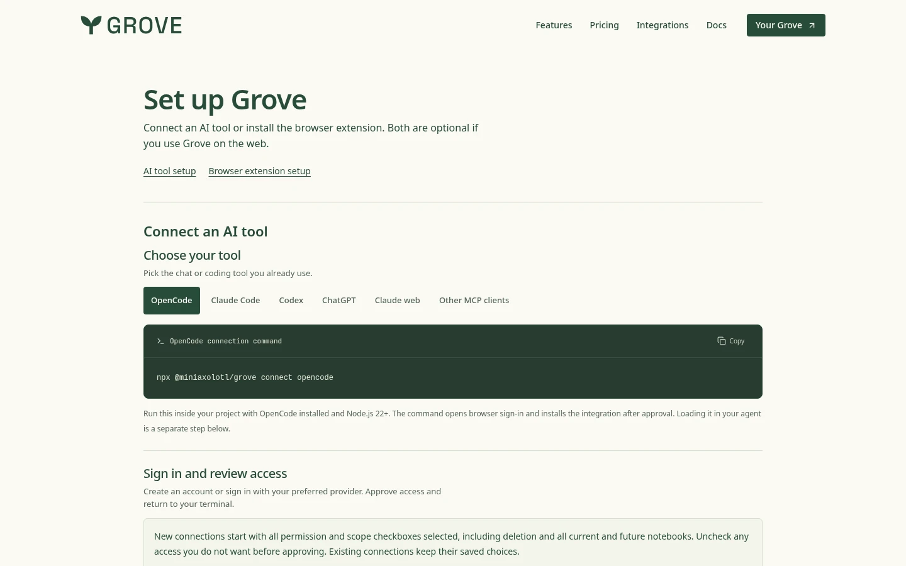 |

### Shared notebook

| Before | After |
| --- | --- |
| 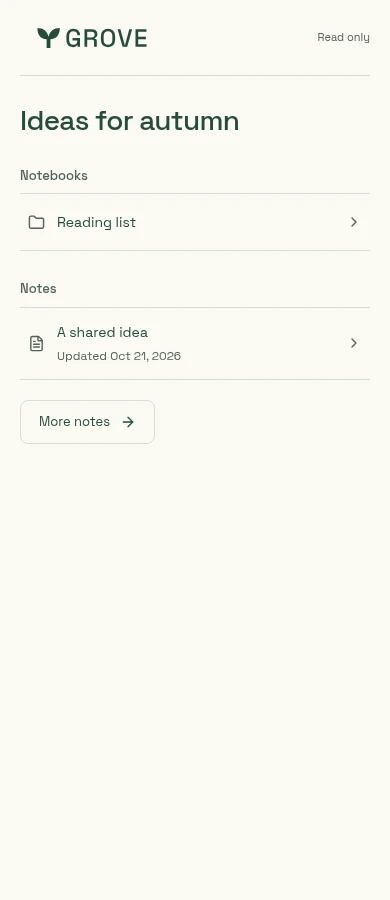 | 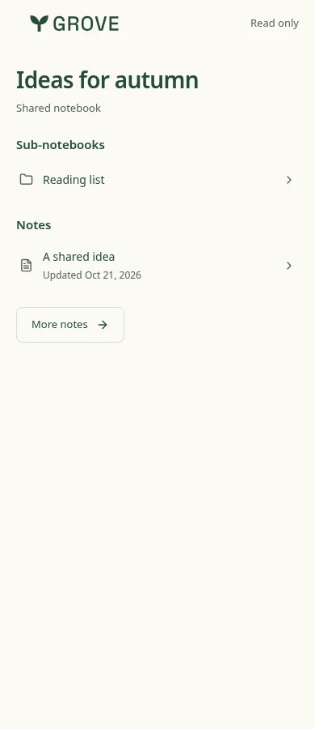 |

## Public landing page

| Before | After |
| --- | --- |
| 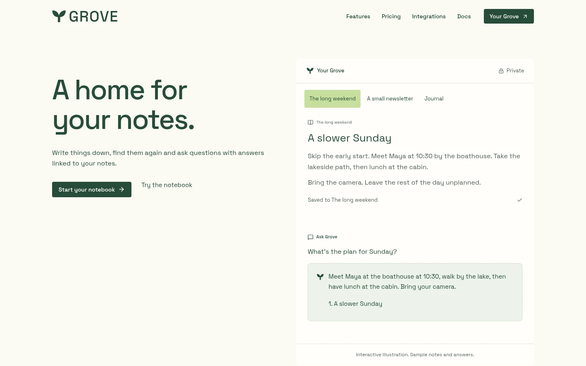 | 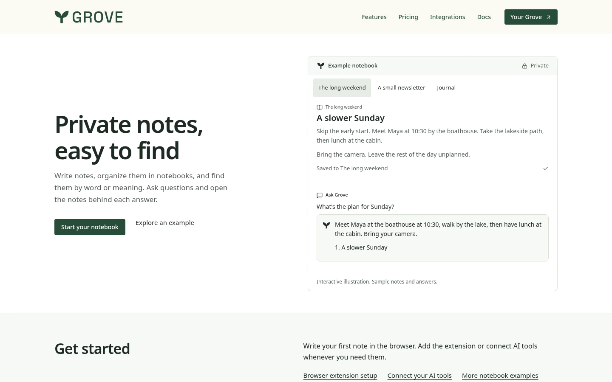 |

## Signed-in workspace

| Before | After |
| --- | --- |
| 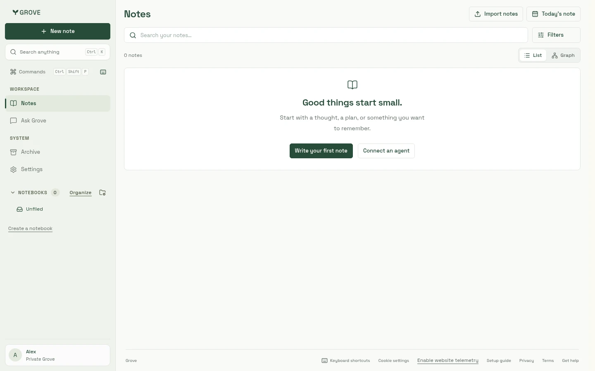 | 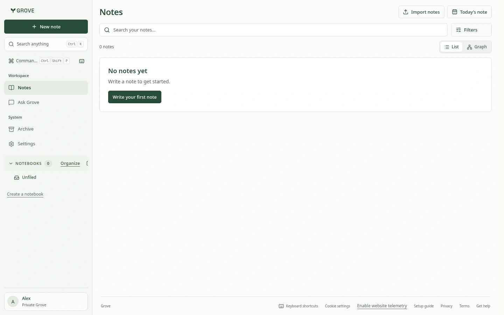 |

## Browser extension

| Before | After |
| --- | --- |
| 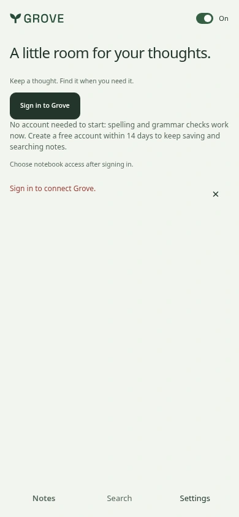 |  |

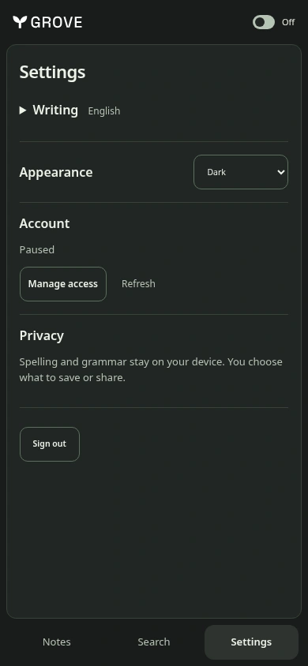
