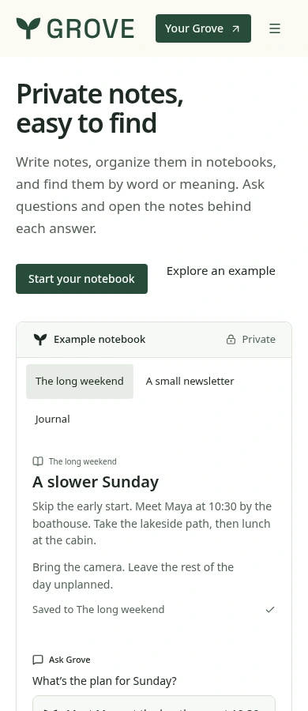
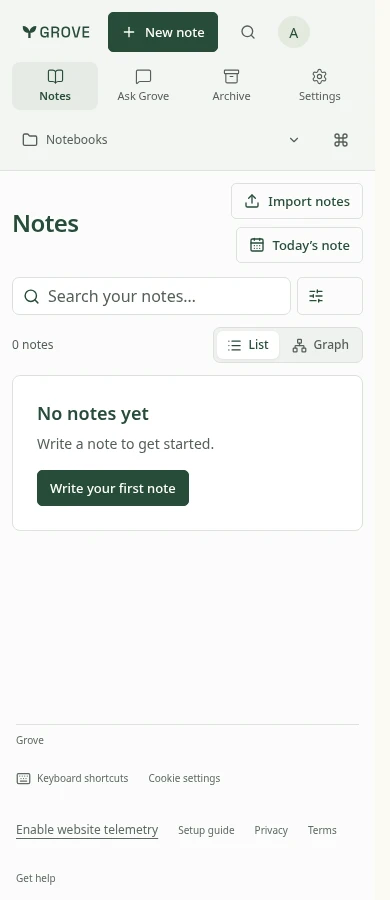
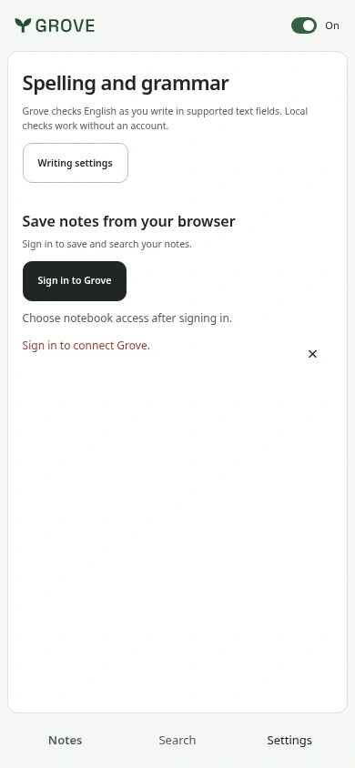
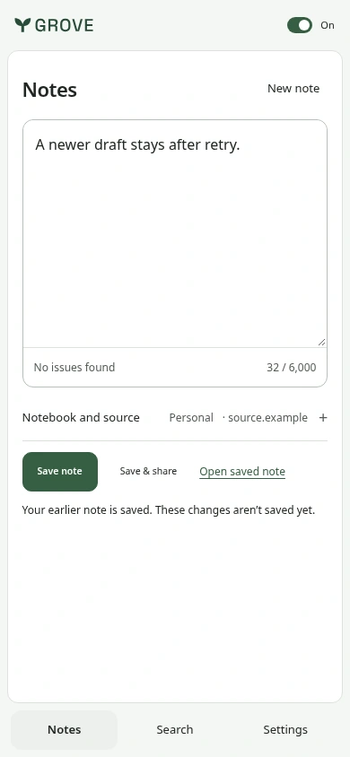

# Grove interface refresh

Local production website build and installed Chrome extension, captured with
synthetic content. The workspace uses the repository's browser fixture, not a
live account. These images show the UI under review, not a deployed release.

## Public landing page

## Signed-in workspace

## Browser extension

