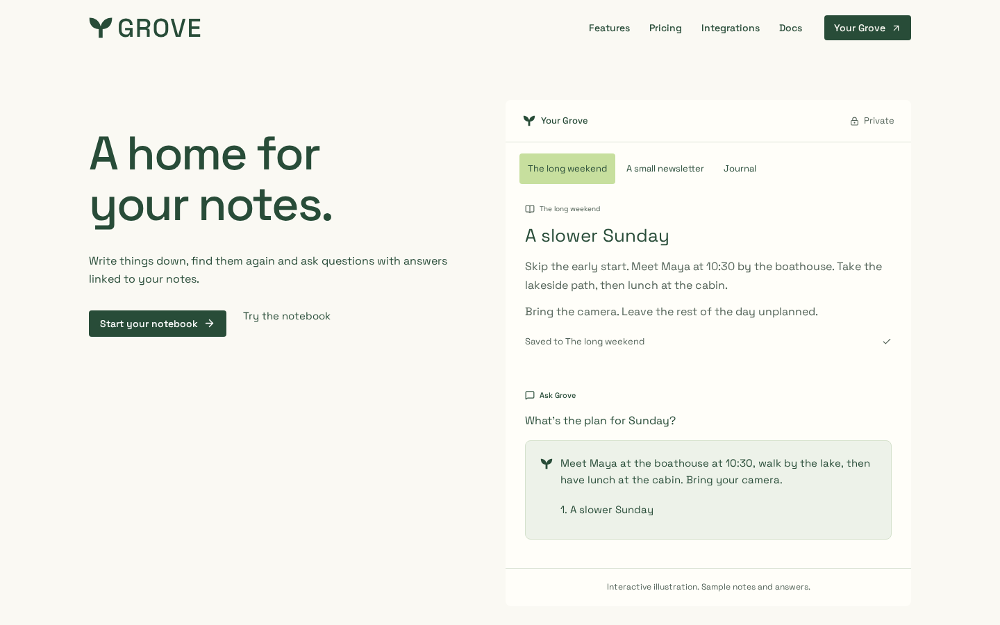
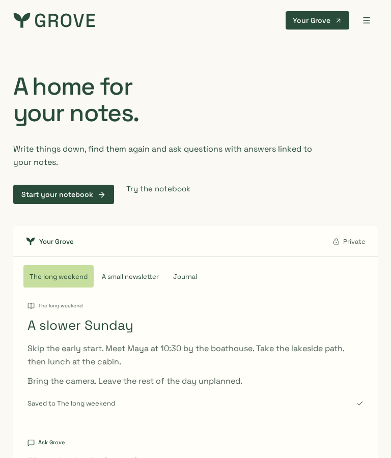
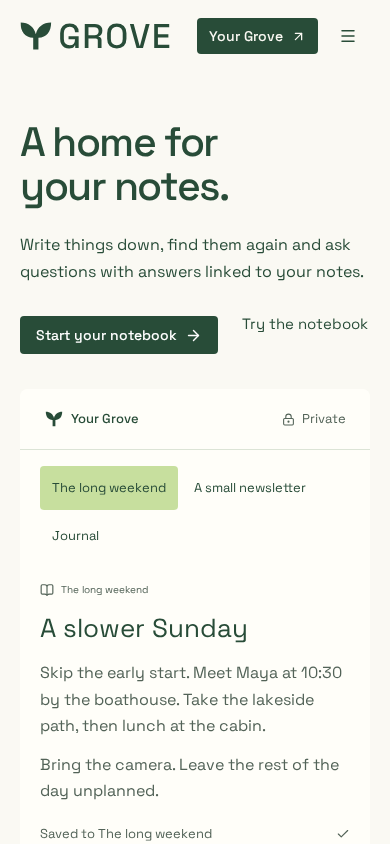
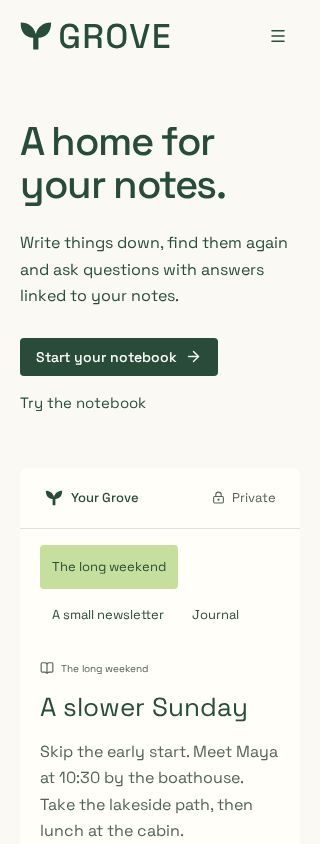
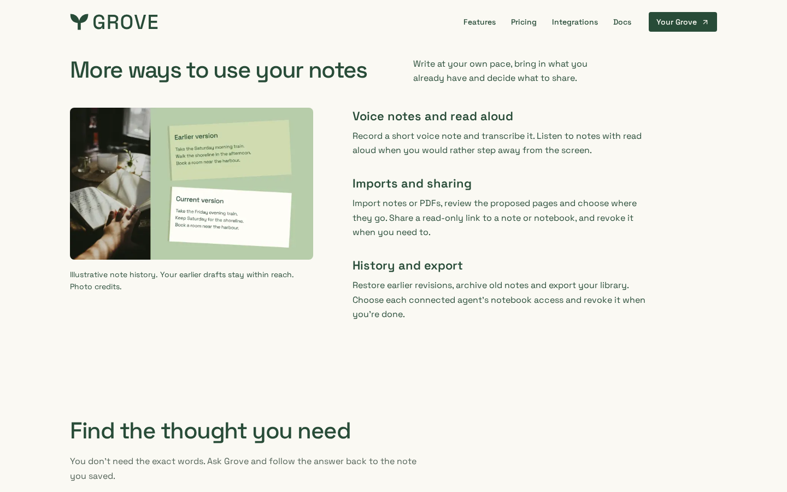
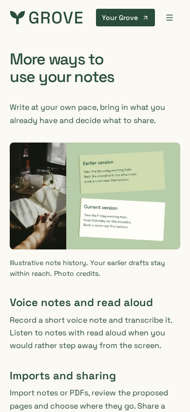

# Grove website review

Local optimized Next.js build, Chromium on Linux, 6 November 2026. Viewports:
1440×900, 768×900, 390×844 and 320×844. Optional cookies were declined through
the existing UI. Notes, answers and graph data are fixtures, not private accounts.
The earlier-draft collage is illustrative; photo licences/source pages ship in
website `public/images/marketing/{CREDITS.md,source-manifest.json}`.

## Verification

Root lint/types/build, 14 artifact checks, website lint/types/build, **278 browser
cases**, documentation checks, 55 CI/release contracts and workflow lint pass.
Browser fixtures use isolated ports; another worktree's occupied defaults were
not stopped. Four-width home checks find zero axe violations, positive overflow
or heading collisions after notice dismissal. Served kit/social bytes and
documentation image dimensions pass. Light/dark favicon media and SVG rendering
at 16/32px pass; toolbar caching and other engines remain separate qualification.

Raw taste findings include notice overlap and hidden closed consent controls.
Reviewed exceptions are `covered-text,reduced-hidden`; a four-width heading probe
passes after ordinary dismissal. Consent and reduced-motion tests remain intact.
Brand-paper, consent outline, few real photos, graph-attribution small text and
no-footage warnings remain. The graph attribution is not running copy; extra stock
photos or motion would compete with the notebook. Billing/configuration is unchanged.

## Final critique — round 2

Seen in one second: a note with a source-linked answer.
Idea: the saved thought becomes both the working example and its evidence.
Live thing: switch notes, inspect the graph and compare saved-context answers.
Layout words: hero=notebook / library=graph / features=editorial split / Ask=comparison / setup=steps / close=pricing and questions.
Scores: design 7.5 · usability 8 · creativity 7 · content 8.5 → **7.7/10**.
Caps applied: no unqualified raw-inspector claim.
Remaining tradeoffs:

1. `home-phone.png`: complete notes/answers keep the page long; intrinsic reserves prevent selection jumps.
2. `home-tablet.png`: the graph has intentional breathing room for navigation, not empty decorative space.
3. `detail-desktop.png`: one supporting collage is enough; keep the product examples primary.

| Desktop                      | Tablet                     | Phone                    |
| ---------------------------- | -------------------------- | ------------------------ |
|  |  |  |

| Small phone                    | History detail                 | Phone detail                       |
| ------------------------------ | ------------------------------ | ---------------------------------- |
|  |  |  |
