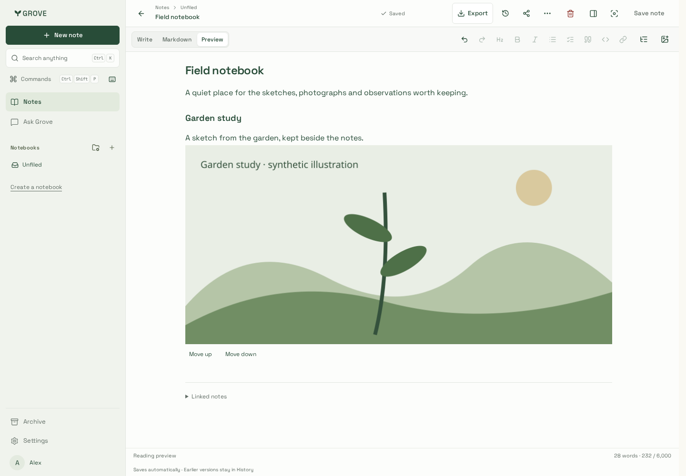
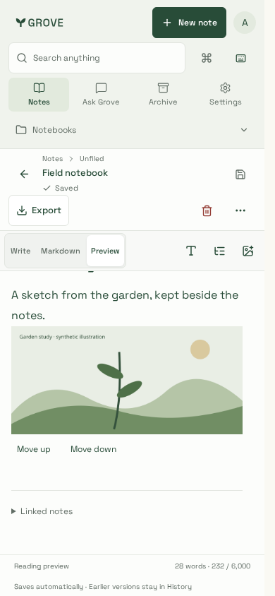
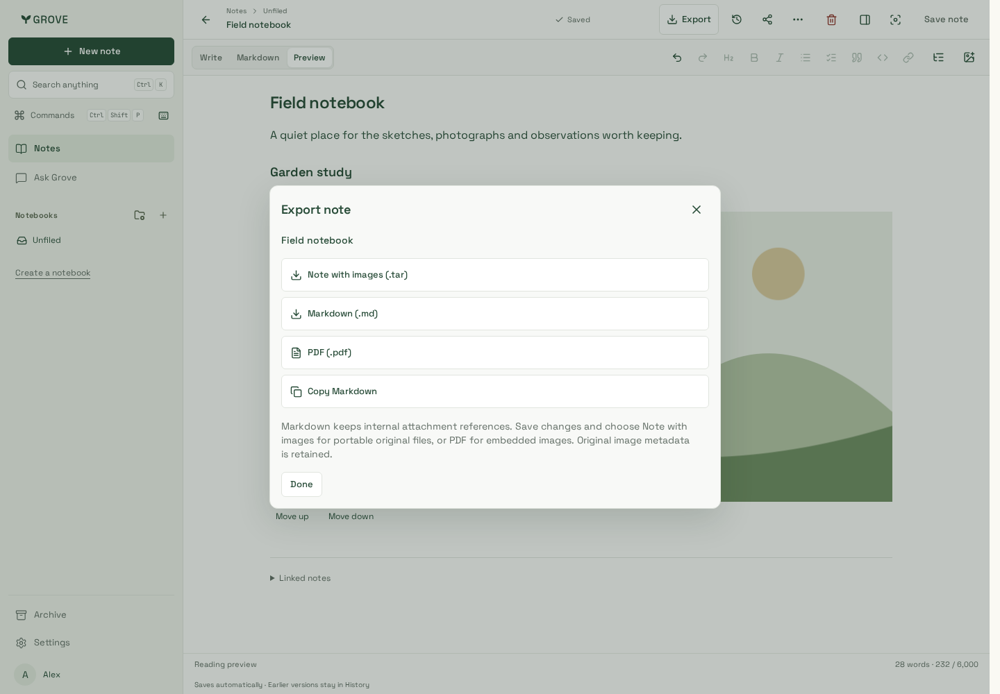

# Images — visual verification

Synthetic garden illustration and notes, rendered with production CSS and real
workspace components. The local browser fixture forwards API requests to the real
Hono service and an owned PostgreSQL database/private local storage adapter; Clerk
is replaced only in the isolated fixture. These captures do not qualify a deployed
Spaces bucket or production hosting limits.

| Desktop image                               | Phone image                              | Portable export                           |
| ------------------------------------------- | ---------------------------------------- | ----------------------------------------- |
|  |  |  |

Verified upload → ordinary autosave → inline preview, narrow viewport bounds,
original-byte TAR download and actual PDF download in Chromium and WebKit. PDF
parsing confirms one embedded image on one page. The WebKit run uses the supported
Noble container and a loopback streaming fixture proxy, preserving actual File bytes.
Native editor history, source
reading, denied/revoked media, tenant/grant boundaries and retained deletion have
separate backend/browser evidence. Original image metadata is retained. No real
account content is used.

Additional capture: [public reader without JavaScript](public-no-javascript.png).
The production-built Next reader fetched the image through the real public API,
made no third-party requests, and returned 404 after revoking its synthetic link.

Follow-up in both Chromium and WebKit verifies trusted image drag to another
paragraph, one-step Undo, keyboard/touch Move up/down, and a file drop on the note
toolbar outside the editor text area. The same media reference moves without
another upload; a new file dropped in the workspace creates its own attachment.
