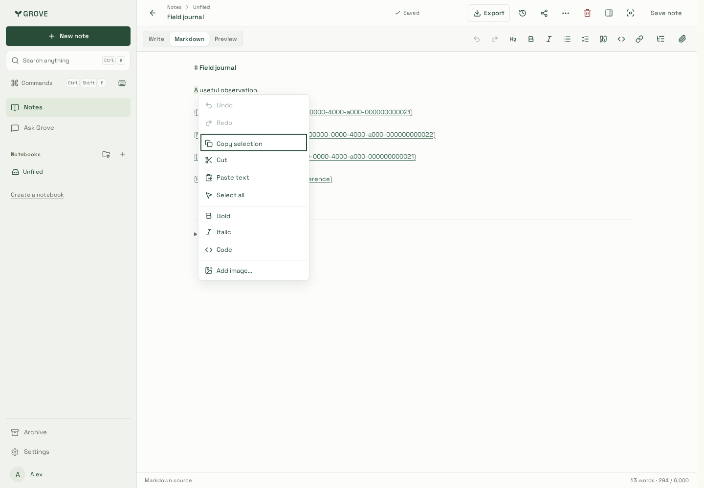
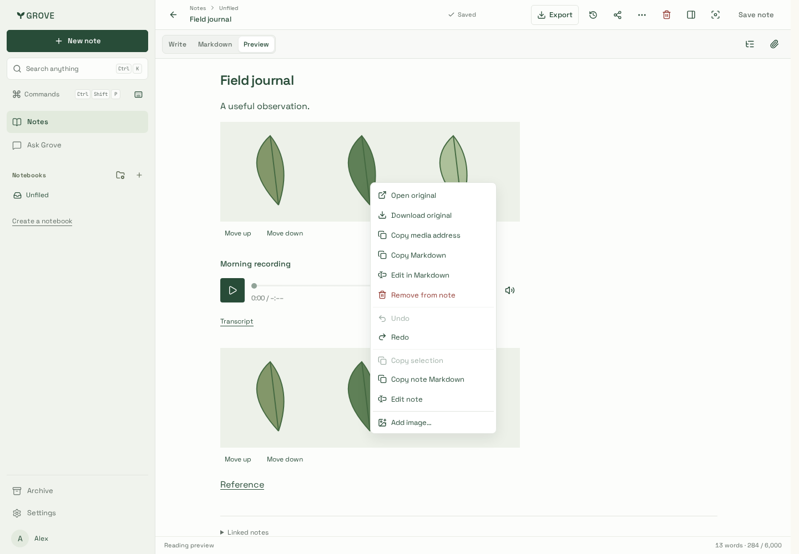
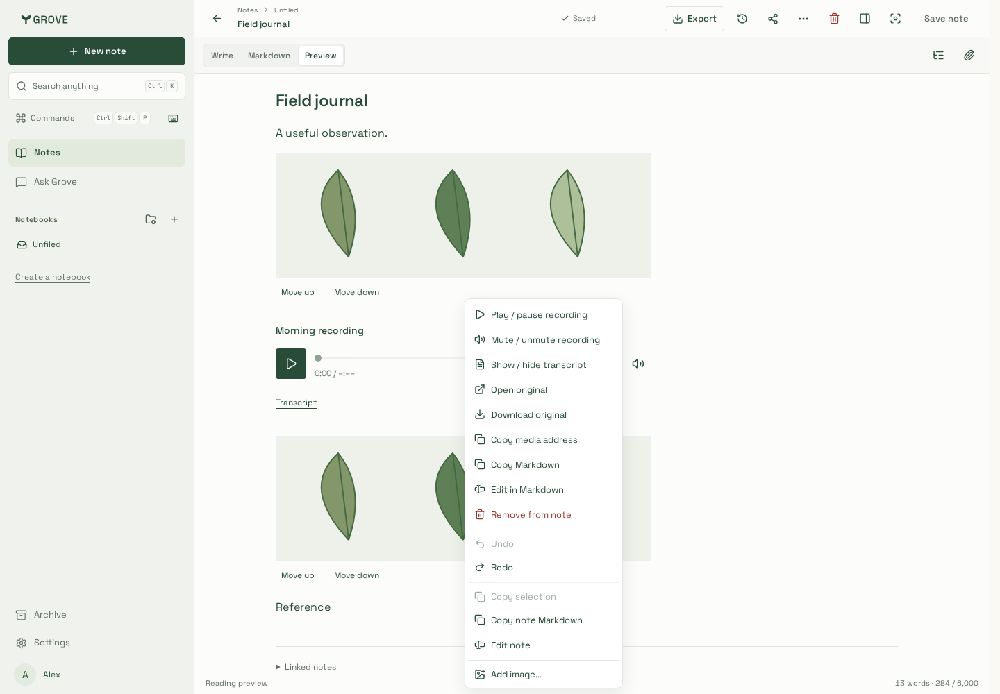
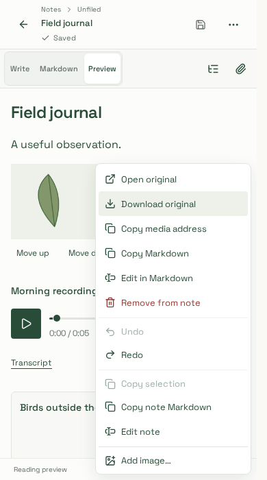
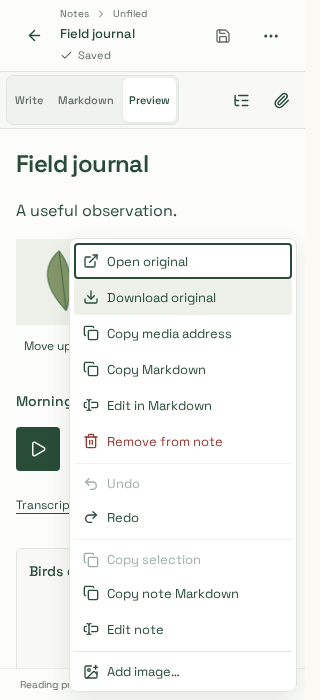
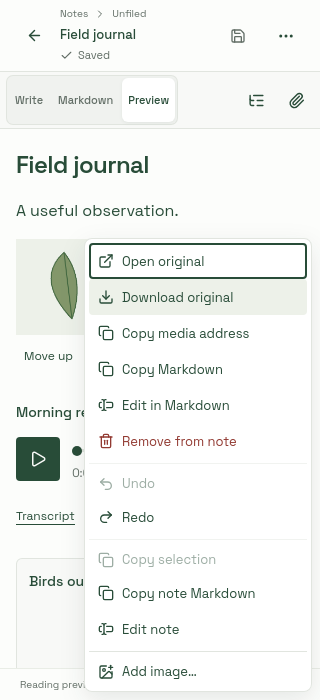

# Note context actions — reviewed captures

Captured 23 October 2026 from actual website components and production-built CSS,
on recordings #95 (`93983e5`) plus this PR's context-action implementation. Build
`kwZtULzPEd7ZZS1jYkTzK`, Notes entry **488,018 gzip bytes**; editor remains deferred.
Synthetic “Field journal” note, generated PNG leaf illustration and five-second WAV;
no personal media, provider calls or production writes. These are fixture views, not
live-account evidence. Capture files are not modified after browser capture.

| Text selection, desktop                         | Image actions, desktop                              | Recording actions, desktop                                |
| ----------------------------------------------- | --------------------------------------------------- | --------------------------------------------------------- |
|  |  |  |

| Phone, 390px                       | Narrow phone, 320px                 | WebKit, 320px                                     |
| ---------------------------------- | ----------------------------------- | ------------------------------------------------- |
|  |  |  |

Both Chromium and WebKit pass pointer and keyboard menu invocation, selection/format/
Undo, denied clipboard and delayed-paste guards, duplicate-reference CRLF targeting,
remove/Undo, original-download byte identity, source-end targeting, lazy playback,
mute/transcript, disabled-upload guards, outside dismissal and native escape hatch.
The full223 Chromium and focused12 WebKit suites also pass unchanged. Native download
verification uses the test fixture's loopback upstream because browsers bypass page
request interception for downloads. The shared native/public no-JavaScript controls
are not replaced by these editable-note menus.

See [feature contract](../../../note-context-actions.md) and
[verification matrix](../../../development/testing.md).
