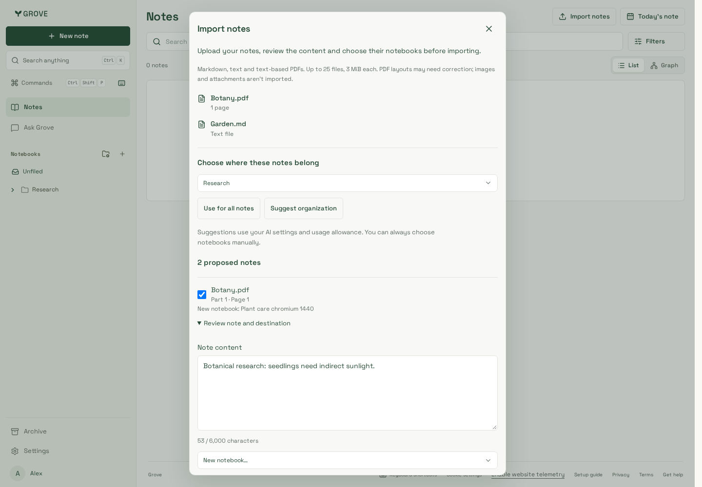
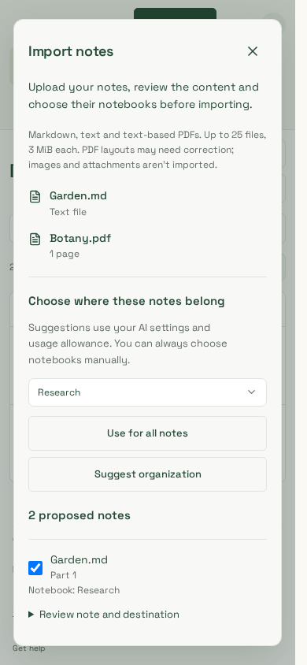
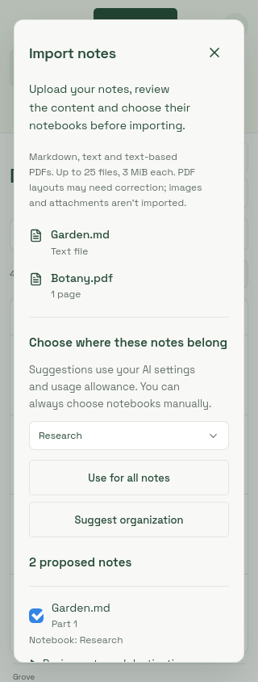
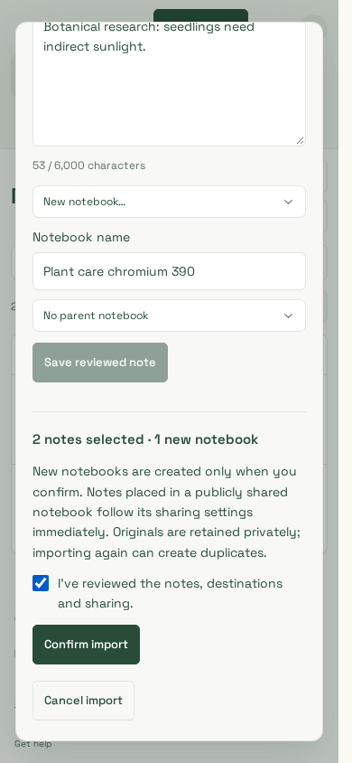
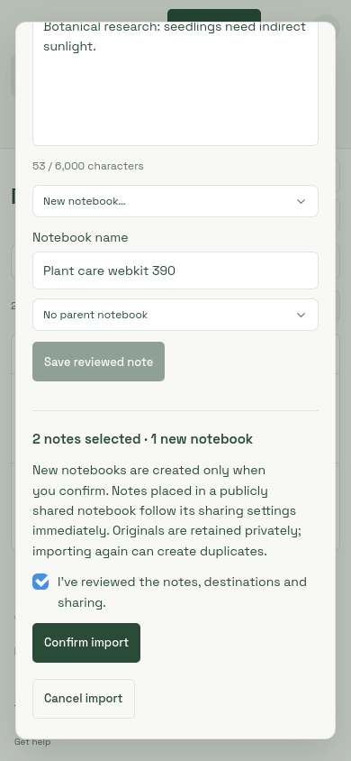
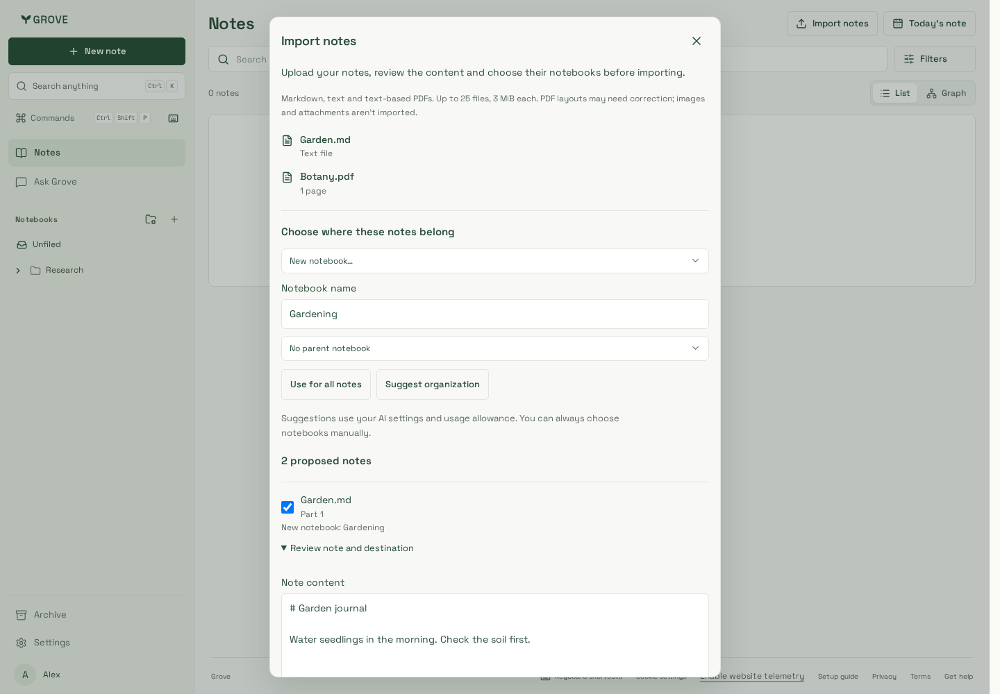
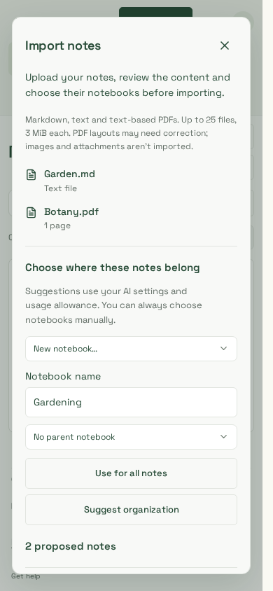
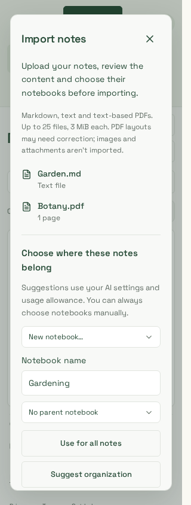

# Note and PDF import review

Synthetic Garden.md/Botany.pdf notes in the real workspace components using
production CSS. Chromium captures were visually reviewed at1440,390 and320px.
The browser journey verifies file selection, reviewed content, mixed new/existing
destinations and explicit confirmation, with WCAG A/AA, overflow and page-error
checks. These synthetic API responses are UI evidence, not real PDF extraction or
production deployment evidence; backend fixtures separately exercise real PDFs.

The `real-*` captures additionally use a disposable real API/worker/PostgreSQL and
genuine PDF extraction through `scripts/testing/document-imports-browser.mjs`.
Chromium and supported-container WebKit journeys at all three widths verify two
ordinary imported notes and SHA-256-identical private original downloads. `confirm-*`
shows the sharing notice and final confirmation on a phone. No production account,
document or model provider is used.

| Real desktop review                            | Real phone review                           | Real narrow WebKit review                         |
| ---------------------------------------------- | ------------------------------------------- | ------------------------------------------------- |
|  |  |  |

| Phone confirmation                                     | WebKit phone confirmation                             |
| ------------------------------------------------------ | ----------------------------------------------------- |
|  |  |

| Desktop review                            | Phone review                           | Narrow phone review                           |
| ----------------------------------------- | -------------------------------------- | --------------------------------------------- |
|  |  |  |
