# Note and PDF import review

The **17 November 2026** Settings and import confirmation captures use synthetic
data in the Chromium dashboard fixture with production CSS, based on `c56ff529`
plus the second workspace clarity pass. The import card separates its primary and
secondary actions on desktop and wraps them at 320px. Confirmation keeps the
public sharing warning next to consent. Browser checks include consent reset after
another tab changes the review and scoped read recovery. No real parser or device was used in this pass.

| Your data, 1440px | Your data, 320px | Import confirmation, 390px |
| --- | --- | --- |
| 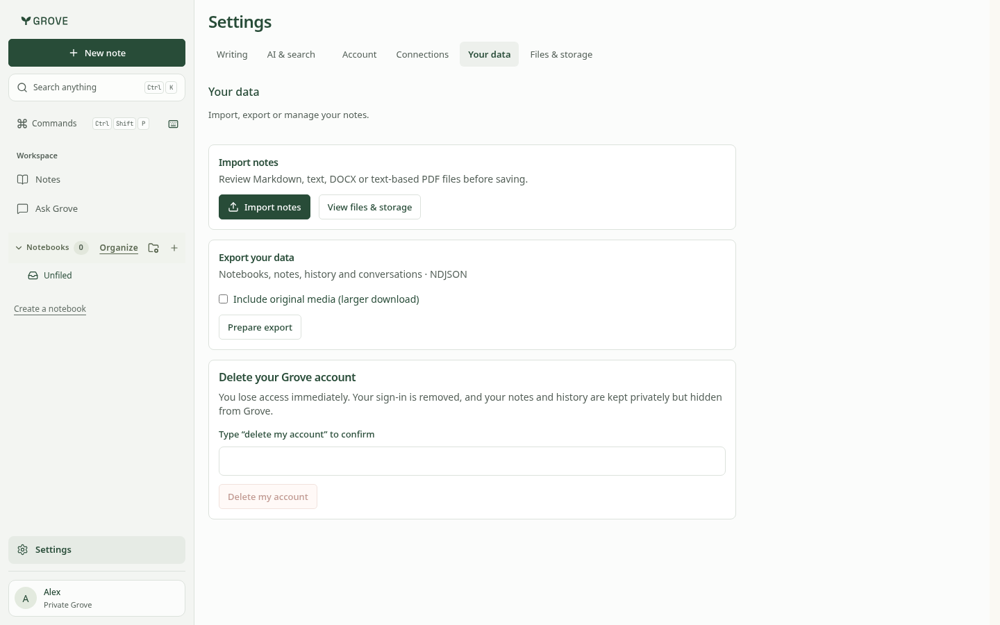 | 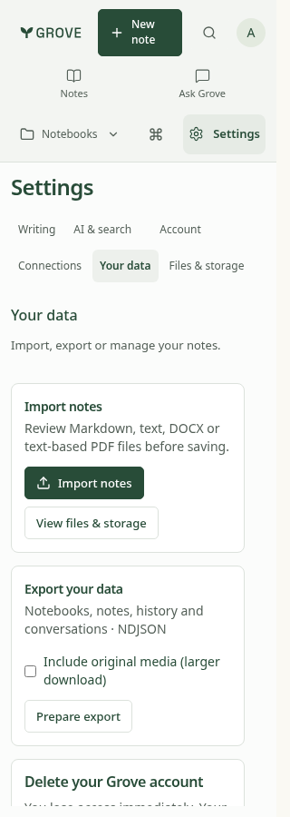 | 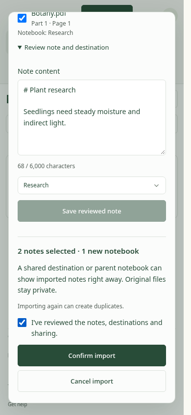 |

The synthetic `review-*` captures below reflect the same pass. The historical
`real-*` and `confirm-*` captures retain the verification method described below;
chat captures are in [ask-documents](../ask-documents/README.md).

Synthetic Garden.md/Botany.pdf notes in the real workspace components using
production CSS. Chromium captures were visually reviewed at1440,390 and320px.
The browser journey verifies file selection, reviewed content, mixed new/existing
destinations and explicit confirmation, with WCAG A/AA, overflow and page-error
checks. These synthetic API responses are UI evidence, not real PDF extraction or
production deployment evidence; backend fixtures separately exercise real PDFs.

The `real-*` captures additionally use a disposable real API/worker/PostgreSQL and
genuine PDF extraction through `scripts/testing/document-imports-browser.mjs`.
Chromium and supported-container WebKit journeys at all three widths verify two
ordinary imported notes and SHA-256-identical private original downloads. `confirm-*`
shows the sharing notice and final confirmation on a phone. No production account,
document or model provider is used.

| Real desktop review                            | Real phone review                           | Real narrow WebKit review                         |
| ---------------------------------------------- | ------------------------------------------- | ------------------------------------------------- |
| 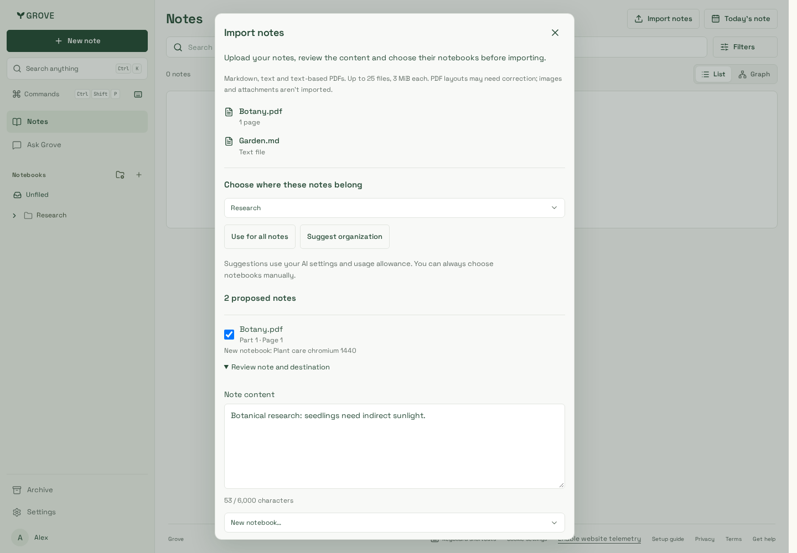 | 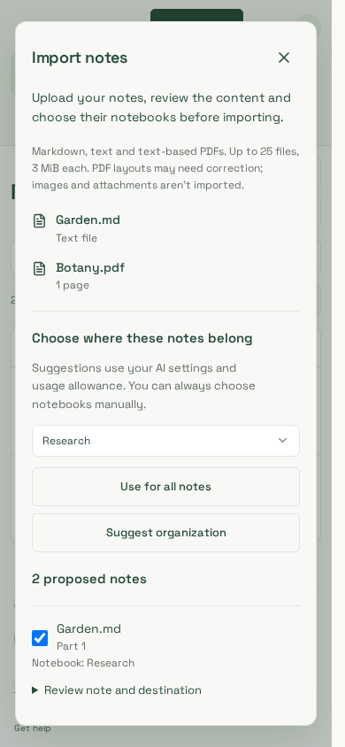 | 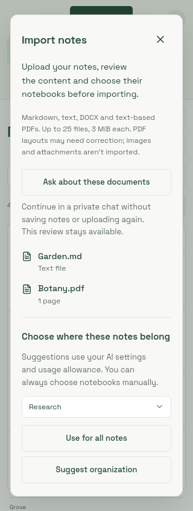 |

| Phone confirmation                                     | WebKit phone confirmation                             |
| ------------------------------------------------------ | ----------------------------------------------------- |
| 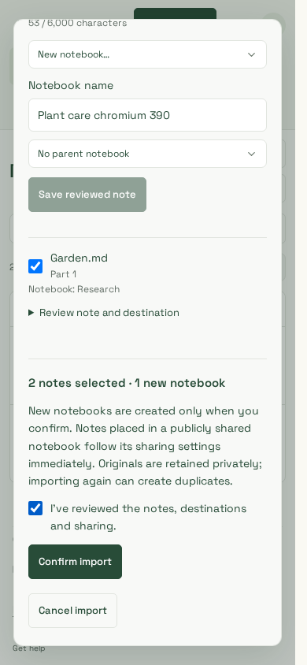 | 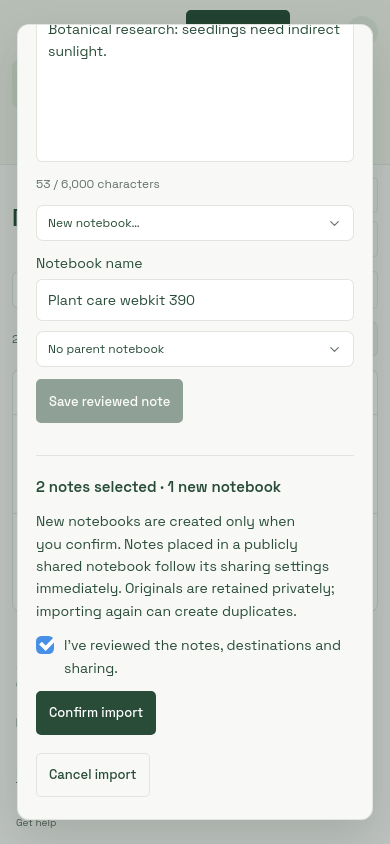 |

| Desktop review                            | Phone review                           | Narrow phone review                           |
| ----------------------------------------- | -------------------------------------- | --------------------------------------------- |
| 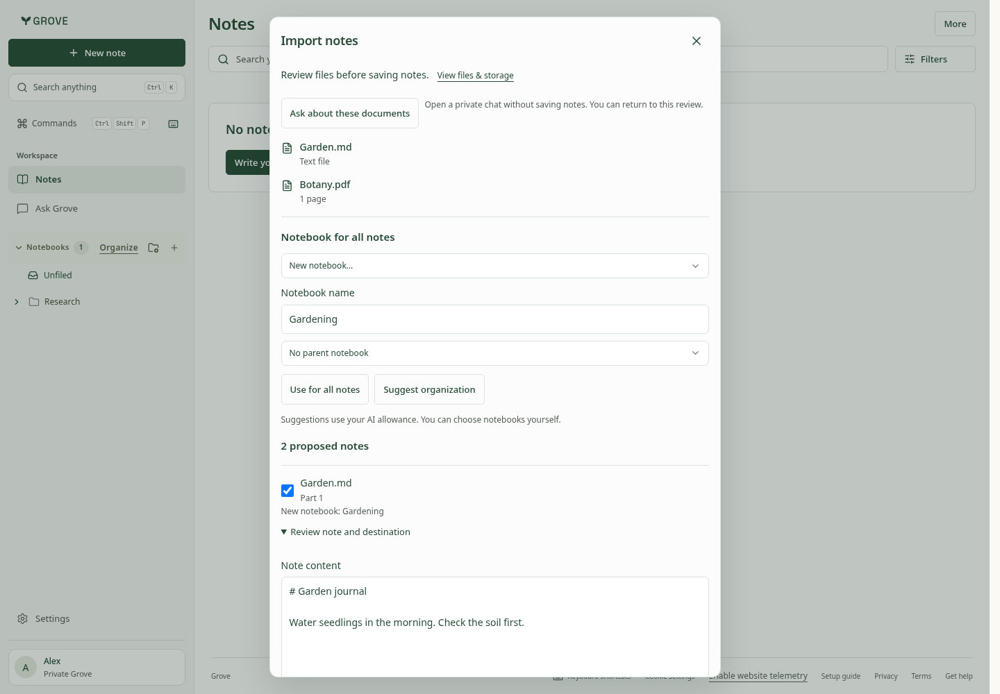 | 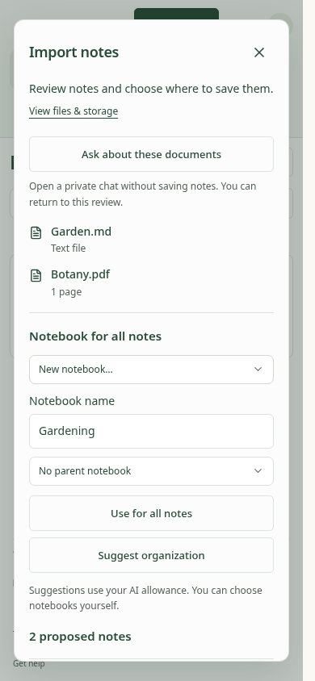 | 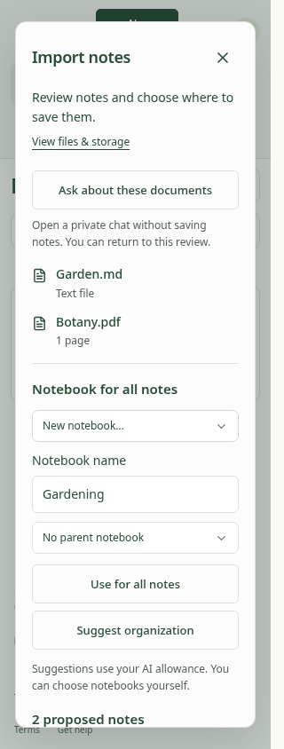 |

[Unsaved review at 390×844](unsaved-review-390.png) shows the save-or-discard
message with confirmation and cancellation disabled. Captured in the Chromium
dashboard fixture on `3001fd90` with the navigation fix, production CSS and
synthetic review data. No live account or document parser was used.
