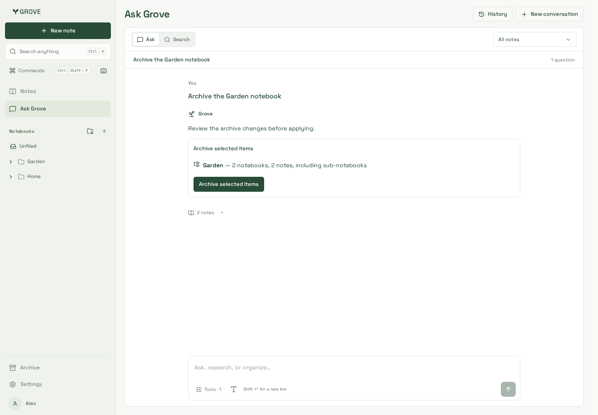
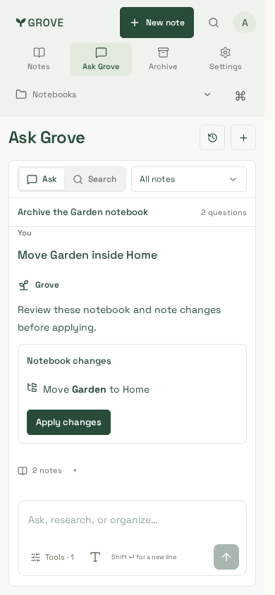
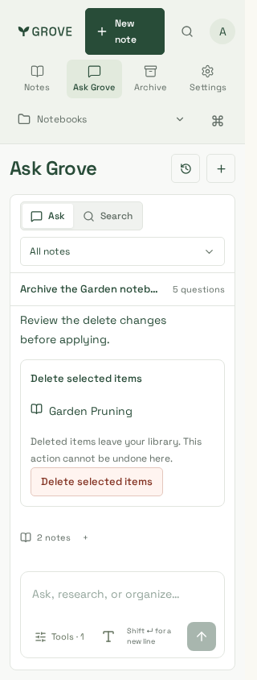

# Note and notebook management tools

Synthetic notes and notebooks, actual workspace components and a disposable
PostgreSQL/API service with non-owner runtime roles. Generation uses deterministic
fixtures, not personal content or paid inference. Captured 24 October 2026.

Desktop is 1440×1000; phone widths are 390 and 320 at 844px height. Chromium captures
below were reviewed alongside the same journeys in supported container WebKit.
The production CSS build is `HkGkWjBTfIv_-H4GG_I-r`; component changes use the existing
workspace styles. Application source is `98742ee`. Source evidence and final verification are in [delivery](../../../delivery.md#note-and-notebook-management-tools-24-october-2026).

| Archive subtree                                                 | Move notebook                          | Confirm note deletion                                   |
| --------------------------------------------------------------- | -------------------------------------- | ------------------------------------------------------- |
|  |  |  |

## Complete gallery

| Scenario                           | Desktop                  | 390px                   | 320px                   |
| ---------------------------------- | ------------------------ | ----------------------- | ----------------------- |
| Archive preview and subtree counts | [View](archive-1440.png) | [View](archive-390.png) | [View](archive-320.png) |
| Existing-notebook parent move      | [View](move-1440.png)    | [View](move-390.png)    | [View](move-320.png)    |
| Exact note deletion preview        | [View](delete-1440.png)  | [View](delete-390.png)  | [View](delete-320.png)  |

Actual-component journeys in both engines verify no mutation before Apply, complete
subtree counts, archive/Undo, notebook moves/Undo, note archive/restore/delete,
no deletion Undo, WCAG A/AA and bounds at each width. A separate two-tab journey
reproduced and verifies immediate deleted-note pruning in an offline library.
Both engines also check disabled Manage notes, interrupted Apply/retry and retained
local drafts blocking deletion without losing the writing.
Backend tests additionally cover stale batches, target scope, retries and retained
history. These checks do not claim live-model intent accuracy or production rollout.
