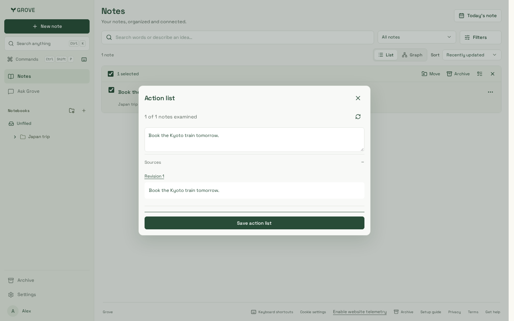
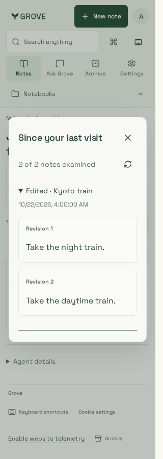
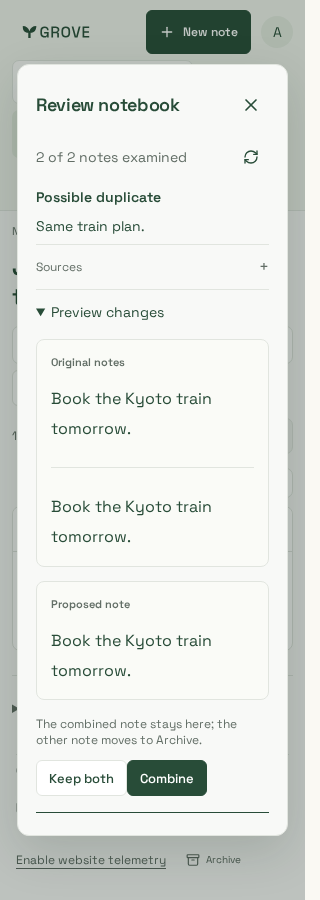

# Notebook assistance

Fourteen reviewed synthetic captures on UI source `ebdb6d5`, including workspace
polish #77. Final dependency integration `1542c08` retains these assistance surfaces.
The full 203-case Chromium run and five focused iPhone/WebKit scenarios pass.
The final queue integration passes eight assistance/source/export cases in each engine.

| View                  | Desktop                             | Phone                             | Compact                           |
| --------------------- | ----------------------------------- | --------------------------------- | --------------------------------- |
| Subject-aware summary | [1440px](notebook-summary-1440.png) | [390px](notebook-summary-390.png) | [320px](notebook-summary-320.png) |
| Editable action list  | [1440px](action-list-1440.png)      | [390px](action-list-390.png)      | [320px](action-list-320.png)      |
| Suggested filing      | [1440px](filing-1440.png)           | [390px](filing-390.png)           | [320px](filing-320.png)           |
| Change digest         |                                     |                                   | [320px](digest-320.png)           |
| Cleanup comparison    |                                     |                                   | [320px](cleanup-320.png)          |
| Exact source revision |                                     |                                   | [320px](source-revision-320.png)  |

WebKit: [action list](webkit-action-list-320.png),
[cleanup comparison](webkit-cleanup-320.png).

Checks cover keyboard/focus return, source links and revisions, accessible dialogs,
editable multiline actions, lost-response replay, filing abstention, both-original
cleanup comparisons, frozen visit windows and offline removal of expired evidence.

