# Notebook organizer review

## Drag targets — 27 November 2026

The floating label card is retained. Only the coloured left-border stripe on the
active target is removed; background highlighting, source feedback and sibling
insertion markers remain. Reviewed actual components with synthetic HTTP data,
production CSS build `SWTOYpeDBLJvByhY0ZFwJ`, on parent `4e2ac9f` plus the integrated
UI changes. Desktop crops come from 1280×800; the touch view is 390×844.

| Drop inside                                                                              | Place after                                                               | Touch hold                                                                             |
| ---------------------------------------------------------------------------------------- | ------------------------------------------------------------------------- | -------------------------------------------------------------------------------------- |
| 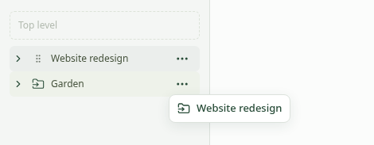 | 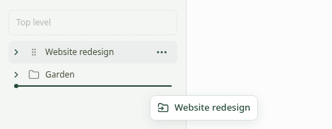 | 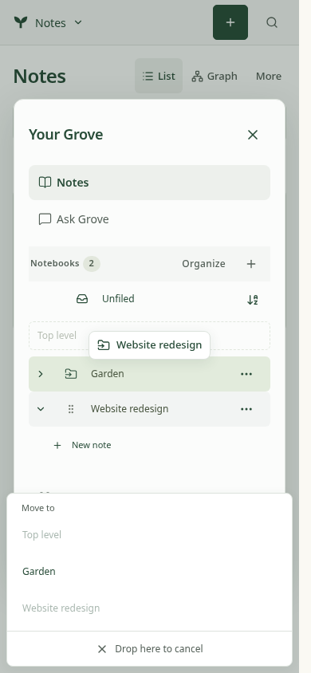 |

`drag-feedback.spec.ts` checks that the preview remains and the target has no
coloured inset shadow/left border. Existing mouse/touch/pen/keyboard, exact release,
covered-row cancellation and Undo cases retain their original preview assertions.
These Chromium/CDP checks are not physical-device or screen-reader acceptance.

## Display sorting — 27 November 2026

Synthetic actual-component captures on `feat/ui-ux-implementation`, parent
`4e2ac9f` plus the notebook-display implementation, production CSS build
`9U8tIIgcdDZUobDo5nr5b`. The manager and explorer share Name Z–A while retaining
the Autumn subtree. Reviewed at 1440×900, 768×900, 390×900 and short 320×480.

| Desktop                                                    | Tablet                                            | Phone                                                 | Short phone                                            |
| ---------------------------------------------------------- | ------------------------------------------------- | ----------------------------------------------------- | ------------------------------------------------------ |
| 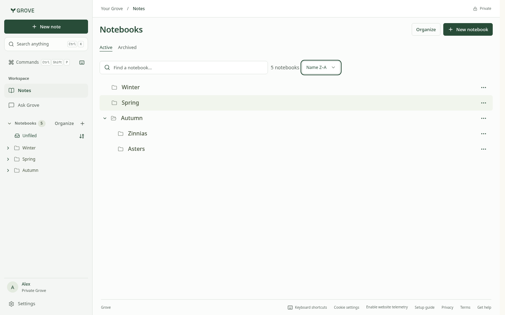 | 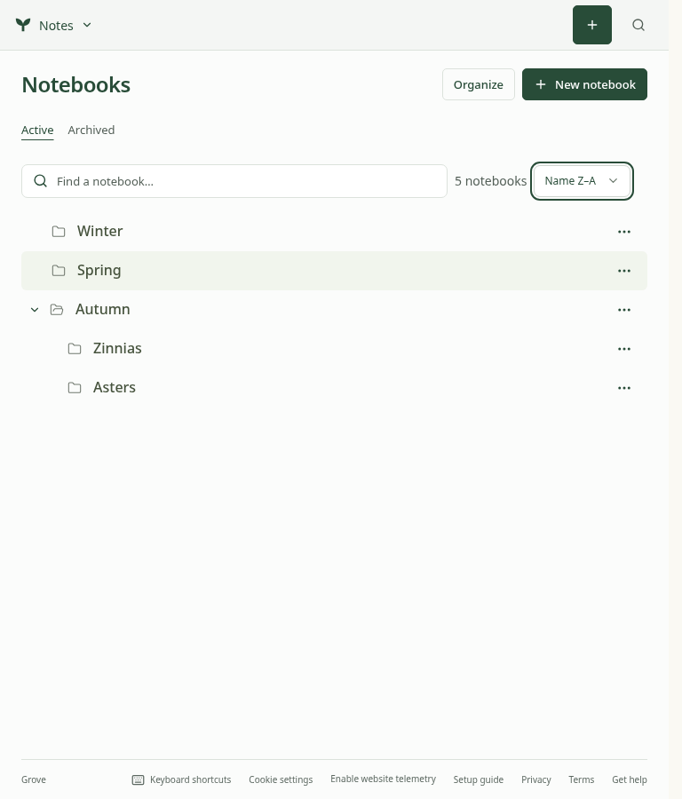 | 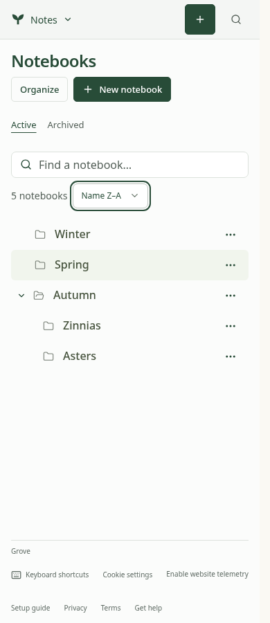 | 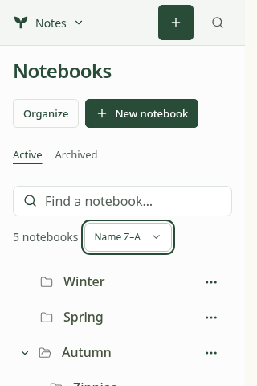 |

`notebook-display-sort.spec.ts` checks name/date sorting, reload persistence,
unchanged saved positions/no organize writes and saved-order Organize. The API
regression checks the actual immutable creation date after rename. Short views
scroll normally to later rows. Fixture HTTP and Chromium geometry are not live
Clerk, screen-reader, physical-device or production acceptance. Earlier images
below retain their original provenance.

## Notebook navigation and Notes toolbar — 18 November 2026

Actual workspace components, production build `Epy0cs4NF59uzZr-6dpGP`, and
synthetic account, plan, notebooks and notes from `organization-sort.spec.ts`.

| Notes, 1440 × 844                                                            | Open tree, 390 × 844                                        | Open tree, 320 × 844                                        | Nested selection, 390 × 844                                                 |
| ---------------------------------------------------------------------------- | ----------------------------------------------------------- | ----------------------------------------------------------- | --------------------------------------------------------------------------- |
| 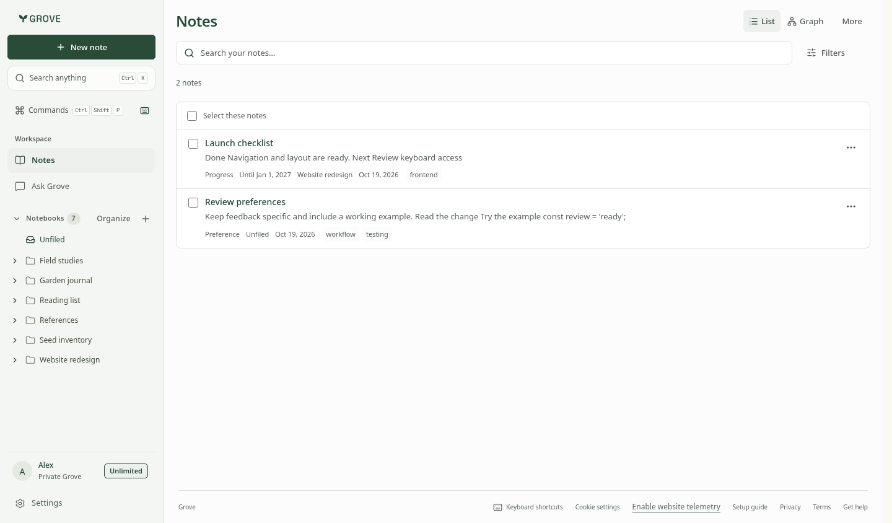 | 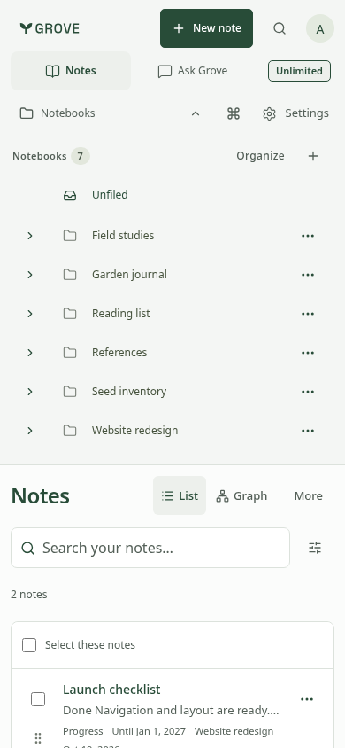 | 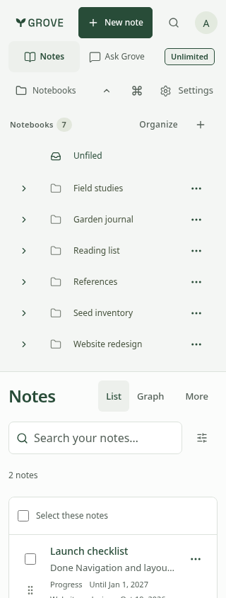 | 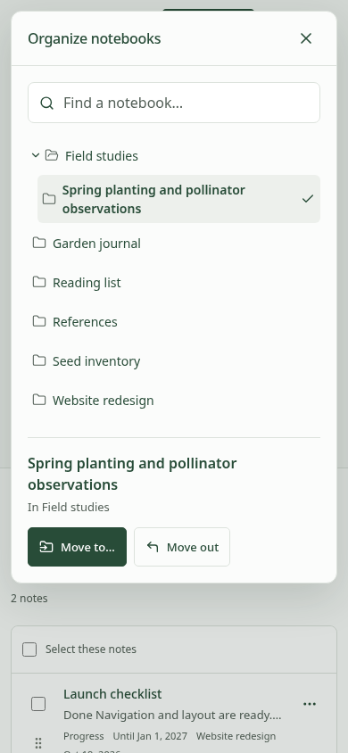 |

The notebook heading keeps Organize and creation together. On phones, the tree
opens below the navigation and uses its full width. The 320px capture uses a
dark system preference; the website retains its existing light palette. These
are Chromium captures with emulated touch, not physical-device verification.

## Sidebar, placement and note sorting — 17 November 2026

Synthetic workspace fixture with production styles from build `l_jyhVC7Lhz9nyXrCderS`.
Open Organize beneath the notebook heading; a known notebook is preselected.
The tree otherwise opens on its own. Selecting a single child exposes the two
available moves without an ordering toolbar or a save footer.

| Viewport            | Sidebar entry                                          | Browse                                    | Selection                                                         |
| ------------------- | ------------------------------------------------------ | ----------------------------------------- | ----------------------------------------------------------------- |
| Desktop, 1440 × 844 | 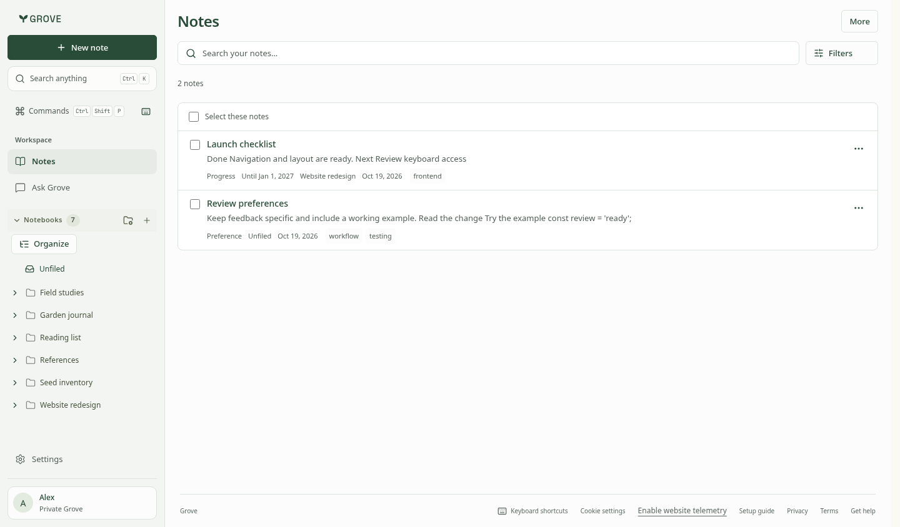 | 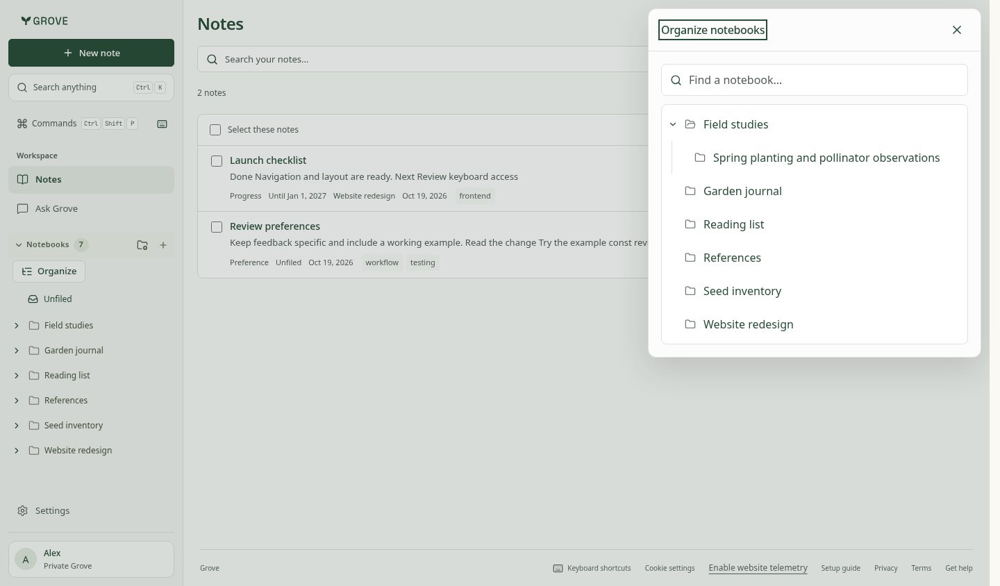 | 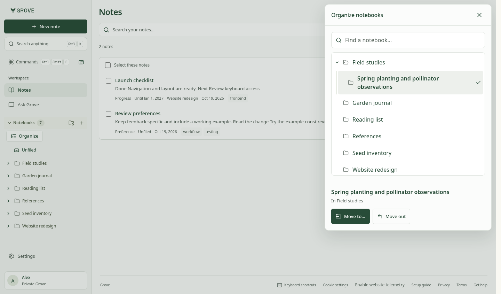          |
| Touch, 390 × 844    | 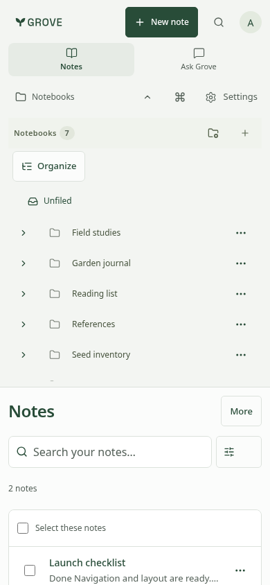   | 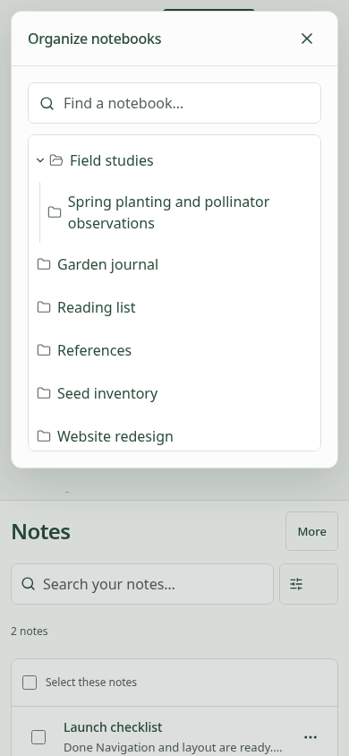      | 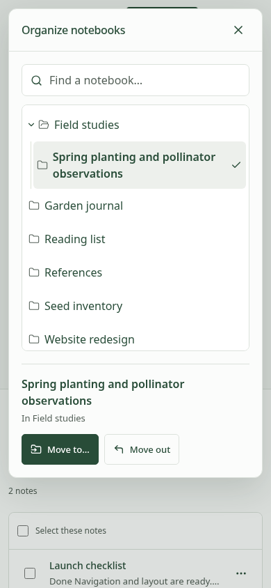 |

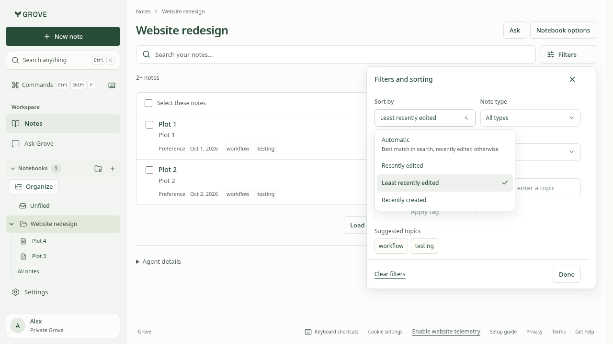

`organization-sort.spec.ts` exercises heading focus, tab order, exact placement,
Undo and focus return, plus the search request and cursor for a date-sorted,
filtered notebook. These are Chromium and touch-emulation checks, not physical
iOS or software-keyboard validation. All identities and records are fixtures.

## Earlier organizer review

26 October 2026 polish. Actual workspace components and production CSS, build
`90_hUwA8nK3oRNZo31GFO`, in the isolated loopback dashboard fixture. The API and
500-notebook account use disposable PostgreSQL and the non-owner API role. All
names, notes and identities are synthetic; no owner reference screenshot is stored.

The refreshed captures show the desktop browse/selection split, phone controls,
single-border Move search and independent action footers. Short windows deliberately
scroll the body while Cancel/Move remain reachable; they do not squeeze every field
into the visible area. No mutation/notification state logic changed in this pass.

| Desktop manager                                                | Phone manager                                      | Desktop Organize                                                        |
| -------------------------------------------------------------- | -------------------------------------------------- | ----------------------------------------------------------------------- |
| 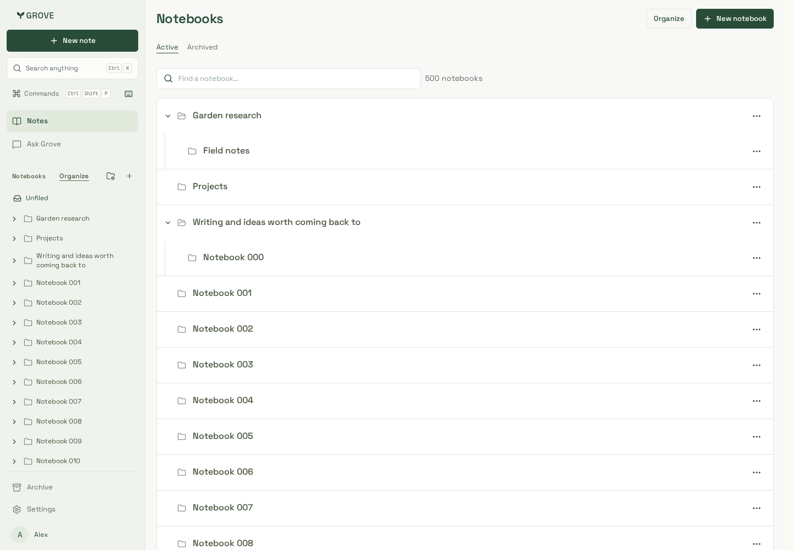 | 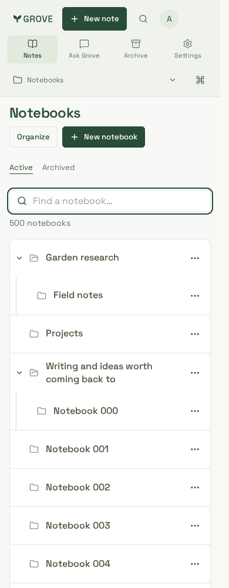 | 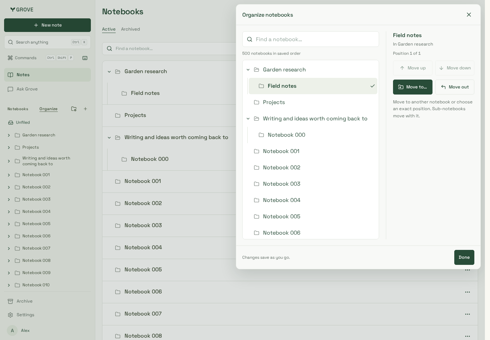 |

| Phone Organize                                            | Move                                                          | Short window                                                            |
| --------------------------------------------------------- | ------------------------------------------------------------- | ----------------------------------------------------------------------- |
| 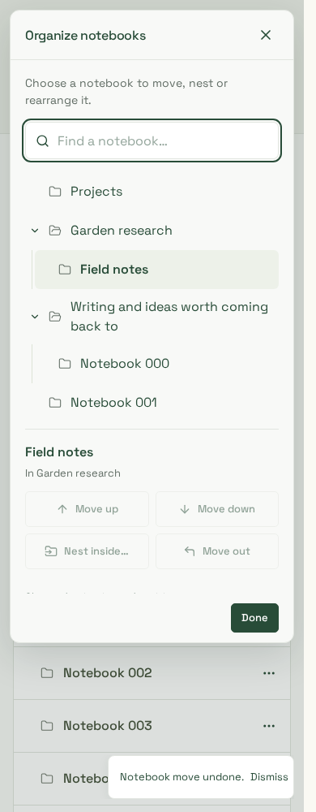 | 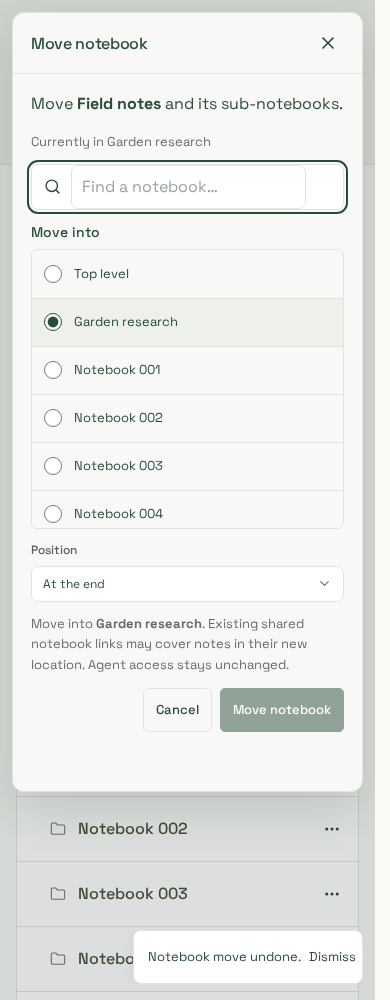 | 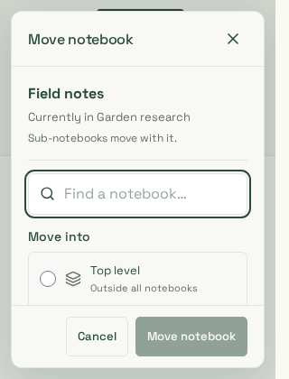 |

Reviewed manager, Organize and Move at1440/390/320px, plus420px heights. Chromium
and touch/mobile WebKit pass layout/empty-search recovery, selected-row visibility,
preview retention, Cancel focus return and locked-heading recovery checks. The
WebKit recovery submission uses native tap; a longer mouse-click sequence had an
intermittent missed submission and remains outside a consistent-pointer claim.
Full500-notebook functional
journeys verify saved sibling order, nest/unnest, inverse Undo, accepted-but-lost
response replay with the exact request, reviewed concurrent changes, stale-Undo
denial and unchanged original note scope/version. Standalone Move also replaces
its old form base after a successful uncertain-response retry. Mouse before/after
insertion targets persist order without changing the source notebook version.

Automated WCAG A/AA and overflow review uses representative filtered layouts; it
is separate from full-catalog functional coverage, not a500-row accessibility
performance claim. Trusted Chromium touch input verifies native vertical scrolling
from the tap-only folder control, no accidental notebook drag/write, tap Organize,
inner-list scrolling, short320px dismissal and body-swipe action reveal/cancellation.
The existing note swipe/drag implementation is unchanged.

The owner's reported physical-phone problems still need device/browser/version
and an actual trace. Headless Chromium and supported Noble WebKit are not physical
iOS/Android, software-keyboard, pinch or back-edge gesture acceptance.
