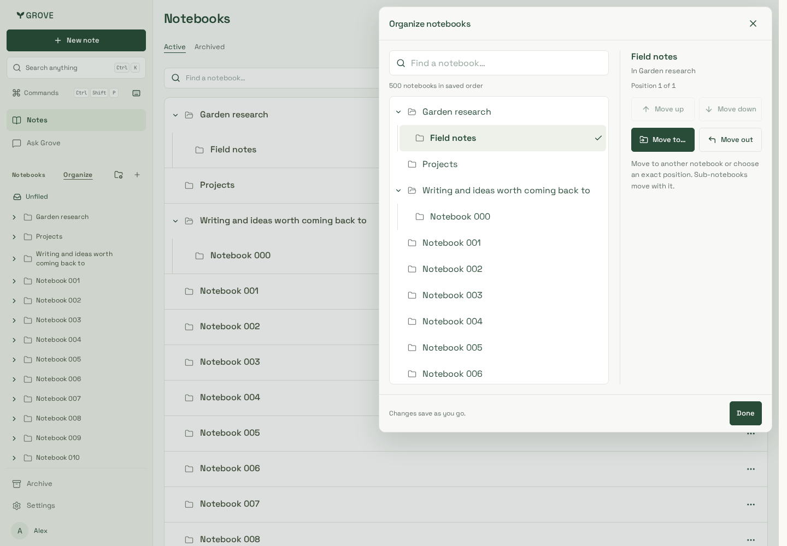
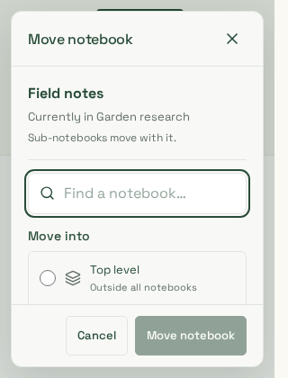

# Notebook organizer review

26 October 2026 polish. Actual workspace components and production CSS, build
`90_hUwA8nK3oRNZo31GFO`, in the isolated loopback dashboard fixture. The API and
500-notebook account use disposable PostgreSQL and the non-owner API role. All
names, notes and identities are synthetic; no owner reference screenshot is stored.

The refreshed captures show the desktop browse/selection split, phone controls,
single-border Move search and independent action footers. Short windows deliberately
scroll the body while Cancel/Move remain reachable; they do not squeeze every field
into the visible area. No mutation/notification state logic changed in this pass.

| Desktop manager                                                | Phone manager                                      | Desktop Organize                                                        |
| -------------------------------------------------------------- | -------------------------------------------------- | ----------------------------------------------------------------------- |
|  |  |  |

| Phone Organize                                            | Move                                                          | Short window                                                            |
| --------------------------------------------------------- | ------------------------------------------------------------- | ----------------------------------------------------------------------- |
|  |  |  |

Reviewed manager, Organize and Move at1440/390/320px, plus420px heights. Chromium
and touch/mobile WebKit pass layout/empty-search recovery, selected-row visibility,
preview retention, Cancel focus return and locked-heading recovery checks. The
WebKit recovery submission uses native tap; a longer mouse-click sequence had an
intermittent missed submission and remains outside a consistent-pointer claim.
Full500-notebook functional
journeys verify saved sibling order, nest/unnest, inverse Undo, accepted-but-lost
response replay with the exact request, reviewed concurrent changes, stale-Undo
denial and unchanged original note scope/version. Standalone Move also replaces
its old form base after a successful uncertain-response retry. Mouse before/after
insertion targets persist order without changing the source notebook version.

Automated WCAG A/AA and overflow review uses representative filtered layouts; it
is separate from full-catalog functional coverage, not a500-row accessibility
performance claim. Trusted Chromium touch input verifies native vertical scrolling
from the tap-only folder control, no accidental notebook drag/write, tap Organize,
inner-list scrolling, short320px dismissal and body-swipe action reveal/cancellation.
The existing note swipe/drag implementation is unchanged.

The owner's reported physical-phone problems still need device/browser/version
and an actual trace. Headless Chromium and supported Noble WebKit are not physical
iOS/Android, software-keyboard, pinch or back-edge gesture acceptance.
