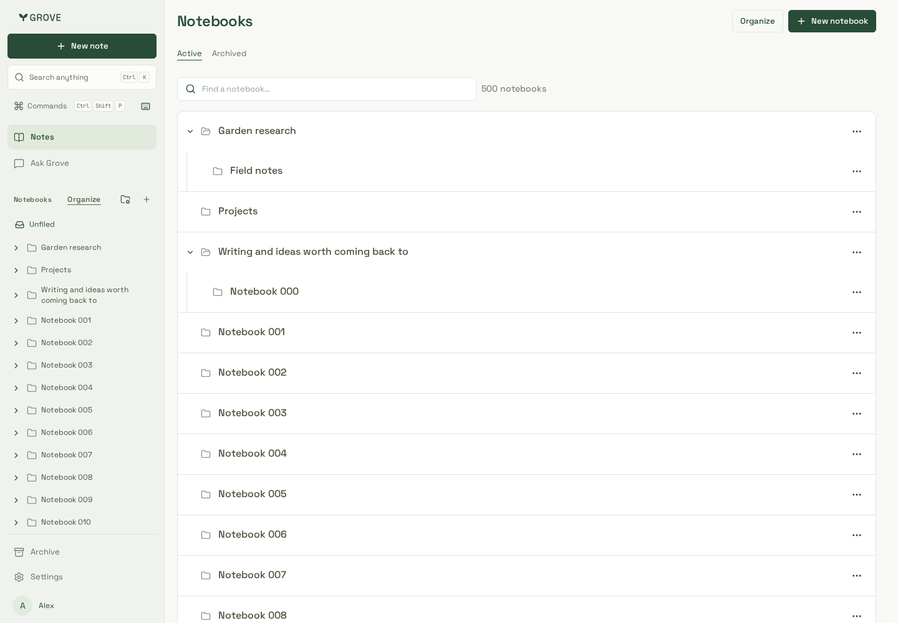
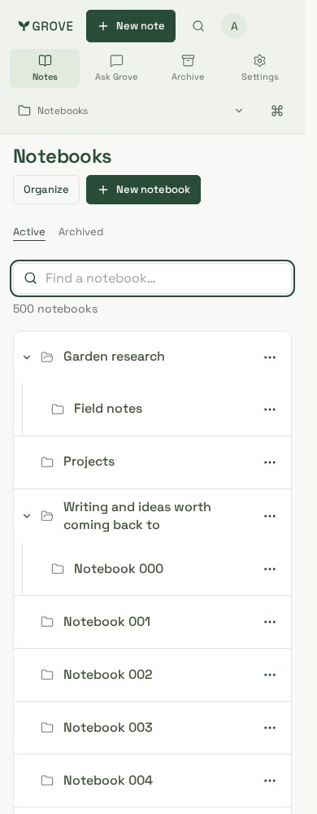
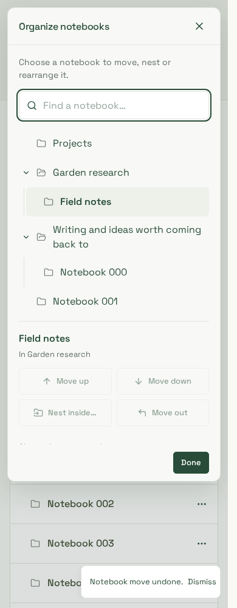
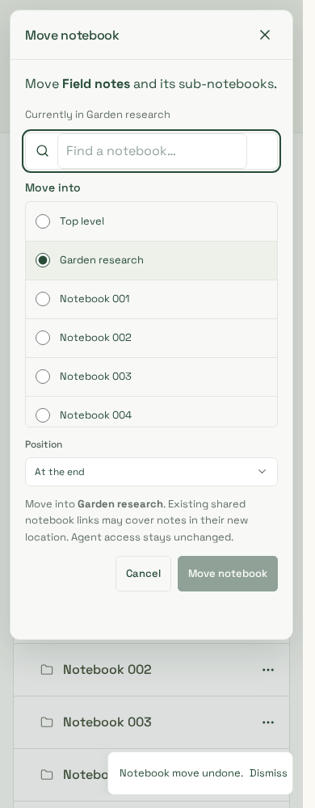

# Notebook organizer review

25 October 2026. Actual workspace components and production CSS, build
`tipF56b61ayjRXkmtRKT1`, in the isolated loopback dashboard fixture. The API and
500-notebook account use disposable PostgreSQL and the non-owner API role. All
names, notes and identities are synthetic; no owner reference screenshot is stored.

These captures precede the nonvisual lookup/reconciliation follow-up. The PR stays
draft: the500-row WebKit pointer/Undo stress journey is inconsistent, even though
small filtered real-service moves/Undo and seven existing WebKit cases pass.
Capture review is not full WebKit interaction acceptance.

| Desktop manager                                                | Phone manager                                      | Organize                                                  | Move                                                          |
| -------------------------------------------------------------- | -------------------------------------------------- | --------------------------------------------------------- | ------------------------------------------------------------- |
|  |  |  |  |

Reviewed manager, Organize and Move at1440/390/320px. Full500-notebook functional
journeys verify saved sibling order, nest/unnest, inverse Undo, accepted-but-lost
response replay with the exact request, reviewed concurrent changes, stale-Undo
denial and unchanged original note scope/version. Standalone Move also replaces
its old form base after a successful uncertain-response retry. Mouse before/after
insertion targets persist order without changing the source notebook version.

Automated WCAG A/AA and overflow review uses representative filtered layouts; it
is separate from full-catalog functional coverage, not a500-row accessibility
performance claim. Trusted Chromium touch input verifies native vertical scrolling
from the tap-only folder control, no accidental notebook drag/write, tap Organize,
inner-list scrolling, short320px dismissal and body-swipe action reveal/cancellation.
The existing note swipe/drag implementation is unchanged.

The owner's reported physical-phone problems still need device/browser/version
and an actual trace. Headless Chromium and supported Noble WebKit are not physical
iOS/Android, software-keyboard, pinch or back-edge gesture acceptance.
