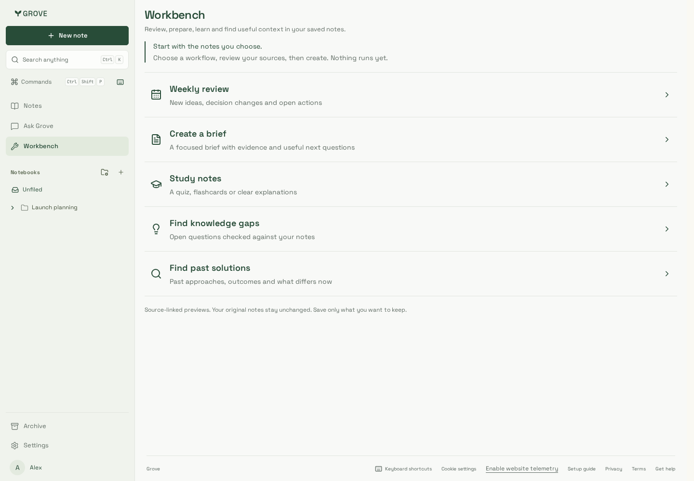
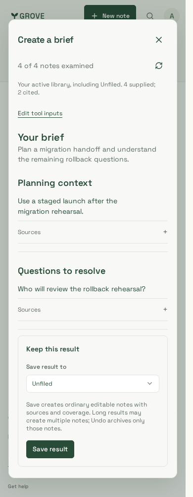
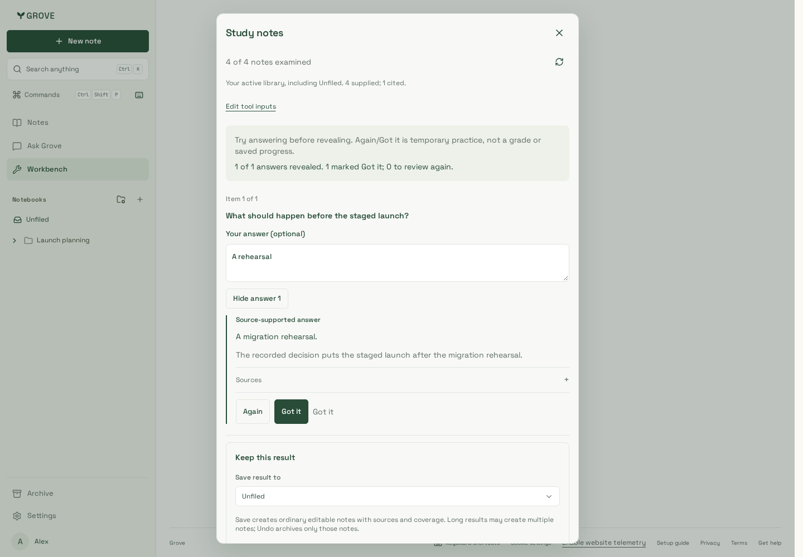
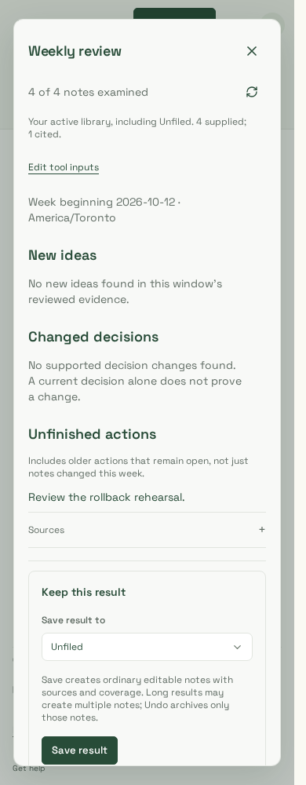
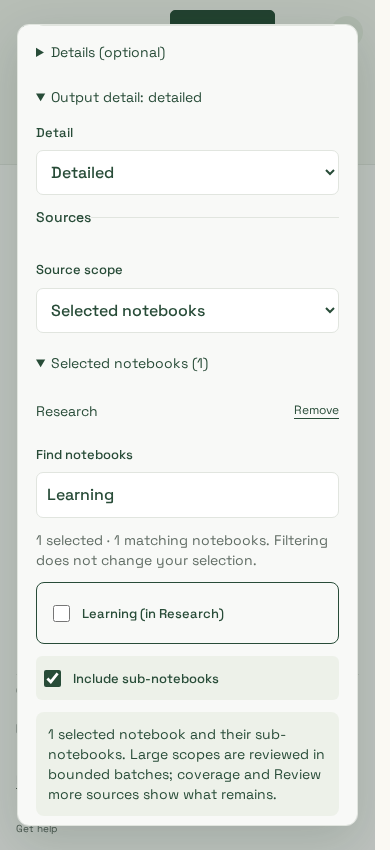

# Workbench — reviewed synthetic captures

Application source **ee98349** (refinement94630dd plus compact-navigation fix),
production CSS/build **SsA58UxOf8U3e2ncubtlS**. The build compiled this source
before the navigation commit; its manifest retains94630dd. Four Chromium captures use actual dashboard components
and the real loopback HTTP API, disposable PostgreSQL and worker with deterministic
synthetic inference. The additional source-picker capture uses the same components/
CSS with two synthetic notebook/search responses to demonstrate hidden selections.
No personal notes or paid providers. The previous881d001 captures remain in Git history.

| Workbench home                       | General brief                         | Study answer and practice       | Weekly review                           |
| ------------------------------------ | ------------------------------------- | ------------------------------- | --------------------------------------- |
|  |  |  |  |

### Explicit sources on a phone

The scrolled source-picker view shows Research still selected while Learning is
the only filter match, explicit sub-notebook inclusion and detailed output choice.

The source flows cover all five modes (including gap answer search and past-solution
outcomes), source links, reviewed Save/Undo and unchanged original versions. Study
Reveal/Hide keeps the typed quiz answer visible; Again/Got it has visible pressed
state and local counts. This is temporary practice, not grading or persisted progress. Weekly
empty idea/decision sections correctly abstain; the older open task remains cited.

Review uses1440/390/320px, WCAG A/AA, no horizontal page overflow or browser errors,
plus the same real-service journeys in supported Noble WebKit. Existing browser
regressions also check consent, retained inputs/pins, lost enqueue/Save identities,
cancellation and expiry. A separate actual-component synthetic continuation exercise
checks per-tool scope/draft retention and an accepted-but-lost Continue recovered via
GET, then resumed at the new version without creating a second operation.
Both engines also pass keyboard launch/Back focus, notebook filtering without lost
selection, retained detail/pins/titles and200% text in640px-high1440/390/320px windows.

This is deterministic source/UI evidence, not live-model grounding, semantic quality,
production latency/cost, large-library performance or physical-device acceptance.
The original [meeting gallery](../meeting-preparation/README.md) is retained only as
historical evidence of the legacy031 slice, not the current Workbench experience.
