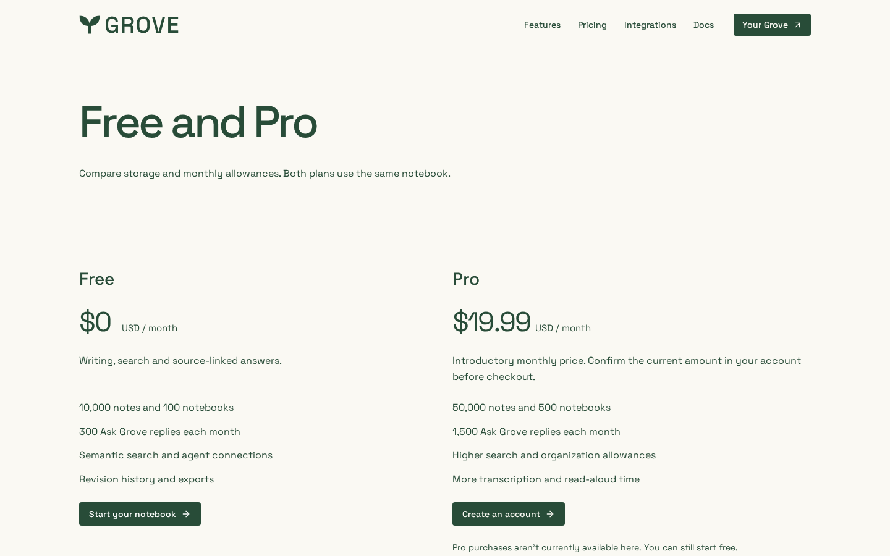

# Pro monthly price

Local optimized-build evidence for the $19.99 USD/month website fallback, with
the billing gate left disabled. [Capture provenance](capture.json) records source,
build, browser and viewports. These are synthetic public-page captures, not payment
or production deployment evidence.

| Desktop                                                 | Phone                                                  |
| ------------------------------------------------------- | ------------------------------------------------------ |
|  |  |

[Tablet](pricing-768.png) · [Small phone](pricing-320.png) ·
[Full desktop page](pricing-page-1440.png) · [Full phone page](pricing-page-390.png).

The no-JavaScript pricing regression first fails at the former $5.00 default and
passes at $19.99. Vercel's `billing-pro-monthly-usd` variant is also 19.99;
billing-enabled, environment rules, allowances and existing subscriptions are
unchanged. No Stripe checkout or price creation is performed for verification.
