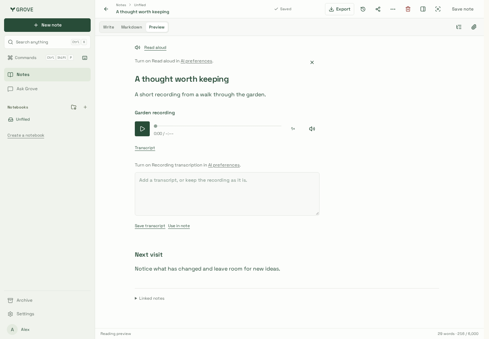
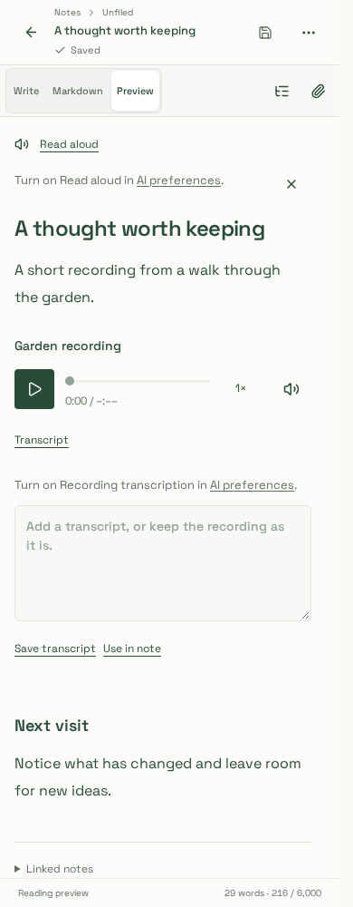
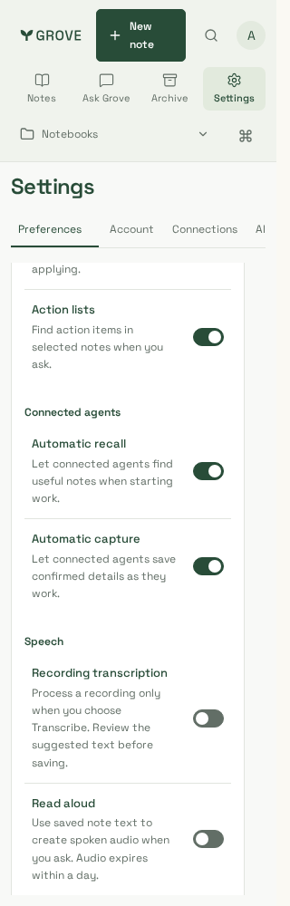

# Feature-focused copy

Reviewed synthetic captures from application source `463b0e3`, production build
`-peSNM7C7EYGVJiboKapO`, on Node 24.21.0 / pnpm 10.33.0 (23 October 2026).
The existing browser fixture bundles real workspace components with production CSS;
API responses contain only synthetic notes/settings. No personal note, recording,
account or production service is used.

| Desktop speech prompts                                             | Phone speech prompts                                   | Narrow preferences                                              |
| ------------------------------------------------------------------ | ------------------------------------------------------ | --------------------------------------------------------------- |
|  |  |  |

Additional reviewed captures:

- [Desktop preferences, scrolled to Speech](preferences-1440.png)
- [AI feature availability](availability-desktop.png)

## Review scope

- Root/site lint, types/builds, nine packaged artifacts, the full 223 Chromium suite
  and the bundle budget pass. Notes entry is 488,014 gzip bytes; editor code stays
  deferred.
- Speech prompts name the feature and link to **AI preferences** rather than
  describing a backend vendor. Both settings links are visibly underlined.
- Preference descriptions explain explicit transcription, reviewing suggested text,
  saved-text narration and the temporary audio lifetime.
- Ordinary availability copy describes features, not service configuration. Actual
  model/provider values in the synthetic response do not appear in rendered text.
- Chromium and WebKit actual-component journeys pass at 1440/390/320px: rendered
  vendor-name checks, horizontal bounds and WCAG A/AA. The settings link navigates
  correctly; opening controls/preferences makes no write or speech request. An
  unavailable Read aloud prompt names that feature without installation jargon.
  Unavailable public sharing uses the same feature-focused language and makes no
  write when opened.
- Six existing focused iPhone/WebKit settings scenarios pass, including independent
  choices, held saves, drafts, accessibility and both ordinary/operator model views.

The initial speech review reproduced a colour-only inline-link accessibility failure;
the scoped underline correction passes the same unchanged check in both engines.
Local WebKit uses the documented Playwright 1.64.1 Noble container because the host
lacks its system libraries. These checks do not qualify physical-device behavior,
actual transcription quality, provider billing or a production rollout.

See [copy guidance](../../../development/product-copy.md) and
[speech contract](../../../speech.md).
