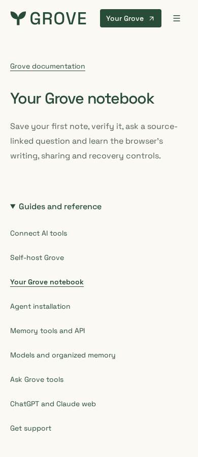
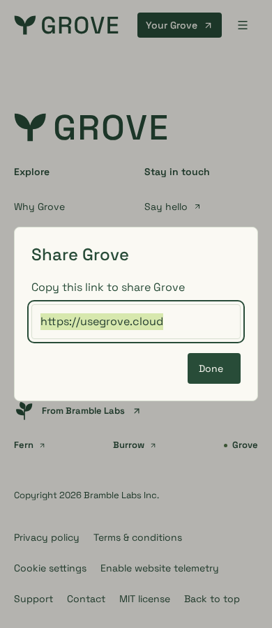
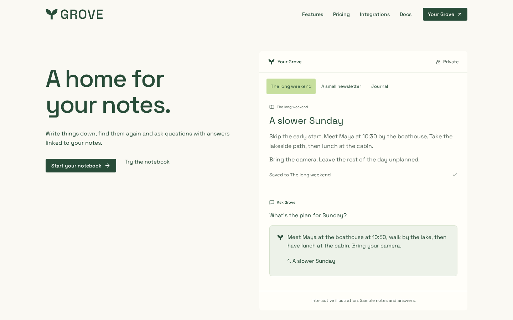
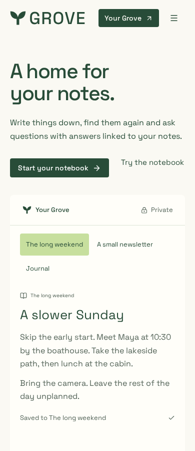
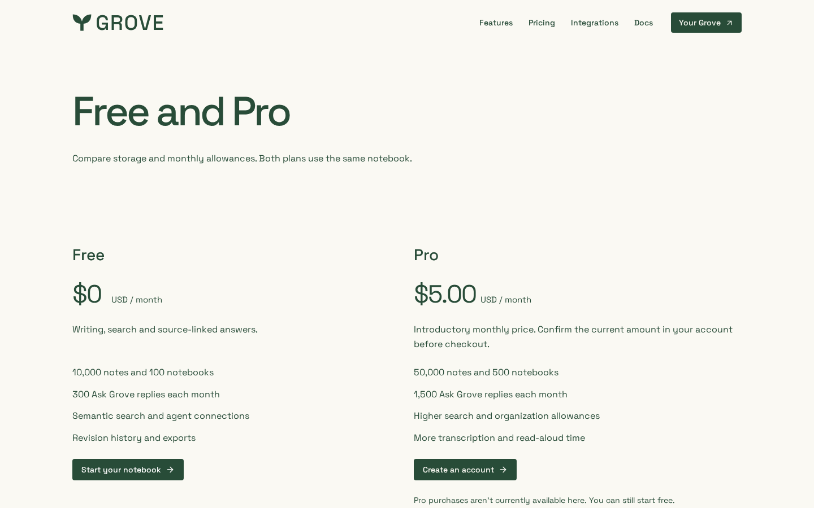
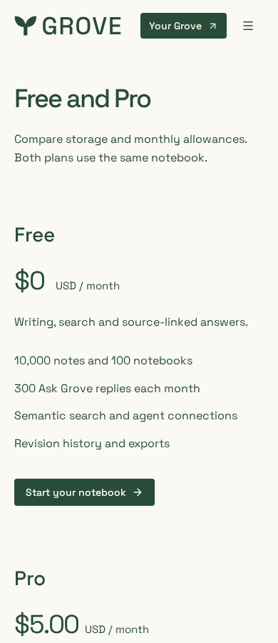
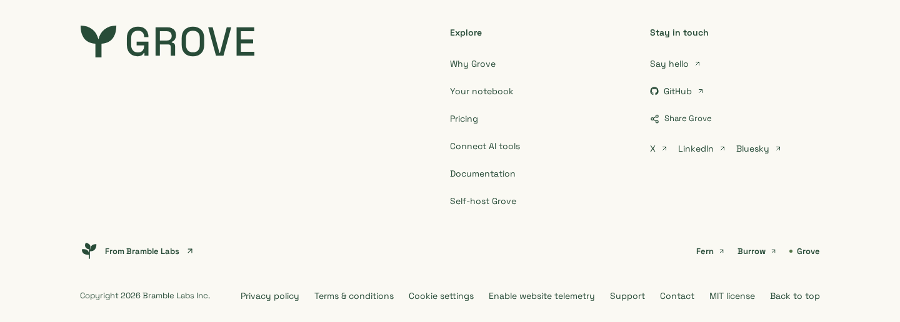
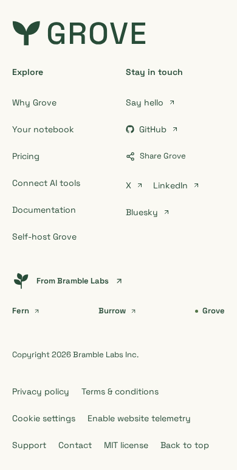

# Grove notebook and pricing pages

Reviewed local optimized-build captures of the live-layout-led polish pass.
[Capture provenance](capture.json) records the source fingerprint, build ID,
browser, viewports and synthetic-data boundary.

## Refinement review

Phone guides use a native resource disclosure; useful notebook instructions start
216px sooner at 390px. Pricing aligns both plans to the 20px page edge rather than
adding a 28px inset. Compact library padding retains every note/graph detail and
the mounted intrinsic-height tracks; it does not clip or remount the sample.

| Guide navigation expanded                                                  | Manual-copy recovery                                                  |
| -------------------------------------------------------------------------- | --------------------------------------------------------------------- |
|  |  |

Recovery uses synthetic denied share/clipboard access. Done/Escape returns focus;
copy feedback and recovery leave the footer/page/scroll unchanged. All 272 browser
cases pass. Four-width reviews report zero inspector failures, automated
accessibility violations, overflow or demo-height changes.
[Small-phone pricing](pricing-320.png) · [Tablet pricing](pricing-768.png).

Captured from the local optimized Next.js build of `feature/website-product-refresh`.
The paper split introduction, Space Grotesk and working notebook examples preserve
the live site's hierarchy. The public graph reuses the app canvas and force layout
with eight local notes, not account queries. Its styles are scoped independently;
the full authenticated stylesheet must not be imported by the public sample.

| Home — 1440 × 900            | Home — 390 × 900                       |
| ---------------------------- | -------------------------------------- |
|  |  |

| Pricing — 1440 × 900               | Pricing — 390 × 900                          |
| ---------------------------------- | -------------------------------------------- |
|  |  |

[Tablet home](home-768.png) · [Full desktop home](home-page-1440.png) ·
[Full phone home](home-page-390.png) · [Full desktop pricing](pricing-page-1440.png) ·
[Full phone pricing](pricing-page-390.png)

| Compact footer — desktop                                             | Compact footer — phone                            |
| -------------------------------------------------------------------- | ------------------------------------------------- |
|  |  |

The 4 November kit guidelines govern Space Grotesk 500 hero and section
headings, meaningful notebook pages and the approved signature in the compact
footer. The giant-name row is removed; footer targets remain at least 44px.
Desktop pricing actions use shared subgrid rows to align across both plans.
[Graph on desktop](graph-1440.png) · [Graph on a phone](graph-390.png).
Only the selected title is shown initially, avoiding a pile-up on narrow canvases;
the Titles control, note selection, linked-note inspector, pan and zoom remain usable.

[Small-phone home](home-320.png) · [Tablet page](home-page-768.png) ·
[Small-phone page](home-page-320.png) · [Keyboard focus](home-focus-1440.png) ·
[200% CSS zoom reflow](home-zoom-200.png).
The zoom capture checks CSS reflow, not native browser zoom or physical-device accessibility.

[Notebook setup, desktop](walkthrough-1440.png) · [Phone](walkthrough-390.png) ·
[Newsletter selection, desktop](newsletter-1440.png) · [Phone](newsletter-390.png) ·
[Source-linked answer, desktop](ask-1440.png) · [Phone](ask-390.png).

All notebook and answer content is labelled synthetic demonstration data. The journal
photograph is a local marketing-kit derivative with retained source/licence hashes in
the [asset manifest](../../../../packages/website/public/images/kit/manifest.json).
No customer proof or live account content is used. Pricing reads
the existing shared allowances and price flag. These captures show the default
introductory $5 USD/month with purchases disabled; no checkout is created. Effective
account grants and checkout remain authoritative.

Optional cookies were declined using the real notice before unobstructed capture;
the browser suite separately covers consent and provider failures. The information-led
pricing page deliberately has no decorative media or scroll animation. The maintained
[notebook guide](docs-notebook-page-390.png) and [client setup](install-page-390.png)
separate writing, approval, activation and save/recall verification. Evidence is local source/fixture qualification,
not billing activation, provider evaluation or production deployment.
