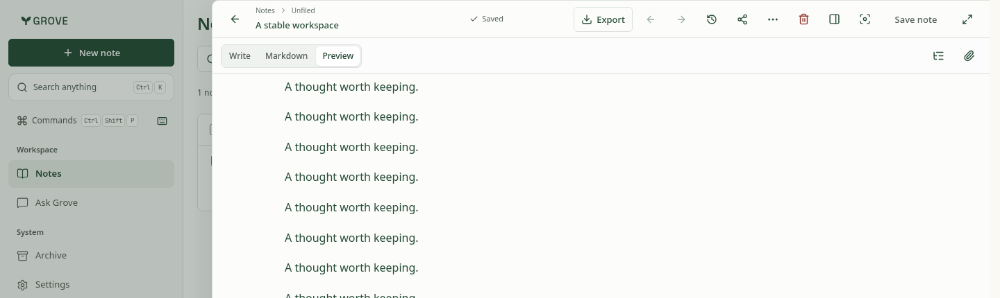
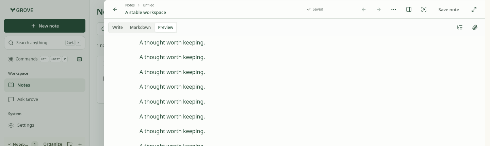
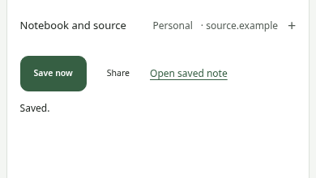
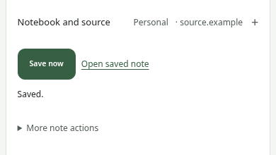

# Quieter note actions

Matched crops from local browser tests with synthetic notes. The before images
show PR #220. The after images show the same views with occasional actions moved
out of the main controls.

## Desktop note toolbar (1440 px viewport)

| Before | After |
| --- | --- |
|  |  |

## Extension Notes panel (390 px viewport)

| Before | After |
| --- | --- |
|  |  |
