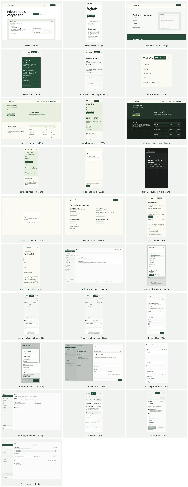

# Grove interface review

[Open the single screenshot sheet](overview.webp) to zoom in. For the uncropped originals, choose a view below. The captures use local fixtures; account entry shows the provider-unavailable state.

| Workflow | Full-size screenshots |
| --- | --- |
| [Home and features · #271](https://github.com/miniaxolotl/grove/pull/271) | [Home](https://github.com/miniaxolotl/grove/blob/500b4dc9ac6a2e449d08763e226ea4413b9779d9/documentation/design/screenshots/website-minimal-refresh/overview/home-1440-light.png) · [Phone home](https://github.com/miniaxolotl/grove/blob/500b4dc9ac6a2e449d08763e226ea4413b9779d9/documentation/design/screenshots/website-minimal-refresh/overview/home-320-light.png) · [Feature example](https://github.com/miniaxolotl/grove/blob/500b4dc9ac6a2e449d08763e226ea4413b9779d9/documentation/design/screenshots/website-minimal-refresh/overview/features-1440-dark.png) · [Get started](https://github.com/miniaxolotl/grove/blob/500b4dc9ac6a2e449d08763e226ea4413b9779d9/documentation/design/screenshots/website-minimal-refresh/overview/setup-390-dark.png) · [Phone feature example](https://github.com/miniaxolotl/grove/blob/500b4dc9ac6a2e449d08763e226ea4413b9779d9/documentation/design/screenshots/website-minimal-refresh/overview/features-390-dark.png) |
| [Public navigation · #268](https://github.com/miniaxolotl/grove/pull/268) | [Phone menu](https://github.com/miniaxolotl/grove/blob/7b82281e03a61ab59ab7fd2f21d063d0f2e9edbd/documentation/design/screenshots/product-redesign/public-menu-320.png) |
| [Pricing · #273](https://github.com/miniaxolotl/grove/pull/273) | [Plan comparison](https://github.com/miniaxolotl/grove/blob/0e766ea2ec42741c894b5f302e168d5893f23365/documentation/design/screenshots/billing-periods/plans-on-1440-light.png) · [Mobile comparison](https://github.com/miniaxolotl/grove/blob/0e766ea2ec42741c894b5f302e168d5893f23365/documentation/design/screenshots/billing-periods/plans-on-390-light.png) · [Upgrades unavailable](https://github.com/miniaxolotl/grove/blob/0e766ea2ec42741c894b5f302e168d5893f23365/documentation/design/screenshots/billing-periods/plans-off-1440-dark.png) · [Narrow comparison](https://github.com/miniaxolotl/grove/blob/0e766ea2ec42741c894b5f302e168d5893f23365/documentation/design/screenshots/billing-periods/plans-off-320-light.png) |
| [Account entry · #269](https://github.com/miniaxolotl/grove/pull/269) | [Sign-in fallback](https://github.com/miniaxolotl/grove/blob/69ef76e9de57a0377140053891a22dbd67816dd2/documentation/design/screenshots/account-entry/sign-in-390-consent.png) · [Sign-up keyboard focus](https://github.com/miniaxolotl/grove/blob/69ef76e9de57a0377140053891a22dbd67816dd2/documentation/design/screenshots/account-entry/sign-up-320-dark-focus.png) · [Desktop fallback](https://github.com/miniaxolotl/grove/blob/69ef76e9de57a0377140053891a22dbd67816dd2/documentation/design/screenshots/account-entry/sign-in-1440.png) |
| [Docs and setup · #270](https://github.com/miniaxolotl/grove/pull/270) | [Docs directory](https://github.com/miniaxolotl/grove/blob/d94f0ef6a72395684cb88bb1e2ab9315d70213c0/documentation/design/screenshots/discovery/tasks-1440.png) · [App setup](https://github.com/miniaxolotl/grove/blob/d94f0ef6a72395684cb88bb1e2ab9315d70213c0/documentation/design/screenshots/discovery/tasks-390.png) · [Article shortcuts](https://github.com/miniaxolotl/grove/blob/d94f0ef6a72395684cb88bb1e2ab9315d70213c0/documentation/design/screenshots/discovery/tasks-320.png) |
| [Notebook navigation · #275](https://github.com/miniaxolotl/grove/pull/275) | [Desktop workspace](https://github.com/miniaxolotl/grove/blob/4c7c7f7de898c21e24f85eeb78c7600b2aa9deec/documentation/design/screenshots/notebook-organizer/rail-entry-1440.webp) · [Notebook selection](https://github.com/miniaxolotl/grove/blob/4c7c7f7de898c21e24f85eeb78c7600b2aa9deec/documentation/design/screenshots/notebook-organizer/rail-selected-390.webp) · [Narrow notebook tree](https://github.com/miniaxolotl/grove/blob/4c7c7f7de898c21e24f85eeb78c7600b2aa9deec/documentation/design/screenshots/notebook-organizer/rail-entry-320.webp) · [Phone notebook tree](https://github.com/miniaxolotl/grove/blob/4c7c7f7de898c21e24f85eeb78c7600b2aa9deec/documentation/design/screenshots/notebook-organizer/rail-entry-390.webp) |
| [Note editor · #272](https://github.com/miniaxolotl/grove/pull/272) | [Phone editor](https://github.com/miniaxolotl/grove/blob/d939ecd3fa631b408c54202b73772eab26ae831b/documentation/design/screenshots/note-workspace/note-form-mobile.png) · [Parent notebook picker](https://github.com/miniaxolotl/grove/blob/d939ecd3fa631b408c54202b73772eab26ae831b/documentation/design/screenshots/note-workspace/note-parent-picker.png) · [Desktop editor](https://github.com/miniaxolotl/grove/blob/d939ecd3fa631b408c54202b73772eab26ae831b/documentation/design/screenshots/note-workspace/note-form-desktop.png) · [Saved properties](https://github.com/miniaxolotl/grove/blob/d939ecd3fa631b408c54202b73772eab26ae831b/documentation/design/screenshots/note-workspace/note-properties.png) |
| [Preferences and files · #274](https://github.com/miniaxolotl/grove/pull/274) | [Writing preferences](https://github.com/miniaxolotl/grove/blob/0ead016436c739678c58421ad718d5be434741e4/documentation/design/screenshots/ai-settings/responsive-writing-1440.webp) · [File filters](https://github.com/miniaxolotl/grove/blob/0ead016436c739678c58421ad718d5be434741e4/documentation/design/screenshots/files-storage/responsive-files-320.webp) · [AI preferences](https://github.com/miniaxolotl/grove/blob/0ead016436c739678c58421ad718d5be434741e4/documentation/design/screenshots/ai-settings/responsive-ai-390.webp) · [File inventory](https://github.com/miniaxolotl/grove/blob/0ead016436c739678c58421ad718d5be434741e4/documentation/design/screenshots/files-storage/responsive-files-1440.webp) |
