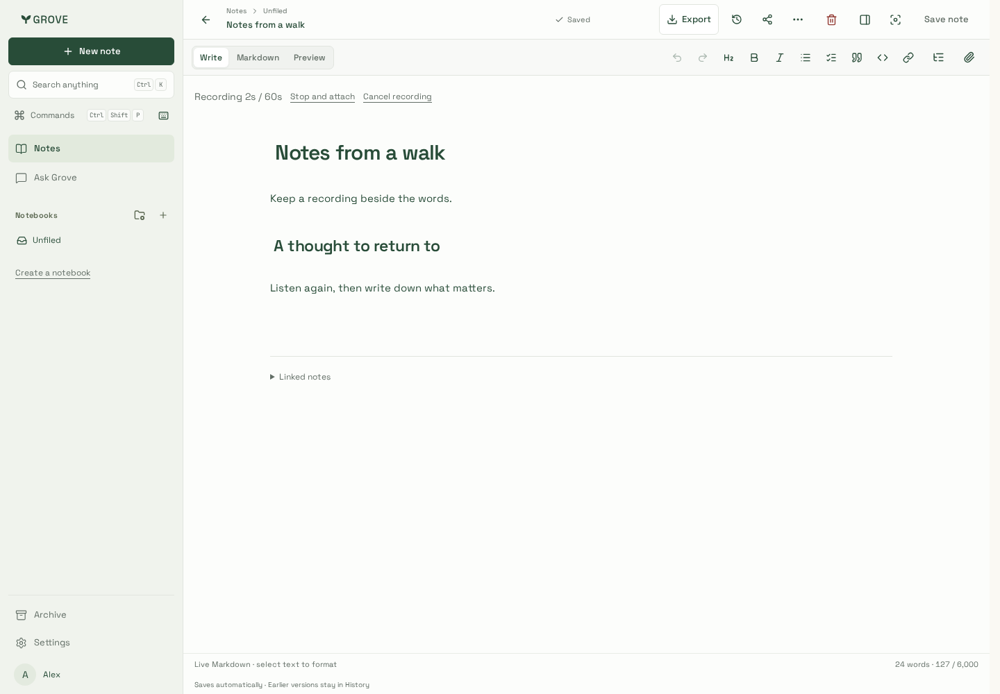
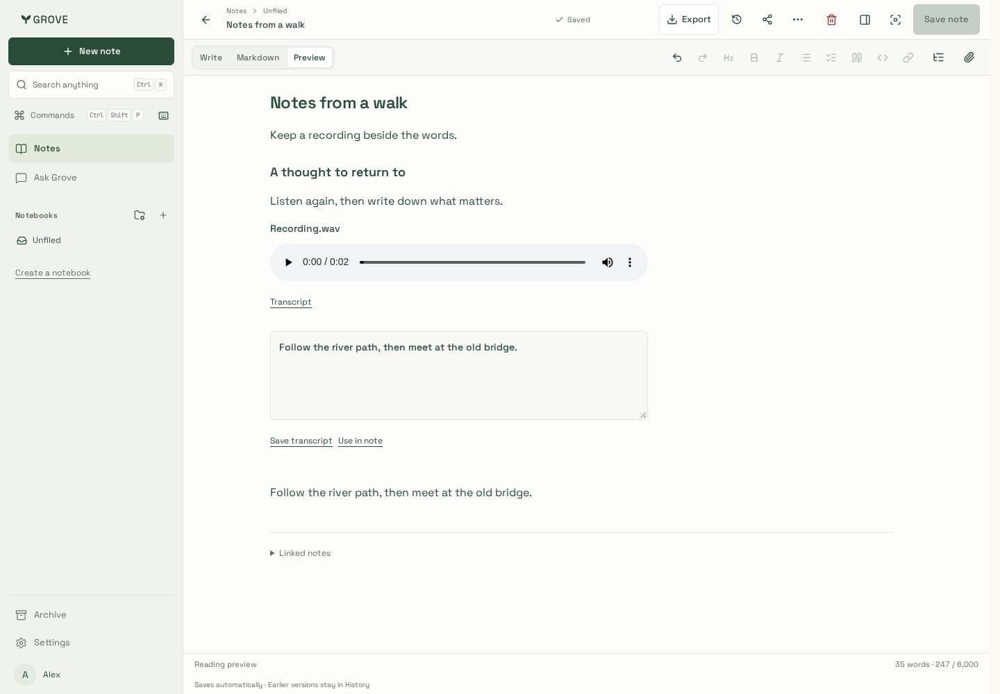
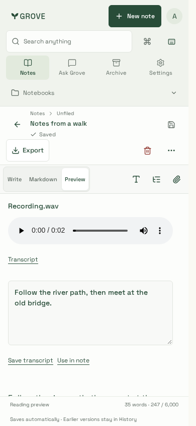

# Recording verification

Synthetic browser microphone input and a disposable real API/PostgreSQL/private
storage fixture; no real voice, account content or provider inference.

| Capture                                               | Playback and transcript                                      | Phone                                            |
| ----------------------------------------------------- | ------------------------------------------------------------ | ------------------------------------------------ |
|  |  |  |

The journey records, stops/attaches, checks ended microphone tracks, saves/reopens
the original WAV, plays it, edits/saves a transcript, uses it in normal note text,
cancels a second recording and downloads TAR/PDF. Physical microphones and OS-level
permission behavior are not inferred from the synthetic device.

WebKit uses a real WAV upload through the fixture's streaming proxy and verifies
playback, transcript editing/use, mobile bounds and both export downloads. Source
URLs stay stable during autosave. Visual review corrected a baseline-aligned player
and an inherited310px textarea; the captures show the final compact layout.
