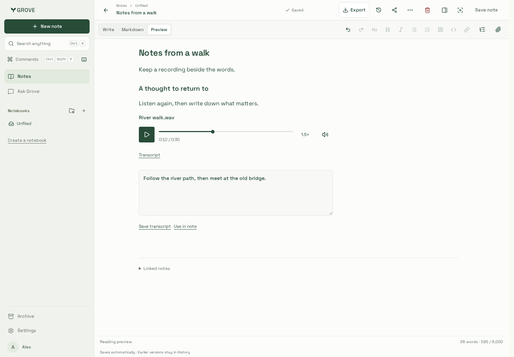
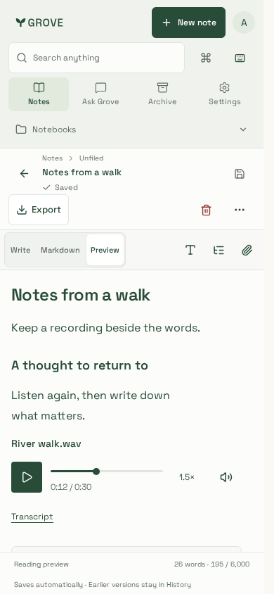
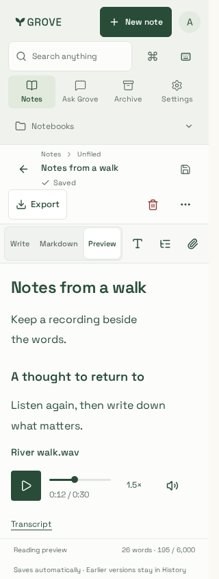
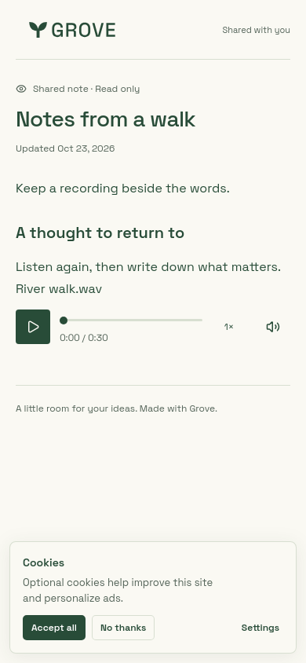
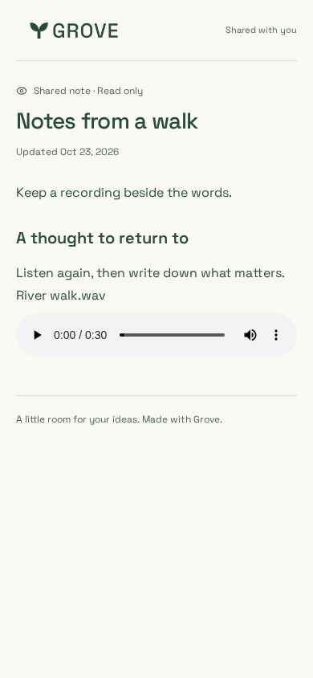
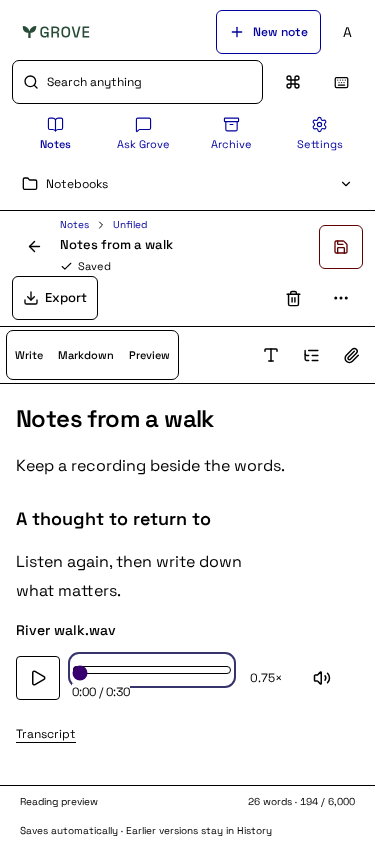

# Recording verification

Synthetic browser microphone input and a disposable real API/PostgreSQL/private
storage fixture; no real voice, account content or provider inference.

## Custom playback controls

| Desktop                                                             | Phone                                             | Narrow phone                                       |
| ------------------------------------------------------------------- | ------------------------------------------------- | -------------------------------------------------- |
|  |  |  |

| Public reader                                       | No JavaScript                                                   | Forced colours                                                        |
| --------------------------------------------------- | --------------------------------------------------------------- | --------------------------------------------------------------------- |
|  |  |  |

The borderless control strip uses existing workspace colours, typography, Lucide
icons and spacing. Chromium and touch/mobile WebKit journeys verify deferred
source loading, play/pause, seeking, speed, mute, end/replay, HTTP503 retry,
unmount cleanup, narrow bounds and WCAG A/AA checks. Additional keyboard checks
cover Space and range Home/End/arrows, preselected speed and 44px controls.
The production Next public reader plays real scoped WAV bytes in both engines,
with and without JavaScript; private transcript controls stay absent. The native
fallback is deliberate, not the enhanced player design. Disposable sharing links
are revoked after verification. No real accounts, voices or speech providers used.

Final-source verification: Next build `Gp1PQ2Is9Xyb8mBnErQhV`, Node24.22.1,
pnpm10.33.0, Playwright1.64.1; WebKit runs in the supported Noble image. All203
Chromium scenarios, root/site lint/types/builds, five artifacts and bundle budgets
pass. Notes entry is483,386 gzip bytes. Physical devices remain unqualified.

## Capture journey

[Explicit recording controls](recording-desktop.png) show the synthetic microphone
journey. The original `playback-transcript.png` and `recording-phone.png` captures
predate custom controls; the gallery above supersedes their native-player design.

The journey records, stops/attaches, checks ended microphone tracks, saves/reopens
the original WAV, plays it, edits/saves a transcript, uses it in normal note text,
cancels a second recording and downloads TAR/PDF. Physical microphones and OS-level
permission behavior are not inferred from the synthetic device.

WebKit uses a real WAV upload through the fixture's streaming proxy and verifies
playback, transcript editing/use, mobile bounds and both export downloads. Source
URLs stay stable during autosave. Visual review corrected a baseline-aligned player
and an inherited310px textarea. Custom controls replace the original browser chrome
without changing private loading or transcript editing.
