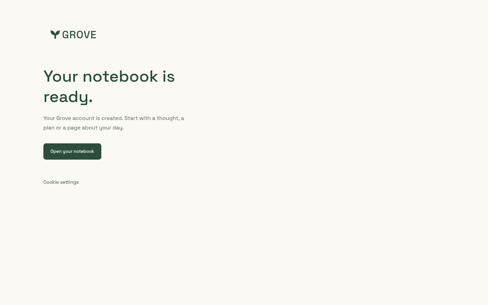

# Registration handoff

Chrome remote-debugging captures, 24 October 2026: desktop 1440×900 and mobile
390×844. `welcome-desktop.png` and `welcome-mobile.png` show the actual welcome
page rendered locally with a synthetic eligible Clerk identity and production CSS.
The disposable renderer substitutes provider calls, client tracking and navigation
wrappers; no real account or conversion was created. The cookie-settings control
is visual-only in this static capture; consent interactions are covered by the
existing browser suite. No personal data or third-party images appear.

| Desktop                                                 | Mobile                                                |
| ------------------------------------------------------- | ----------------------------------------------------- |
|  |  |
