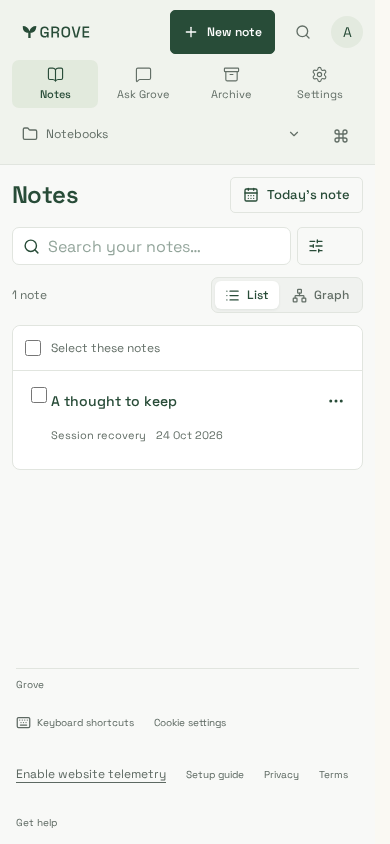
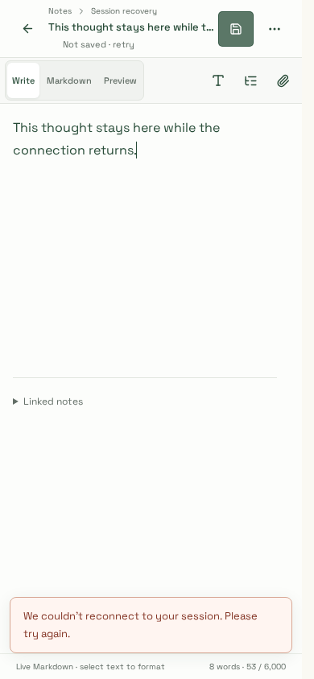
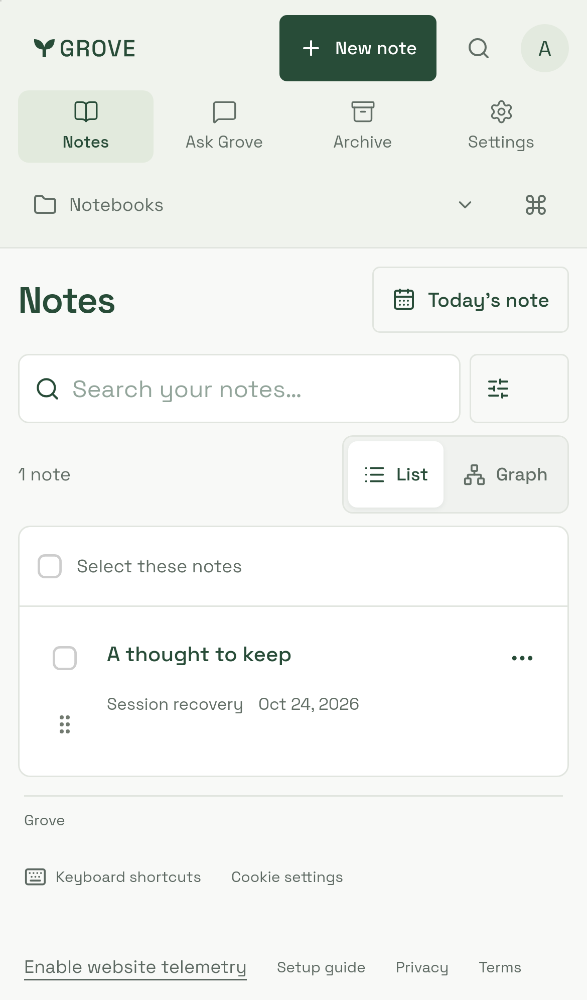
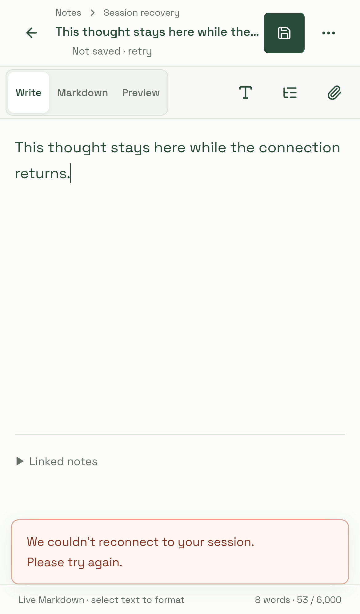
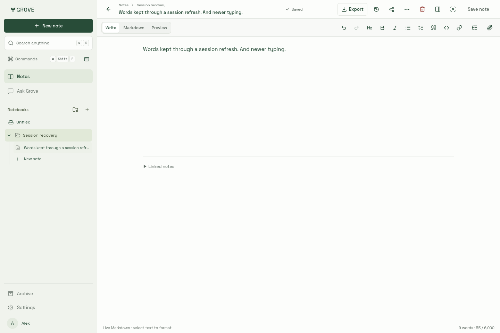

# Session recovery

Captured 24 October 2026 against application source `48aa5a3` using the actual
workspace components and production CSS (build `smtMXO4hDeIDxV-YdR-44`). All note,
account and token data is synthetic. Mobile captures use Chromium at 390×844 and
Playwright's iPhone 13 WebKit emulation; saved-draft captures use 1440×960 in both
engines. WebKit runs in the supported Playwright 1.64.1 Noble container.

| Initial 401 recovered                                                          | Refresh outage retains draft                                                      | Replayed save and newer typing saved                                         |
| ------------------------------------------------------------------------------ | --------------------------------------------------------------------------------- | ---------------------------------------------------------------------------- |
|  |  |  |
|      |      |      |

Fifteen recovery journeys pass in each engine with zero page errors: token
readiness, initial/concurrent/late/resumed 401s, held save replay with newer typing,
refresh outage and manual retry after navigation, startup outage and ten-second
timeout, notebook/listing 403s, persistent 401, missing token, and same-account
session/different-account replacement during a held refresh. Byte-identical mutation
replay, retained editor identity and clearing old private state are asserted.

The outage capture shows the existing save-retry surface receiving the new
recoverable session error. Recovery never claims an unsaved draft is saved.
The initial-load capture follows an actual injected 401 and successful replay.
These are controlled recovery checks, not a captured production token race or
physical iOS suspension test. [Verification procedure](../../../development/testing.md#workspace-session-recovery).
